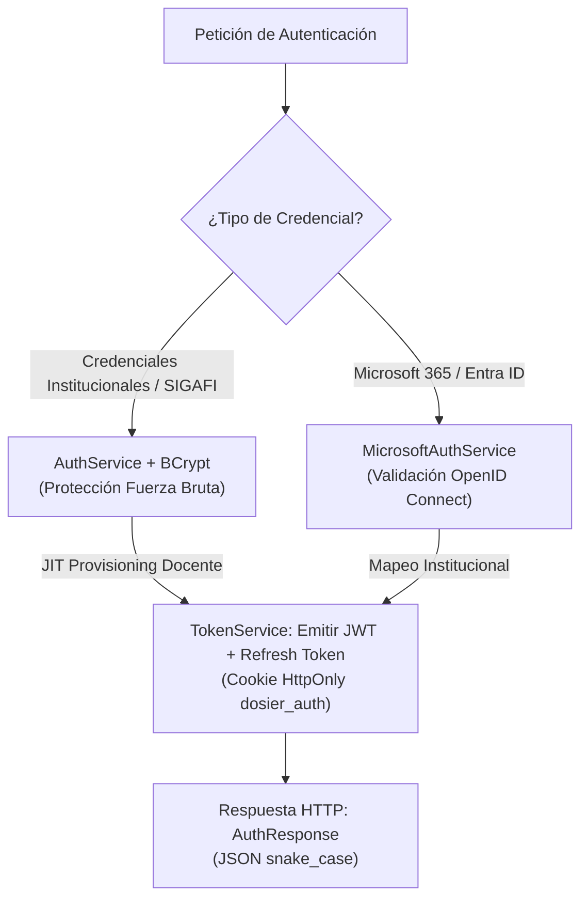
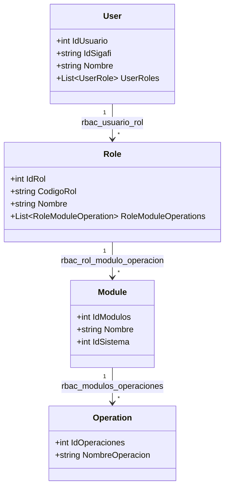

# Arquitectura de Autenticación, SSO y Control de Acceso (RBAC)

## 1. Visión General de Seguridad

El subsistema de seguridad e identidad de DOSIER (`Security`) proporciona un marco de autenticación híbrido y control de acceso basado en roles (RBAC) con políticas de autorización granulares (PBAC). El sistema da soporte integral a la gobernanza curricular docente del Instituto Superior Tecnológico Mayor Pedro Traversari (ISTPET):

1. **Docentes y Autoridades Institucionales:** Autenticación mediante Single Sign-On (SSO) con Microsoft 365 / Entra ID o credenciales institucionales validadas contra la nómina docente de SIGAFI con algoritmo hash BCrypt.
2. **Coordinadores y Vicerrectorado:** Aprovisionamiento automático basado en designaciones institucionales y asignaciones curriculares para la revisión colegiada y legalización de instrumentos pedagógicos.
3. **Público General y Auditores CACES:** Verificación criptográfica abierta de autenticidad documental mediante escaneo de código QR sin requerir credenciales de acceso.

---

## 2. Métodos de Autenticación Soportados



### 2.1. Autenticación Local y Aprovisionamiento JIT (Just-In-Time)

* **Just-In-Time (JIT) Provisioning Docente:**
  * Cuando un docente ingresa con su cédula o correo institucional por primera vez, `AuthService` valida las credenciales contra la nómina en `profesores` de `sigafi_es`. Si son válidas, aprovisiona de forma transparente su registro en `usuarios` y le asigna el rol `DOSIER_DOCENTE` en el sistema RBAC institucional.
* **Aprovisionamiento de Autoridades Curriculares (`doc_autoridades_curriculares`):**
  * Durante la sincronización de roles en `RbacService.SynchronizeUserRolesAsync`, el sistema consulta las designaciones oficiales activas del usuario:
    * `VICERRECTOR`: Asigna automáticamente el rol institucional `DOSIER_VICERRECTOR` con privilegios de legalización final y sellado oficial.
    * `COORD_ACADEMICO`: Asigna el rol institucional `DOSIER_COORD_ACAD` para emisión de avales académicos y auditoría pedagógica.
    * `COORD_CARRERA`: Asigna el rol `DOSIER_COORD_CARRERA` y vincula la supervisión del PEA y la bandeja curricular a las carreras bajo su coordinación (`idCarrera`).
* **Superadministrador y Administrador Maestro (`Security:SuperAdminCedula` y `Security:MasterAdminId`):**
  * Si la cédula o identificador del usuario coincide con las identidades declaradas en la configuración institucional (`appsettings.json` o variables de entorno), `RbacService` asegura automáticamente el rol curricular máximo **`DOSIER_ADMIN`** de forma determinista e idempotente en `rbac_usuario_rol`, garantizando privilegios completos de administración independientemente del entorno (Staging local o AWS Producción).
* **Protección contra Fuerza Bruta y Bloqueo Temporal:**
  * Ante intentos fallidos consecutivos de inicio de sesión, `AuthService` bloquea temporalmente la cuenta retornando HTTP 423 Locked con la estructura `LoginBlockedResponse`:
    ```json
    {
      "message": "Cuenta temporalmente bloqueada por exceso de intentos fallidos.",
      "bloqueado_hasta": "2026-11-20T18:15:00Z",
      "segundos_restantes": 900
    }
    ```
* **Hashing de Contraseñas:** Administrado por `PasswordService` utilizando el algoritmo **BCrypt** (`BCrypt.Net-Next`) con verificación y re-hashing automático ante factores de costo desactualizados.
* **Estructura del Contrato de Autenticación (`AuthResponse`):**
  ```json
  {
    "id_referencia": "1712345678",
    "nombre_completo": "ING. JUAN PÉREZ",
    "role": "DOSIER_DOCENTE",
    "roles": ["DOSIER_DOCENTE"],
    "role_codes": ["DOSIER_DOCENTE"],
    "tipo_usuario": "profesor",
    "permissions": ["PEA:VER", "PEA:CREAR", "PEA:EDITAR", "PEA:COWORK"],
    "token": "eyJhbGciOiJIUzI1Ni...",
    "refresh_token": "a8f3c7e2...",
    "email": "juan.perez@traversari.edu.ec",
    "sistemas": "6",
    "administrador": false,
    "id_usuario": 142,
    "user_uuid": "3fa85f64-5717-4562-b3fc-2c963f66afa6",
    "usuario": "1712345678",
    "acepto_lopdp": true
  }
  ```

### 2.2. Single Sign-On (SSO) Microsoft 365 / Entra ID
* **Servicio:** `MicrosoftAuthService` en `dosier_infrastructure/Security/`.
* **Mecanismo:** El cliente React autentica al usuario contra Microsoft Identity Platform (MSAL) y transmite el `id_token` mediante `POST /api/auth/microsoft-login`.
* **Validación Backend:** El servidor valida la firma del token OpenID Connect contra las claves públicas institucionales de Microsoft, verifica el *Audience* (ClientID institucional) y mapea o aprovisiona la cuenta del docente en DOSIER con su correo `@traversari.edu.ec`.

### 2.3. Gestión y Recuperación Universal de Contraseñas
Administrado por `PasswordRecoveryService`:
* **`POST /api/auth/recuperar-contrasenia`:** Solicitud pública mediante cédula o correo institucional con limitador de tasa (3 solicitudes / 15 min) y emisión de token criptográfico SHA-256 de 30 minutos de vigencia enviado por correo SMTP.
* **`POST /api/auth/ver-contrasenia`:** Validación previa de vigencia del token de recuperación sin consumirlo.
* **`POST /api/auth/cambiar-contrasenia`:** Cambio voluntario para usuarios con sesión activa, exigiendo contraseña actual y longitud mínima de 8 caracteres alfanuméricos.
* **`POST /api/auth/revertir-contrasenia-alerta`:** Reversión de emergencia con revocación de tokens JWT ante alertas de seguridad notificadas al docente.
* **`POST /api/auth/restablecer-contrasenia-recuperacion`:** Consumo del token de recuperación y establecimiento definitivo de la nueva clave con hash BCrypt.

---

## 3. Modelo de Control de Acceso Basado en Roles Curriculares (RBAC)

DOSIER implementa un modelo de autorización relacional registrado en las tablas `rbac_*` de `sigafi_es`, correspondiente al subsistema institucional con **`id_sistema = 6`** (`DOSIER`):



### 3.1. Roles Curriculares Oficiales del Sistema (Sistema ID 6)

| Código de Rol | Denominación Institucional | Jerarquía | Módulos y Operaciones Habilitadas |
| :--- | :--- | :---: | :--- |
| **`DOSIER_ADMIN`** | Administrador DOSIER | **5** | Control total sobre los 4 módulos: `PEA`, `GOBERNANZA_CURRICULAR`, `AUDITORIA_CACES`, `CONFIGURACION` (16 permisos). |
| **`DOSIER_VICERRECTOR`** | Vicerrectorado Académico | **4** | Máxima autoridad de legalización: aprobación final y sellado oficial (`PEA:VER`, `PEA:OBSERVAR`, `PEA:APROBAR`, `PEA:EXPORTAR_PDF`), gestión de normativas, auditoría y configuración (10 permisos). |
| **`DOSIER_COORD_ACAD`** | Coordinación Académica | **3** | Revisión metodológica y cuadre horario (`PEA:VER`, `PEA:OBSERVAR`, `PEA:AVALAR_ACADEMICO`, `PEA:EXPORTAR_PDF`), gestión de normativas, auditoría y reportes CACES (9 permisos). |
| **`DOSIER_COORD_CARRERA`** | Coordinación de Carrera | **2** | Revisión de coherencia curricular disciplinar (`PEA:VER`, `PEA:OBSERVAR`, `PEA:AVALAR_CARRERA`, `PEA:EXPORTAR_PDF`), perfiles de egreso y cobertura CACES (8 permisos). |
| **`DOSIER_DOCENTE`** | Docente Elaborador | **1** | Elaboración, co-redacción y subsanación de PEAs asignados (`PEA:VER`, `PEA:CREAR`, `PEA:EDITAR`, `PEA:COWORK`, `PEA:SUBSANAR`, `PEA:EXPORTAR_PDF`), consulta de normativas (8 permisos). |

---

## 4. Política de Permisos Granulares (PBAC en ASP.NET Core)

En lugar de validar únicamente nombres de rol mediante cadenas de texto en los controladores, DOSIER implementa **Policy-Based Access Control (PBAC)** evaluado por `PermissionHandler` y `PermissionRequirement`.

### 4.1. Catálogo Canónico de los 16 Permisos (`Permissions.cs`)
Declaradas como constantes públicas en `dosier_domain.Identity.Enums.Permissions`:

```csharp
namespace dosier_domain.Identity.Enums;

public static class Permissions
{
    // Módulo de Elaboración y Gestión del PEA (10 permisos)
    public const string PeaVer = "PEA:VER";
    public const string PeaCrear = "PEA:CREAR";
    public const string PeaEditar = "PEA:EDITAR";
    public const string PeaCowork = "PEA:COWORK";
    public const string PeaObservar = "PEA:OBSERVAR";
    public const string PeaSubsanar = "PEA:SUBSANAR";
    public const string PeaAvalCarrera = "PEA:AVALAR_CARRERA";
    public const string PeaAvalAcademico = "PEA:AVALAR_ACADEMICO";
    public const string PeaAprobar = "PEA:APROBAR";
    public const string PeaExportarPdf = "PEA:EXPORTAR_PDF";

    // Módulo de Gobernanza y Antecedentes Curriculares (2 permisos)
    public const string GobernanzaVer = "GOBERNANZA_CURRICULAR:VER";
    public const string GobernanzaGestionar = "GOBERNANZA_CURRICULAR:GESTIONAR";

    // Módulo de Auditoría y Acreditación CACES (2 permisos)
    public const string AuditoriaVer = "AUDITORIA_CACES:VER-AUDITORIA";
    public const string AuditoriaReportes = "AUDITORIA_CACES:REPORTES";

    // Módulo de Configuración del Sistema (2 permisos)
    public const string ConfiguracionVer = "CONFIGURACION:VER";
    public const string ConfiguracionEditar = "CONFIGURACION:EDITAR";
}
```

### 4.2. Registro Dinámico de Políticas en `Program.cs`
Durante la inicialización del contenedor de inyección de dependencias, `Program.cs` escanea mediante reflexión todas las constantes de `Permissions` y las registra de forma automática como políticas de autorización de ASP.NET Core:

```csharp
builder.Services.AddAuthorization(options =>
{
    var permissionFields = typeof(dosier_domain.Identity.Enums.Permissions)
        .GetFields(BindingFlags.Public | BindingFlags.Static | BindingFlags.FlattenHierarchy)
        .Where(f => f.IsLiteral && !f.IsInitOnly);

    foreach (var field in permissionFields)
    {
        var permissionValue = field.GetValue(null)?.ToString();
        if (permissionValue != null)
        {
            options.AddPolicy(permissionValue, policy =>
                policy.Requirements.Add(new PermissionRequirement(permissionValue)));
        }
    }
});
```

---

## 5. Desacoplamiento de Banderas Legacy y Resolución de Contratos

1. **Neutralización del Flag Legacy `usuarios.administrador`:**
   * En la base de datos histórica `sigafi_es`, el campo `administrador = 1` en `usuarios` contenía asignaciones pertenecientes a otros contextos operativos (personal de TICS o Bienestar).
   * Se eliminó el bypass que concedía `DOSIER_ADMIN` por la simple presencia de dicho flag. En su lugar, el rol administrativo se reserva exclusivamente a las identidades designadas por configuración institucional (`Security:SuperAdminCedula` y `Security:MasterAdminId`) o a asignaciones explícitas en `rbac_usuario_rol`.
2. **Aislamiento Estricto de Roles:**
   * La base de datos `sigafi_es` contiene roles compartidos de otros sistemas institucionales (DIITRA, GRECUH, GACAD). `AuthService` en `GetAuthResponseAsync` aplica un filtro de aislamiento estricto que restringe los claims emitidos en el JWT exclusivamente a los roles oficiales de DOSIER (`ur.Role.CodigoRol.StartsWith("DOSIER_")` o asociados al sistema ID 6), garantizando que ningún rol ajeno contamine la sesión.
3. **Segregación de Personal y Resolución Curricular de Contratos:**
   * En `AdminService.GetUsersAsync`, la partición entre personal `DOCENTE` y `ADMINISTRATIVO` evalúa los departamentos institucionales (`DOCENCIA` y `ACADEMIA`), asignaciones en `asignaciones_profesores`, actividades curriculares y autoridades vigentes.
   * Para usuarios con relaciones contractuales mixtas, el sistema prioriza en `AdminService` y en `SignatureProfileSubservice` los contratos vigentes de `DOCENCIA` / `ACADEMIA` con cargo docente por sobre cargos técnicos o secundarios, asegurando la consistencia de sus credenciales pedagógicas y pies de firma oficial.

---

## 6. Matriz de Autorización en el Ciclo de Vida y Firma del PEA

En `PeaService.FirmarPeaAsync`, `AgregarObservacionAsync` y `SubsanarObservacionAsync`, el backend ejecuta una validación de autorización estricta consultando los roles activos en `rbac_usuario_rol`:

| Transición / Operación | Estado Previo | Estado Resultante | Rol Curricular Requerido | Endpoint de API |
| :--- | :--- | :--- | :--- | :--- |
| **Firma Elaboración** | `Borrador` / `Corregido` | `EnRevision` | `DOSIER_DOCENTE` (o `DOSIER_ADMIN`) | `POST /api/pea/{id}/firmar` o `POST /api/pea/uuid/{uuid}/firmar` |
| **Aval Curricular de Carrera** | `EnRevision` | `RevisadoCoord` | `DOSIER_COORD_CARRERA` (o `DOSIER_ADMIN`) | `POST /api/pea/{id}/firmar` o `POST /api/pea/uuid/{uuid}/firmar` |
| **Aval Metodológico Académico** | `RevisadoCoord` | `RevisadoAcad` | `DOSIER_COORD_ACAD` (o `DOSIER_ADMIN`) | `POST /api/pea/{id}/firmar` o `POST /api/pea/uuid/{uuid}/firmar` |
| **Aprobación y Legalización Final** | `RevisadoAcad` | `Aprobado` | `DOSIER_VICERRECTOR` (o `DOSIER_ADMIN`) | `POST /api/pea/{id}/firmar` o `POST /api/pea/uuid/{uuid}/firmar` |
| **Registro de Observaciones** | `EnRevision`, `RevisadoCoord`, `RevisadoAcad` | `Observado` | `DOSIER_COORD_CARRERA`, `DOSIER_COORD_ACAD`, `DOSIER_VICERRECTOR`, `DOSIER_ADMIN` | `POST /api/pea/{id}/observaciones` o `/uuid/{uuid}/observaciones` |
| **Subsanación de Observaciones** | `Observado` | `Corregido` | `DOSIER_DOCENTE` (o `DOSIER_ADMIN`) | `PATCH /api/pea/observaciones/{id}/subsanar` |
| **Transición Administrativa Forzada** | Cualquier estado | Cualquier estado | Exclusivo `DOSIER_ADMIN` | `PATCH /api/pea/{id}/estado` o `/uuid/{uuid}/estado` |
