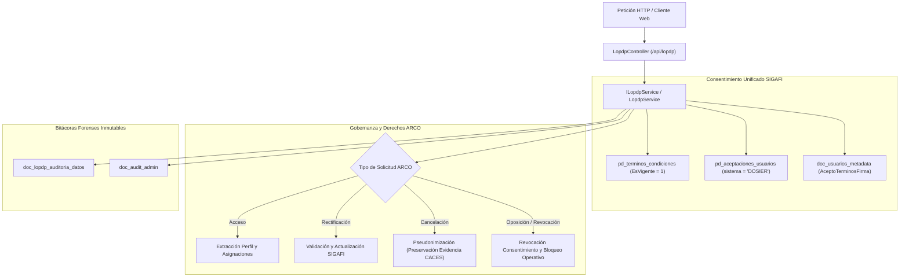
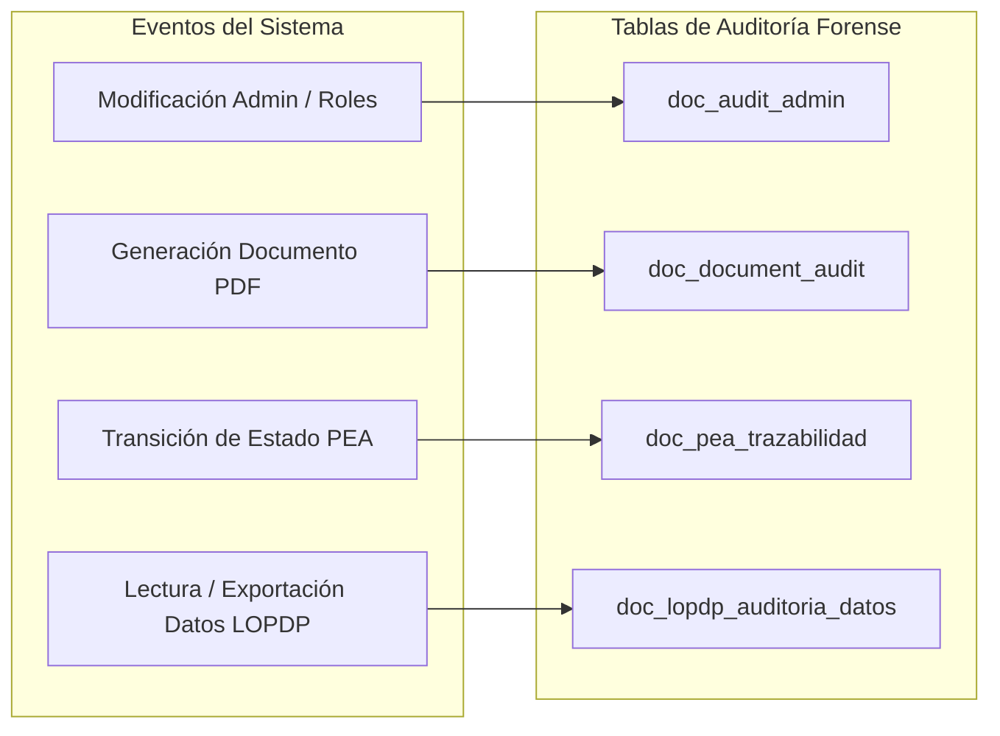

# Gobernanza de Datos, Protección LOPDP y Bitácora de Auditoría Forense

## 1. Visión General y Marco Legal

DOSIER implementa una arquitectura integral de gobernanza de datos diseñada para cumplir rigurosamente con la **Ley Orgánica de Protección de Datos Personales (LOPDP)** de la República del Ecuador (publicada en el Registro Oficial Suplemento 459 del 26 de mayo de 2021) y satisfacer los criterios de trazabilidad, auditabilidad e inmutabilidad exigidos por el **Consejo de Aseguramiento de la Calidad de la Educación Superior (CACES)** para la acreditación de carreras técnicas y tecnológicas.

El subsistema articula tres pilares operativos:
1. **Tratamiento Lícito y Consentimiento Informado:** Gestión federada de consentimientos mediante la integración bidireccional con el sistema institucional SIGAFI.
2. **Canal de Derechos ARCO:** Procedimientos de Acceso, Rectificación, Cancelación (anonimización y pseudonimización de expedientes académicos) y Oposición sin menoscabo del principio de custodia documental CACES.
3. **Cuádruple Bitácora de Auditoría Inmutable:** Registro forense distribuido en cuatro tablas especializadas para auditar accesos a datos sensibles, cambios de estado en la máquina de estados del PEA, generación documental criptográfica y transacciones administrativas con deltas JSON (*before/after*).

---

## 2. Cumplimiento de la Ley Orgánica de Protección de Datos Personales (LOPDP)

### 2.1. Gestión Centralizada de Consentimientos (`pd_aceptaciones_usuarios` y `pd_terminos_condiciones`)

A fin de evitar fricciones y duplicación de acuerdos, DOSIER se conecta con las tablas institucionales maestras alojadas en la base de datos `sigafi_es`:

* **Término Institucional Vigente (`pd_terminos_condiciones`):**
  Almacena la versión oficial aprobada por las autoridades institucionales.
  - Campos clave: `idTermino` (PK), `versionTermino` (ej. `"2.0"`), `contenido` (texto legal en formato HTML/prosa), `fechaPublicacion`, `esVigente` (`1` activo, `0` histórico).
  - Consulta pública desacoplada: Expuesta mediante el endpoint público `GET /api/lopdp/termino-vigente` (`[AllowAnonymous]`).
* **Registro Federado de Aceptación (`pd_aceptaciones_usuarios`):**
  Almacena cada aceptación vinculada al identificador institucional (`idUsuario = idSigafi` / cédula de identidad):
  - Campos clave: `idAceptacionUsuario` (PK), `idUsuario` (cédula institucional), `idTermino` (FK hacia término aceptado), `sistema` (fijado a `'DOSIER'`), `fechaRegistro` (marca temporal), `ipOrigen` (IPv4/IPv6 de la conexión), `dispositivo` (User-Agent truncado a 200 caracteres).
  - Concurrencia controlada: El servicio utiliza un semáforo asíncrono (`SemaphoreSlim(1, 1)`) para prevenir condiciones de carrera durante el registro simultáneo de consentimientos.
* **Metadata de Usuario DOSIER (`doc_usuarios_metadata`):**
  Complementa el registro institucional activando banderas operativas en el dominio curricular:
  - `AceptoTerminosFirma`: Valor booleano que habilita al docente para emitir firmas electrónicas institucionales (DFRM o PKCS#12).
  - `FechaConsentimientoFirma`: Marca de tiempo UTC del otorgamiento.
  - `Version`: Contador de control de concurrencia optimista (*optimistic concurrency token*).

### 2.2. Procedimientos para la Atención de Derechos ARCO

Conforme a los artículos 12 al 16 de la LOPDP, DOSIER provee los mecanismos técnicos para atender solicitudes formales de los titulares de datos:

| Derecho LOPDP | Mecanismo Técnico en DOSIER | Restricción Institucional / Justificación Legal |
| :--- | :--- | :--- |
| **Acceso** (Art. 13) | Consulta estructurada mediante `GET /api/lopdp/perfil` y trazabilidad en `doc_lopdp_auditoria_datos`. Genera reporte integral con datos personales, asignaciones y planificaciones. | Libre acceso a todo titular autenticado sobre su información académica. |
| **Rectificación** (Art. 14) | Endpoint `PUT /api/lopdp/perfil` (`ActualizarPerfilRequest`) para datos complementarios y canal de derivación a Secretaría SIGAFI para datos filiatorios primarios. | Los nombres, títulos y cédula provienen de la frontera de solo lectura SIGAFI y requieren trámite administrativo institucional. |
| **Cancelación / Supresión** (Art. 15) | Protocolo de **Pseudonimización Curricular**. Los expedientes de asignaturas, actas y PEAs aprobados no se eliminan físicamente del almacenamiento. En su lugar, se disocian las referencias personales del docente. | **Excepción Legal CACES/LOES:** La información curricular aprobada constituye patrimonio institucional y evidencia obligatoria de acreditación académica por un mínimo de 10 años. |
| **Oposición y Revocación** (Art. 16) | Endpoint `POST /api/lopdp/revocar`. Desactiva `AceptoTerminosFirma` en `doc_usuarios_metadata` e impide la suscripción de nuevos instrumentos curriculares. | No invalida firmas previamente estampadas ni actos académicos perfeccionados con anterioridad. |

### 2.3. Protección Especial de Adaptaciones Curriculares (NEE)

El Reglamento de Régimen Académico y la normativa de inclusión disponen la atención a estudiantes con Necesidades Educativas Específicas (NEE). En el Bloque H del PEA (*Adaptaciones Curriculares*):
1. **Segregación Estricta:** La información médica, psicológica o de condición de discapacidad de los discentes no se vincula a datos de identidad en los esquemas abiertos.
2. **Exclusión en Publicación Estudiantil:** Los documentos PDF de libre acceso para estudiantes omiten o consolidan bajo códigos anónimos las adaptaciones curriculares individuales para prevenir discriminación o revelación de datos de categoría especial.

---

## 3. Catálogo de Endpoints REST del Subsistema LOPDP

El controlador `LopdpController` (`dosier_api/Controllers/LopdpController.cs`) expone la siguiente interfaz contractual bajo el prefijo `/api/lopdp`:

| Método | Ruta | Autorización | DTO Entrada | Retorno HTTP | Descripción |
| :--- | :--- | :--- | :--- | :--- | :--- |
| `GET` | `/api/lopdp/termino-vigente` | Pública (`[AllowAnonymous]`) | Ninguno | `200 OK` (`TerminoVigenteDto`) / `404 Not Found` | Obtiene el texto y versión de los términos vigentes en `pd_terminos_condiciones`. |
| `POST` | `/api/lopdp/consentimiento` | `[Authorize]` | `RegistrarConsentimientoRequest` | `200 OK` (`{ message }`) / `400 Bad Request` | Registra aceptación en `pd_aceptaciones_usuarios` y actualiza `doc_usuarios_metadata`. |
| `GET` | `/api/lopdp/consentimientos` | `[Authorize(Roles = "DOSIER_ADMIN")]` | Paginación implícita (Top 500) | `200 OK` (`List<ConsentimientoResponse>`) | Bitácora de consentimientos institucionales para el Administrador del Sistema. |
| `GET` | `/api/lopdp/perfil` | `[Authorize]` | Ninguno | `200 OK` (`PerfilLopdpDto`) / `401 Unauthorized` | Devuelve el perfil LOPDP del usuario autenticado (estado de firma y certificado P12). |
| `PUT` | `/api/lopdp/perfil` | `[Authorize]` | `ActualizarPerfilRequest` | `200 OK` (`{ message }`) / `400 Bad Request` | Actualiza preferencias de firma y consentimiento del usuario. |
| `POST` | `/api/lopdp/revocar` | `[Authorize]` | Ninguno | `200 OK` (`{ message }`) / `401 Unauthorized` | Revoca el consentimiento para firma electrónica en el perfil del usuario. |

---

## 4. Cuádruple Bitácora Forense e Inmutable

Para satisfacer las normativas de auditoría de seguridad informática y las auditorías de acreditación del CACES, DOSIER mantiene cuatro bitácoras inalterables desacopladas por responsabilidad técnica:

### 4.1. Auditoría Transaccional Administrativa (`doc_audit_admin`)

Gestionada por el servicio `IAuditService` (`AuditService.cs`), registra de forma centralizada cualquier acción que afecte la configuración, roles, accesos o entidades críticas del sistema.

* **Estructura Relacional:**
  - `IdAudit` (INT, PK, Auto-incremental).
  - `IdUsuarioAdmin` (INT, FK nullable): Identificador del usuario que ejecuta la acción (resuelto desde el Claim `NameIdentifier` / cédula SIGAFI).
  - `IdUsuarioAfectado` (INT, FK nullable): Usuario sobre el que recae la modificación.
  - `Accion` (VARCHAR(100)): Código normalizado de la operación (ej. `LOGIN`, `CAMBIO_CONTRASENIA`, `ASIGNAR_ROL`, `REVOCAR_ROL`, `ACTUALIZAR_PARAMETRO`).
  - `Modulo` (VARCHAR(50)): Módulo funcional de origen (ej. `SEGURIDAD`, `ROLES`, `CURRICULAR`, `DOCUMENTAL`).
  - `Detalle` (TEXT): Descripción legible en prosa de lo sucedido.
  - `IpOrigen` (VARCHAR(45)): Dirección IPv4 o IPv6 extraída del contexto HTTP.
  - `UserAgent` (TEXT): Cabecera de navegador o cliente emisor.
  - `ValoresAnteriores` (LONGTEXT JSON): Instantánea serializada del estado del objeto previo a la mutación.
  - `ValoresNuevos` (LONGTEXT JSON): Instantánea serializada del estado del objeto posterior a la mutación.
  - `Fecha` (DATETIME UTC): Marca de tiempo generada directamente en el servidor.

### 4.2. Auditoría Documental Criptográfica (`doc_document_audit` / `DocumentAuditEntry`)

Diseñada para certificar la autenticidad e integridad de cada PDF generado por el motor documental `DocumentEngine`:

* **Estructura y Atributos:**
  - `TraceabilityCode`: Código alfanumérico institucional estampado en el folio físico/digital (ej. `DOSIER-PROTO-2026-X1Y2Z3`).
  - `TemplateCode`: Identificador unívoco del molde utilizado (ej. `PEA_OFICIAL_ISTPET_2026`).
  - `TemplateVersion`: Versión incremental de la plantilla al momento de la renderización.
  - `Category`: Categoría documental para estadísticas del CACES (`Syllabus`, `Acta`, `InformeDocente`).
  - `GeneratedBy`: Identificador institucional (cédula o correo) del usuario que generó el archivo.
  - `GeneratedAt`: Marca temporal UTC exacta de emisión.
  - `WasBlindMode`: Flag booleano que indica si el documento se generó bajo el protocolo de revisión a doble ciego.
  - `FileName`: Nombre físico del archivo en el sistema de almacenamiento.
  - `FileHash`: Hash criptográfico SHA-256 calculado sobre los bytes del PDF final o firmado.
  - `DataSnapshotJson`: Instantánea serializada en JSON de la totalidad de datos inyectados en la plantilla al momento de imprimir.

### 4.3. Trazabilidad de Ciclo de Vida del PEA (`doc_pea_trazabilidad`)

Registra cronológicamente cada cambio de estado curricular en la máquina de estados del PEA, constituyendo la base de auditoría curricular del CACES:

* **Estructura y Atributos:**
  - `IdTrazabilidad` (INT, PK, Auto-incremental).
  - `Uuid` (VARCHAR(36)): Identificador global único de la transacción.
  - `IdPea` (INT, FK hacia `doc_pea`): Planificación sujeta al cambio.
  - `IdUsuario` (INT, FK nullable): Docente, Coordinador o Vicerrector que autorizó la transición.
  - `EstadoAnterior` (VARCHAR(50)): Estado de salida (ej. `Borrador`, `EnRevision`, `RevisadoCoord`, `RevisadoAcad`).
  - `EstadoNuevo` (VARCHAR(50)): Estado de llegada (ej. `EnRevision`, `RevisadoCoord`, `RevisadoAcad`, `Aprobado`, `Observado`).
  - `Motivo` (TEXT): Justificación técnica académica o texto formal de las observaciones emitidas.
  - `HashIntegridadSha256` (VARCHAR(64)): Hash criptográfico SHA-256 del contenido curricular del PEA al instante de registrarse la transición.
  - `FechaTransicion` (DATETIME UTC): Marca temporal inmutable del cambio.

### 4.4. Auditoría de Tratamiento de Datos Personales (`doc_lopdp_auditoria_datos`)

Exigida por el artículo 20 de la LOPDP, supervisa el acceso y visualización de datos reservados:

* **Estructura y Atributos:**
  - `IdAuditoriaDatos` (INT, PK).
  - `Uuid` (CHAR(36)): Identificador universal del registro.
  - `IdUsuarioActor` (INT, FK): Autoridad o usuario que consultó o procesó la información.
  - `IdUsuarioAfectado` (INT, FK): Titular de los datos sensibles consultados.
  - `TablaAfectada` (VARCHAR(100)): Nombre de la tabla consultada (ej. `doc_usuarios_metadata`, `profesores`).
  - `ColumnaAfectada` (VARCHAR(100) nullable): Campo específico (ej. `CertificadoP12`, `FirmaDigitalHash`).
  - `Operacion` (VARCHAR(50)): Acción ejecutada (`LECTURA`, `ESCRITURA`, `ELIMINACION`, `DESCARGA`).
  - `Motivo` (TEXT nullable): Justificación académica o legal del acceso.
  - `IpDireccion` y `UserAgent`: Parámetros de red del emisor.
  - `FechaAcceso` (DATETIME): Marca temporal del evento.
* **Mecanismo de Resiliencia y Contingencia:**
  Si la base de datos no estuviera disponible al momento de persistir `DocLopdpAuditoriaDatos`, el servicio atrapa la excepción y emite un log crítico inmutable en el subsistema de telemetría (`_logger.LogCritical("CONTINGENCIA_LOPDP: ...")`), garantizando que la traza forense permanezca en los registros físicos del servidor de aplicaciones.

---

## 5. Políticas de Retención, Inmutabilidad y Custodia Documental

1. **Inmutabilidad Post-Aprobación (*State Locking*):**
   Una vez que el PEA alcanza el estado `Aprobado` y ha sido suscrito por el Vicerrector Académico, el registro curricular queda congelado de manera permanente contra modificaciones o eliminaciones lógicas. Toda actualización curricular futura exige la apertura de un nuevo PEA asociado al siguiente período académico.
2. **Preservación Obligatoria CACES:**
   Conforme a la normativa del Sistema de Aseguramiento de la Calidad, los PEAs, sus actas de aprobación colegiada y las bitácoras de trazabilidad deben custodiarse por un período mínimo de 10 años, garantizando reproducibilidad en procesos de evaluación y acreditación externa.
3. **Custodia Criptográfica de Firmas:**
   Los certificados digitales PKCS#12 cargados por los docentes se almacenan cifrados con AES-256 a nivel de infraestructura, y las firmas estampadas mediante DFRM se verifican contra el hash SHA-256 de integridad institucional.
