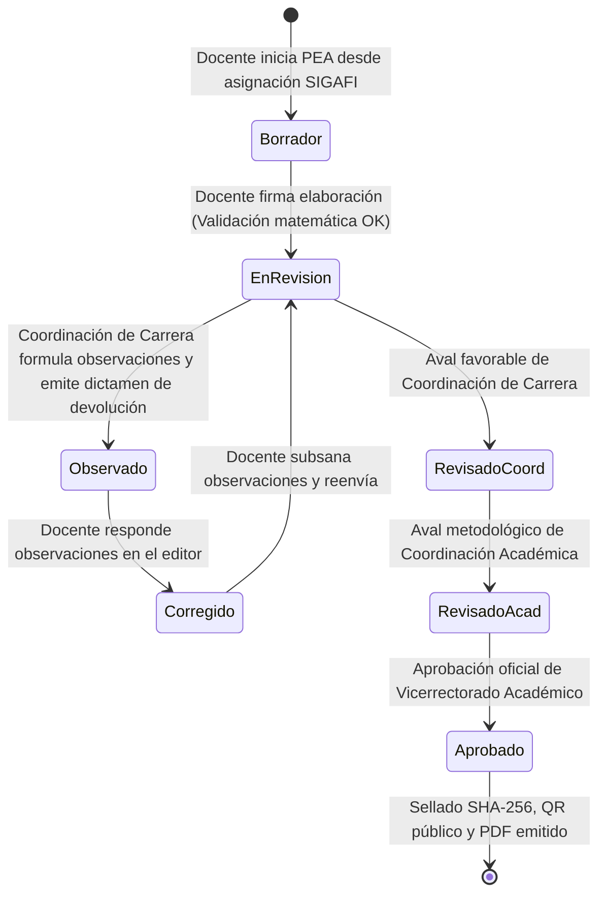

# Ciclo de Vida Curricular, Workflow y Portafolio Docente

## 1. Visión General del Módulo Curricular

El módulo de gestión curricular constituye el núcleo operativo de **DOSIER**. Administra la totalidad del ciclo de vida de la planificación microcurricular docente en el Instituto Superior Tecnológico Mayor Pedro Traversari (ISTPET), centrado en el **Programa de Estudio de la Asignatura (PEA)** en sus 11 secciones oficiales (a - k), su articulación con los proyectos de carrera, la co-redacción concurrente y su legalización forense.

---

## 2. Máquina de Estados y Circuito de Firmas del PEA

El avance de un PEA a través de sus fases está regulado por `PeaService` y las restricciones de seguridad RBAC:

### 2.1. Estados del Documento

| Estado | Significado Institucional | Actores Autorizados para Operar |
| :--- | :--- | :--- |
| `Borrador` | Redacción inicial del PEA por el docente titular y co-redactores mediante CoWork. | `DOSIER_DOCENTE` |
| `EnRevision` | Documento enviado formalmente para revisión colegiada. Se bloquea la edición directa. | `DOSIER_COORD_CARRERA`, `DOSIER_COORD_ACAD` |
| `Observado` | Dictamen formal de devolución emitido por la autoridad. El docente recupera permisos de edición y visualiza las observaciones. | `DOSIER_DOCENTE` |
| `Corregido` | El docente ha subsanado los requerimientos y prepara el reenvío a evaluación. | `DOSIER_DOCENTE` |
| `RevisadoCoord` | Aval favorable del Coordinador de Carrera sobre pertinencia disciplinar y perfil de egreso. | `DOSIER_COORD_ACAD` |
| `RevisadoAcad` | Aval favorable de la Coordinación Académica sobre estructura metodológica y horas. | `DOSIER_VICERRECTOR` |
| `Aprobado` | Aprobación legal definitiva de Vicerrectorado Académico. Documento inmutable y público. | Solo lectura |

---

## 3. Validaciones Matemáticas Bloqueantes

Antes de permitir la transición a `EnRevision`, el `CurricularValidationEngine` verifica de forma intransigente:
1. **Total de Horas:** La suma de horas de las unidades temáticas debe ser exactamente igual a las horas totales de la asignatura en `detallemallas` de SIGAFI.
2. **Componentes de Aprendizaje:**
   $$\text{Horas Docencia} + \text{Horas APE} + \text{Horas Autónomo} = \text{Horas Totales Asignatura}$$
   $$\text{Horas Autónomo} = \text{Horas Totales} - (\text{Horas Docencia} + \text{Horas APE})$$
3. **Carga Práctico-Experimental:** La suma de horas de las actividades prácticas planificadas no puede exceder las horas APE autorizadas para la asignatura.
4. **Articulación al Perfil de Egreso:** Cada resultado de aprendizaje de la asignatura (RDA) debe estar vinculado a al menos un resultado del Perfil de Egreso de la carrera.
5. **Bibliografía Mínima:** Presencia obligatoria de bibliografía básica con justificación académica.

---

## 4. Módulo de Observaciones y Subsanación Colegiada

Para evitar revisiones informales en hojas dispersas o correos electrónicos, DOSIER integra un flujo estructurado de observaciones:
* **Observación por Sección (`doc_pea_observaciones`):** El Coordinador de Carrera o Coordinador Académico registra comentarios directamente asociados a una sección específica del PEA (ej. `Sección f: Contenidos`, `Sección i: Evaluación`).
* **Desacoplamiento Estricto de Observaciones y Estado:** El acto de guardar observaciones preliminares en `doc_pea_observaciones` mantiene el documento en estado `EnRevision`. El cambio formal al estado `Observado` se produce de manera atómica únicamente cuando la autoridad emite el dictamen formal de devolución ("Devolver con Observaciones") en `FinalizeAuditModal.tsx` a través de `PATCH /api/pea/uuid/{uuid}/estado`.
* **Privacidad de Observaciones Preliminares:** Las observaciones registradas durante la auditoría técnica permanecen reservadas para la autoridad evaluadora y no se exponen al docente mientras el documento permanezca en `EnRevision`. Únicamente se vuelven visibles para el docente una vez que el documento ha sido formalmente dictaminado en estado `Observado`.
* **Subsanación Auditada:** El docente elaborador atiende cada observación registrando su respuesta formal y los ajustes realizados en el editor.
* **Trazabilidad Inalterable e Integridad Referencial (`doc_pea_trazabilidad`):** Cada observación formulada, cada dictamen emitido y cada respuesta registrada queda almacenada cronológicamente con usuario, rol, fecha UTC y hash del documento, constituyendo evidencia documental ante auditorías del CACES.
  * **Resolución de Identidad de Usuario:** La clave foránea hacia la tabla `usuarios(idUsuario)` requiere un identificador numérico interno. Dado que `ClaimTypes.NameIdentifier` en los tokens JWT institucionales transporta el `IdReferencia` alfanumérico de SIGAFI, el backend extrae específicamente el claim `"id_usuario"`. En caso de discrepancia, se aplica verificación previa de existencia relacional con fallback al usuario resuelto por `IdSigafi` antes de la persistencia, impidiendo errores de restricción de clave foránea (`errno 1452`).
  * **Cálculo Robusto de Hash SHA-256 en Transiciones:** Al mutar de estado o registrar trazabilidad, el recálculo criptográfico del hash de contenido carga de manera completa el grafo microcurricular (`.Include(p => p.Unidades).ThenInclude(u => u.Temas)`), garantizando determinismo estricto y previniendo excepciones por desreferenciación nula (`NullReferenceException`).
* **Navegación Inmediata y Bloqueo de Vista Devuelta:** Al confirmar el dictamen de devolución con observaciones, la interfaz redirige inmediatamente al usuario a la ruta institucional `/documentacion`. Si la autoridad curricular reingresa a consultar un PEA en estado `Observado`, el panel de revisión deshabilita los controles de emisión de avales, bloquea los campos de redacción preliminar y despliega un banner de notificación informando que el documento fue devuelto para subsanación docente.

---

## 5. Sincronización Relacional de Metadatos (`SincronizarMetadataAsync`)

Para garantizar la interoperabilidad entre el editor colaborativo dinámico (`doc_documentos_instancias.data_snapshot_json`) y el esquema relacional normalizado del PEA (`doc_pea`, `doc_pea_unidades`, `doc_pea_prerrequisitos`, `doc_pea_resultados_aprendizaje`, `doc_pea_actividades_practicas`, `doc_pea_evaluaciones`, `doc_pea_bibliografia`):
* **Sincronización Transaccional Defensiva:** Parseo resiliente de valores numéricos y alfanuméricos mediante `SafeParseInt`, `SafeParseDecimal` y `SafeParseString`, previniendo errores por tipos de datos serializados como string.
* **Normalización de Enumeraciones MySQL:** Mapeo estricto a los tipos `ENUM` de base de datos (`tipoBibliografia` en `'Basica'|'Consulta'|'Virtual'`, `nivelDesarrollo` en `'Inicial'|'Medio'|'Alto'`).
* **Integridad Referencial en Cascada:** Eliminación previa de subtemas (`doc_pea_temas`) antes de purgar unidades temáticas (`doc_pea_unidades`), previniendo bloqueos por clave foránea.
* **Sincronización en Firma del Docente:** Ejecución automática previa a la transición de estado a `EnRevision` durante la firma digital, garantizando que el hash forense SHA-256 selle datos 100% persistidos y actualizados.

---

## 6. Bandeja de Supervisión Curricular Institucional

Para los roles de gestión y aseguramiento de la calidad académica (`DOSIER_COORD_CARRERA`, `DOSIER_COORD_ACAD`, `DOSIER_VICERRECTOR`, `DOSIER_ADMIN`), el endpoint `GET /api/pea/bandeja` provee la vista consolidada de los instrumentos microcurriculares:

* **Filtros de Consulta:** Permite filtrar por período académico (`idPeriodo`), carrera (`idCarrera`), estado del documento (`estado`) y alcance institucional (`alcanceInstitucional`). Los filtros evalúan comodines institucionales (`todos`/`todas`) de forma insensible a mayúsculas y minúsculas.
* **Seguridad y Alcance RBAC:**
  * Administrador, Vicerrector y Coordinador Académico: Acceso irrestricto a todas las carreras y asignaturas del instituto (`esInstituto = 1`).
  * Coordinador de Carrera: Supervisión disciplinar habitual acotada a las asignaturas de sus carreras coordinadas. Cuando se consulta desde módulos directivos de analítica institucional con `alcanceInstitucional = true`, se permite la visualización agregada del corte institucional completo.
  * Docente: Visualización exclusiva de sus asignaturas asignadas.
* **Optimización de Carga:** Mapeo mediante carga por lotes (batching) en memoria de diccionarios de carreras, asignaturas y profesores para erradicar el problema de consultas N+1 en bases de datos relacionales.

### 6.1. Separación de Tareas de Revisión vs. Monitoreo de Borradores

Para evitar ambigüedad operativa en las autoridades curriculares:
* **Bandeja de Tareas Operativas («Por revisar»):** Constituye la vista predeterminada de trabajo. Lista únicamente los instrumentos formalmente remitidos por los docentes con sellado de entrega (`EnRevision`, `Observado`, `Corregido`). Habilita de forma exclusiva el botón primario de «Revisión Técnica» y la emisión de avales.
* **Monitoreo de Cumplimiento («En redacción docente»):** Permite verificar qué asignaturas continúan en formulación inicial (`Borrador`, `NoIniciado`). La interacción se restringe estrictamente a «Consultar avance (Lectura)», bloqueando la formulación de observaciones formales y la emisión de avales hasta la entrega formal. El botón de edición solo se habilita para el propio docente titular elaborador o administradores del sistema.
