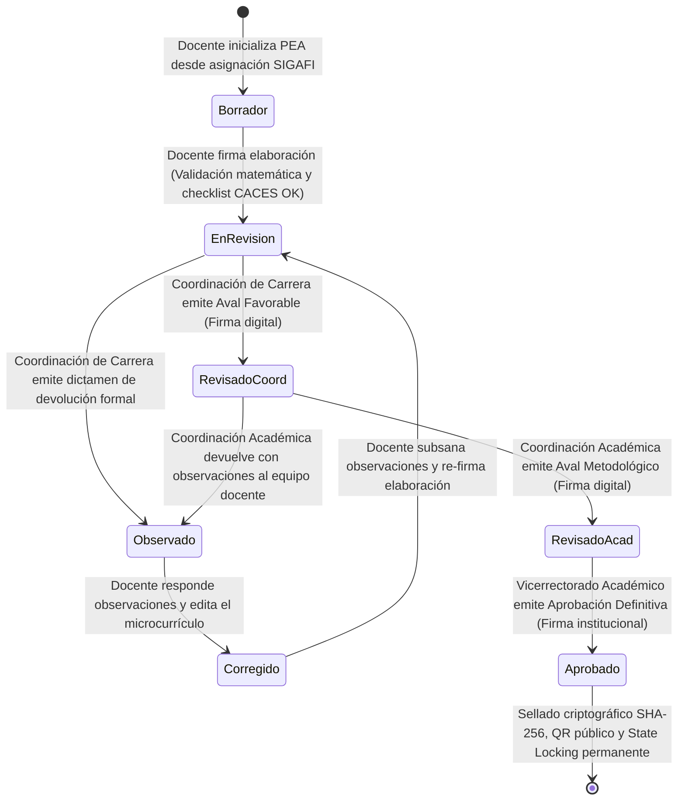
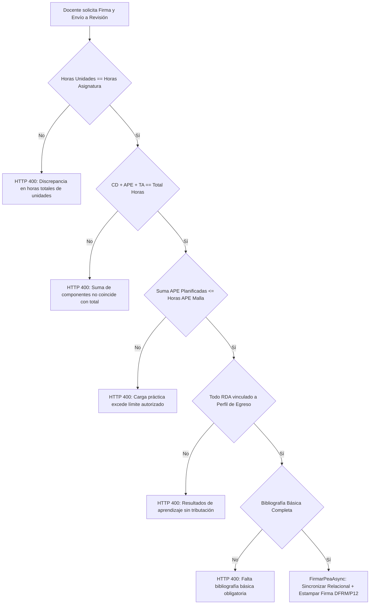

# Ciclo de Vida Curricular, Workflow y Portafolio Docente

## 1. Visión General del Módulo Curricular

El módulo de gestión curricular constituye el núcleo funcional y operativo de **DOSIER**. Administra la totalidad del ciclo de vida de la planificación microcurricular en el Instituto Superior Tecnológico Mayor Pedro Traversari (ISTPET), estructurado en torno al **Programa de Estudio de la Asignatura (PEA)** oficial en sus 11 secciones normativas (a - k).

El subsistema orquesta:
1. La formulación y co-redacción concurrente entre docentes titulares y colaboradores sobre el motor CRDT (Yjs) y WebSockets (SignalR).
2. La validación matemática determinista conforme al Artículo 21 del Reglamento de Régimen Académico (RRA) del Consejo de Educación Superior (CES).
3. El circuito jerárquico de revisión colegiada, dictamen de observaciones y emisión de avales institucionales.
4. El sellado criptográfico mediante firmas digitales (DFRM y certificados PKCS#12) con inmutabilidad posterior a la aprobación definitiva.
5. El co-diseño intercurricular y las Salas Curriculares de Carrera en tiempo real para alineación del perfil de egreso.

---

## 2. Estructura Oficial de las 11 Secciones Microcurriculares del PEA

El PEA oficial del ISTPET se estructura en 11 secciones estandarizadas que responden a los criterios de evaluación del CACES, persistidas tanto en el documento dinámico (`data_snapshot_json`) como en el modelo relacional normalizado:

| Sección | Denominación Institucional | Descripción Funcional | Entidades Relacionales Clave |
| :--- | :--- | :--- | :--- |
| **Sección a** | Datos Informativos | Carátula, carrera, período académico, código de asignatura, créditos, horas por componente, modalidad y equipo docente. | `doc_pea`, `carreras`, `detallemallas`, `periodos` |
| **Sección b** | Prerrequisitos y Correquisitos | Asignaturas antecedentes y simultáneas obligatorias que garantizan la coherencia de la malla curricular. | `doc_pea_prerrequisitos` |
| **Sección c** | Descripción de la Asignatura | Caracterización de la cátedra, aporte a la formación profesional y propósito formativo. | `doc_pea.DescripcionAsignatura` |
| **Sección d** | Objetivos de Aprendizaje | Objetivos generales y específicos articulados a las competencias técnicas del perfil de egreso. | `doc_pea.ObjetivoGeneral`, `doc_pea.ObjetivosEspecificos` |
| **Sección e** | Resultados de Aprendizaje (RDA) | Competencias observables tributadas por la asignatura hacia el perfil de egreso de la carrera. | `doc_pea_resultados_aprendizaje`, `doc_perfil_egreso` |
| **Sección f** | Unidades Temáticas y Contenidos | Desglose pedagógico de unidades, temas, subtemas, horas de docencia, tutorías y trabajo autónomo. | `doc_pea_unidades`, `doc_pea_temas` |
| **Sección g** | Actividades Práctico-Experimentales (APE) | Planificación de talleres, laboratorios, simulaciones y prácticas de campo con sus ambientes y horas. | `doc_pea_actividades_practicas`, `doc_pea_ambientes_aprendizaje` |
| **Sección h** | Adaptaciones Curriculares (NEE) | Ajustes metodológicos y evaluativos para estudiantes con Necesidades Educativas Específicas (segregados por LOPDP). | `doc_pea_adaptaciones` |
| **Sección i** | Criterios y Mecanismos de Evaluación | Esquema de ponderación y momentos de evaluación diagnóstica, formativa y sumativa conforme al reglamento interno. | `doc_pea_evaluaciones` |
| **Sección j** | Bibliografía y Recursos Didácticos | Referencias bibliográficas normalizadas (APA 7ma edición) clasificadas en Básica, Complementaria y Virtual. | `doc_pea_bibliografia` |
| **Sección k** | Suscripción y Avales Colegiados | Bloque de firmas electrónicas avanzadas de Elaboración (Docente), Revisión de Carrera (Coordinador), Revisión Académica y Aprobación (Vicerrector). | `doc_pea.Firma*`, `doc_documentos_firmas` |

---

## 3. Máquina de Estados y Circuito Jerárquico de Firmas

El avance del PEA a través de sus fases está regulado por `PeaService` (`backend/dosier_infrastructure/Curriculum/PeaService.cs`) en combinación con la infraestructura de seguridad RBAC:

### 3.1. Matriz de Estados y Roles Autorizados

| Estado | Significado Académico e Institucional | Roles Autorizados para Mutar | Acción Operativa |
| :--- | :--- | :--- | :--- |
| `Borrador` | Redacción inicial del PEA por el docente titular y co-redactores autorizados en CoWork. | `DOSIER_DOCENTE`, `DOSIER_ADMIN` | Co-diseño microcurricular y auto-evaluación. |
| `EnRevision` | Documento formalmente remitido para control de calidad. Edición directa bloqueada por `<SectionBlockGuard>`. | `DOSIER_COORD_CARRERA` | Auditoría disciplinar, formulación de observaciones o emisión de aval. |
| `Observado` | Dictamen formal de devolución por inconsistencias pedagógicas o de horas. Firmas previas revocadas. | `DOSIER_DOCENTE` | Apertura de campos para subsanación y respuesta punto a punto. |
| `Corregido` | El docente ha respondido a todas las observaciones y prepara el reenvío a la autoridad revisora. | `DOSIER_DOCENTE` | Verificación de respuestas y re-suscripción con firma digital. |
| `RevisadoCoord` | Aval disciplinar y de pertinencia curricular otorgado por la Coordinación de Carrera. | `DOSIER_COORD_ACAD` | Auditoría metodológica macro y verificación de congruencia de malla. |
| `RevisadoAcad` | Aval de aseguramiento de la calidad emitido por la Coordinación Académica General. | `DOSIER_VICERRECTOR` | Verificación institucional y preparación de resolución de aprobación. |
| `Aprobado` | Legalización plena del Vicerrectorado Académico. El instrumento se vuelve inmutable y público. | Solo lectura (Todos) | Consulta pública, exportación PDF con QR y portafolio docente. |

---

## 4. Validaciones Matemáticas Bloqueantes (Art. 21 RRA - CES)

Antes de permitir la transición del estado `Borrador` o `Corregido` hacia `EnRevision`, el backend ejecuta un conjunto de validaciones aritméticas deterministas que no admiten discrepancia:

### 4.1. Fórmulas Normativas de Validación

1. **Balance de Componentes de Aprendizaje:**
   $$\text{Horas Componente Docencia (CD)} + \text{Horas Práctico-Experimental (APE)} + \text{Horas Trabajo Autónomo (TA)} = \text{Horas Totales Asignatura}$$
   $$\text{Horas Trabajo Autónomo (TA)} = \text{Horas Totales} - (\text{Horas CD} + \text{Horas APE})$$
2. **Consistencia de Créditos Académicos (RRA Art. 21):**
   $$\text{Total Horas Asignatura} = \text{Créditos} \times 48 \text{ horas}$$
3. **Control de Carga Práctica:**
   La sumatoria de la duración de las prácticas planificadas en la Sección g (`doc_pea_actividades_practicas`) no puede exceder las horas de APE registradas en `detallemallas` de SIGAFI:
   $$\sum_{i=1}^{n} \text{DuracionPractica}_i \le \text{Horas APE Asignatura}$$
4. **Articulación de Competencias:**
   Cada Resultado de Aprendizaje (RDA) de la Sección e debe asociarse a un Resultado del Perfil de Egreso (`IdResultadoPerfil`) con su respectivo nivel de contribución (`'Inicial'`, `'Medio'`, `'Alto'`).

---

## 5. Módulo de Observaciones, Subsanación y Revocación Criptográfica de Firmas

Para garantizar que el proceso de revisión no degenere en revisiones informales en canales externos, DOSIER encapsula el flujo de observaciones y subsanaciones dentro de la arquitectura forense:

### 5.1. Ciclo de Vida de una Observación

* **Registro Puntual (`doc_pea_observaciones`):**
  La autoridad evaluadora (`DOSIER_COORD_CARRERA` o `DOSIER_COORD_ACAD`) formula observaciones vinculadas a una sección específica del PEA mediante `POST /api/pea/uuid/{uuid}/observaciones`.
* **Privacidad Preliminar:**
  Mientras el PEA continúe en estado `EnRevision`, las observaciones registradas son estrictamente privadas para la comisión evaluadora, previniendo estados de pánico o ediciones desordenadas durante la auditoría.
* **Dictamen Atómico de Devolución:**
  La transición al estado `Observado` se produce de forma atómica cuando la autoridad confirma el dictamen formal en `FinalizeAuditModal.tsx` vía `PATCH /api/pea/uuid/{uuid}/estado`.

### 5.2. Protocolo de Reapertura y Revocación Forense de Firmas

Al emitir el dictamen formal de devolución a `Observado`, el sistema ejecuta una reapertura controlada del instrumento microcurricular:

1. **Anulación de Firmas en `doc_pea`:**
   Se anulan los avales emitidos (`FirmaRevisadoCoord = null`, `FirmaRevisadoAcad = null`) y la firma de elaboración del docente (`FirmaElaboradoDocente = null`, `FechaElaborado = null`), retornando el documento a un estado editable.
2. **Revocación Inmutable en `doc_documentos_firmas`:**
   Los registros históricos de firma previa pasan al estado `EsValida = false`, estampando marca temporal de revocación en UTC y motivo normativo formal (`"Reapertura para subsanación de observaciones curriculares"`).
3. **Rehabilitación del Pipeline de Generación y Firma:**
   El estado `Observado` desbloquea la re-generación en caliente del PDF con los cambios introducidos y permite la posterior aplicación de la nueva firma de elaboración, retornando el documento al estado `EnRevision`.
4. **Registro Cronológico en `doc_pea_trazabilidad`:**
   Se registra un nuevo evento inmutable conteniendo el identificador de la autoridad, el texto del dictamen y el hash SHA-256 del contenido curricular previo a la reapertura.

---

## 6. Sincronización Relacional Defensiva (`SincronizarMetadataAsync`)

El editor microcurricular interactivo opera sobre documentos JSON semi-estructurados en `doc_documentos_instancias.data_snapshot_json`. Para mantener la integridad referencial y permitir consultas analíticas relacionales en MySQL, `PeaService.SincronizarMetadataAsync` ejecuta una sincronización bidireccional:

* **Parseo Defensivo con Tipado Seguro:**
  Uso de utilitarios de conversión resiliente (`SafeParseInt`, `SafeParseDecimal`, `SafeParseString`) que neutralizan inconsistencias cuando valores numéricos son serializados como texto por componentes del cliente.
* **Normalización de Enumeraciones:**
  Traducción de valores abiertos a los tipos estrictos de MySQL (`tipoBibliografia` a `'Basica'|'Consulta'|'Virtual'`; `nivelDesarrollo` a `'Inicial'|'Medio'|'Alto'`).
* **Integridad Referencial en Dos Fases:**
  Al actualizar la Sección f (*Unidades Temáticas*), el servicio purga primero los temas dependientes en `doc_pea_temas` antes de sincronizar `doc_pea_unidades`, eliminando bloqueos por restricción de clave foránea (`foreign key constraint failure`).
* **Sincronización Previa al Sellado:**
  La sincronización relacional se ejecuta obligatoriamente antes de estampar la firma digital del docente, asegurando que el hash criptográfico SHA-256 represente con precisión tanto el JSON del folio como las tablas relacionales.

---

## 7. Bandeja de Supervisión Curricular Institucional (`GET /api/pea/bandeja`)

La bandeja curricular unificada provee a cada rol del sistema una visión depurada de los instrumentos bajo su competencia:

| Rol Institucional | Alcance de Supervisión en Bandeja | Reglas de Aislamiento y Visibilidad |
| :--- | :--- | :--- |
| `DOSIER_ADMIN` | Supervisión macro-curricular total. Visualiza todos los PEAs de todas las carreras y en cualquier estado. | Control global del sistema e intervenciones técnicas. |
| `DOSIER_COORD_CARRERA` | Instrumentos pertenecientes a sus carreras asignadas o asignaturas donde figura como docente titular. | Acceso completo a fases de redacción, revisión de carrera y seguimiento. |
| `DOSIER_COORD_ACAD` | Supervisión macro institucional condicionada al avance normativo. | **Aislamiento Temporal:** Los PEAs únicamente ingresan a su bandeja tras el aval formal de carrera (`RevisadoCoord`). Los estados `Borrador`, `EnRevision` (pendiente carrera) u `Observado` permanecen ocultos salvo que sea el docente titular. |
| `DOSIER_VICERRECTOR` | Supervisión institucional para legalización definitiva. | **Aislamiento Temporal:** Los PEAs ingresan exclusivamente tras el aval de la Coordinación Académica (`RevisadoAcad`) y en estado `Aprobado`, salvo que sea docente titular de la cátedra. |
| `DOSIER_DOCENTE` | Exclusivamente sus asignaturas asignadas en el distributivo de SIGAFI. | Redacción en CoWork, atención de observaciones y reenvío formal. |

### 7.1. Separación de Vistas: Tareas Operativas vs. Monitoreo

Para prevenir confusiones operativas en las autoridades curriculares:
* **Pestaña «Por revisar» (Tareas Operativas):** Lista exclusivamente instrumentos formalmente remitidos (`EnRevision`, `Observado`, `Corregido`). Habilita el botón de acción directa «Revisar» y la emisión de avales colegiados.
* **Pestaña «En redacción docente» (Monitoreo):** Lista materias que continúan en formulación preliminar (`Borrador`, `NoIniciado`). La autoridad únicamente puede «Consultar avance (Lectura)», deshabilitando la formulación de observaciones formales hasta que el docente entregue el documento con su respectiva firma de elaboración.

---

## 8. Co-Diseño Intercurricular y Gobernanza de Colaboración Docente

DOSIER faculta la cooperación formal entre docentes para cátedras paralelas o asignaturas articuladas mediante el subsistema de colaboración de `PeaService`:

* **Solicitud Formal de Colaboración (`SolicitarColaboracionAsync`):**
  Un docente puede solicitar acceso como co-diseñador a un PEA titular mediante `POST /api/pea/{idPea}/colaboracion/solicitar`, justificando el propósito pedagógico (ej. homologación de cátedra paralela).
* **Estados de la Solicitud:**
  Transita por los estados formales `Pendiente`, `Aceptada`, `Rechazada` y `Cancelada`.
* **Despacho y Notificación:**
  El docente titular recibe una notificación interactiva en tiempo real (`NotificationsHub`), pudiendo aceptar o rechazar la solicitud con justificación técnica (`ResponderColaboracionAsync`).
* **Habilitación en CoWork:**
  Al ser aceptada la solicitud, el colaborador adquiere permisos de edición concurrente en `CoWorkField` y su nombre se acredita automáticamente en la carátula como co-elaborador.

---

## 9. Salas Curriculares de Carrera en Tiempo Real (`IExpedienteCurricularService`)

Para coordinar comisiones académicas y comités de carrera, DOSIER provee el entorno sincronizado de **Salas de Carrera**:

* **Conmutación de Sala (`ConmutarEstadoSalaCarreraAsync`):**
  El Coordinador de Carrera activa la sala para un período académico determinado, fijando la agenda técnica de la sesión.
* **Pizarra Digital Compartida (`PizarraSalaCarreraDto`):**
  Espacio de co-redacción y acuerdos curriculares sincronizado mediante Yjs sobre SignalR.
* **Alineación del Perfil de Egreso:**
  Matriz dinámica de tributación que contrasta en tiempo real los RDA formulados en los PEAs contra los resultados generales del perfil de egreso de la carrera (`IPerfilEgresoService`), detectando competencias huérfanas o sobredimensionadas antes de la aprobación final.

---

## 10. Asistente de Inteligencia Artificial Curricular (`IPeaAiAssistantService`)

El subsistema curricular integra un motor de inteligencia artificial pedagógica enfocado en el aseguramiento de la calidad y el cumplimiento estricto de la taxonomía de Bloom:

* **Generación Asistida de Borradores (`GenerateDraftAsync`):**
  A partir de los datos informativos de la asignatura, horas aprobadas y resultados del perfil de egreso, sugiere una estructura coherente de unidades temáticas, actividades prácticas y bibliografía sugerida.
* **Auditoría Previa de Calidad (`AnalyzeForReviewAsync`):**
  Evalúa el PEA antes del envío a revisión contra las directrices normativas del CACES:
  - Verificación de verbos de desempeño según taxonomía de Bloom adaptada a formación técnica/tecnológica.
  - Evaluación de la congruencia entre actividades prácticas (APE) y ambientes de aprendizaje asignados.
  - Alerta temprana de inconsistencias horarias o bibliografía con antigüedad superior a los límites recomendados.
* **Extracción y Migración Documental (`IPeaDocumentExtractorService`):**
  Permite la importación y parseo de programas de estudio heredados en formatos PDF o Word, estructurando automáticamente los bloques y campos correspondientes en el nuevo estándar oficial.
