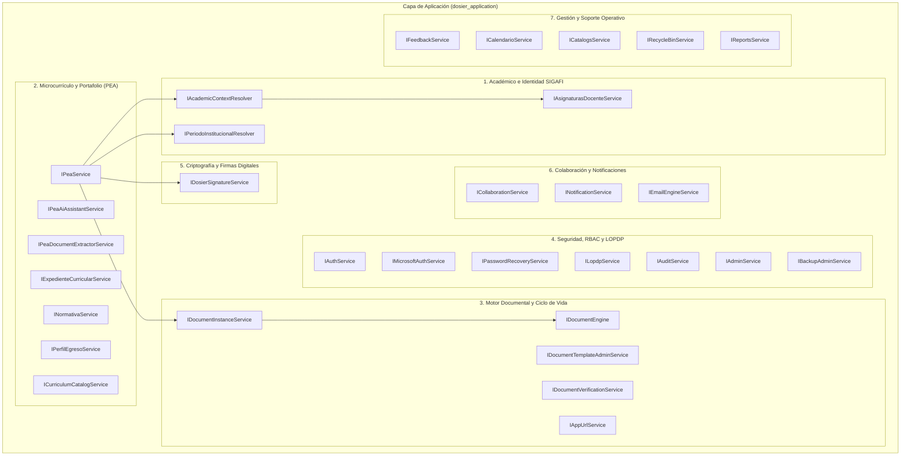

# Capa de Aplicación, Casos de Uso y Servicios de Orquestación (Application Layer)

## 1. Responsabilidad y Principios de Diseño

La capa de aplicación (`dosier_application`) materializa los casos de uso del sistema **DOSIER**, orquestando el flujo de información entre las entidades de dominio (`dosier_domain`), la persistencia en base de datos (`dosier_infrastructure`) y los controladores de la API REST (`dosier_api`).

Bajo los principios de **Clean Architecture** e inversión de dependencias:
* `dosier_application` es completamente independiente de tecnologías de infraestructura: no contiene dependencias de Entity Framework Core, comandos SQL, llamadas a sockets ni bibliotecas de renderizado PDF.
* Define interfaces estrictas (`Contracts`) y objetos de transferencia de datos (`DTOs`) inmutables o fuertemente tipados.
* Centraliza las reglas de negocio, validaciones cruzadas (como el balance de horas del RRA Art. 21), orquestación de firmas electrónicas, sincronización colaborativa y cumplimiento LOPDP.
* El 100% de los controladores en `dosier_api` consumen exclusivamente servicios de `dosier_application`, garantizando una separación nítida de responsabilidades.

---

## 2. Mapa Integral de Subsistemas de Aplicación

---

## 3. Subsistema Académico y Resolución de Contexto SIGAFI (`Academico/`)

Garantiza la frontera estricta de solo lectura con la base de datos `sigafi_es`, resolviendo períodos, carreras del instituto y asignaciones docentes con aislamiento de la Escuela de Conducción.

### 3.1. `IPeriodoInstitucionalResolver` (Fuente Única de Verdad de Períodos)

Centraliza las reglas institucionales para la determinación de períodos académicos:
* **Aislamiento de Conducción:** Filtra registros donde `esConduccion == 0` o `null`.
* **Filtro del Instituto:** Exige carreras con `esInstituto = 1`.
* **Invariante de Período Activo Único:** Garantiza que exactamente un período lectivo tenga `EsActivo = true` (priorizando `periodoactivoinstituto == 1`).
* **Métodos Principales:**
  - `Task<PeriodoAcademicoDto?> GetPeriodoActivoAsync(CancellationToken ct)`
  - `Task<string> GetIdPeriodoActivoAsync(CancellationToken ct)`
  - `Task<List<PeriodoAcademicoDto>> GetPeriodosInstitucionalesAsync(int? limite, CancellationToken ct)`

### 3.2. `IAcademicContextResolver`

Resuelve la integridad académica de una materia previo a su formulación en DOSIER:
* `Task<AcademicContextDto?> ResolveByAssignmentAsync(int idAsignacion, string? expectedProfessorId, CancellationToken ct)`: Valida la titularidad del docente, resuelve la carrera institucional (`carreras`), la versión de la malla (`mallas_periodos`) y consolida la distribución oficial de horas: docencia (CD), prácticas (APE) y trabajo autónomo (TA).

### 3.3. `IAsignaturasDocenteService`

Expone la carga académica y el estado de avance de los instrumentos microcurriculares del profesor:
* `GetPeriodoActivoAsync()`: Resuelve el período lectivo vigente.
* `GetMisAsignaturasAsync(string idProfesor, string? idPeriodo)`: Carga horaria docente con banderas calculadas del estado del PEA (`NoIniciado`, `Borrador`, `EnRevision`, `Observado`, `RevisadoCoord`, `RevisadoAcad`, `Aprobado`).
* `GetCurriculoAsignaturaAsync(int idAsignatura, int idCarrera)`: Contenidos mínimos, créditos y prerrequisitos oficiales de la malla.

---

## 4. Subsistema Curricular y Portafolio Docente (`Curriculum/`)

Coordina la formulación, revisión colegiada, firmas digitales, validaciones normativas CACES y co-diseño entre docentes.

### 4.1. `IPeaService` (Gestión Integral del PEA)

Orquesta el ciclo de vida de las 11 secciones oficiales del microcurrículo:
* **Lectura e Instanciación:**
  - `GetByIdAsync(int idPea, int? idUsuario)` y `GetByUuidAsync(string uuid, int? idUsuario)`.
  - `CanUserAccessPeaAsync(int idPea, int idUsuario)`: Regla de aislamiento temporal por rol.
  - `CrearDesdeAsignacionAsync(int idAsignacion, string idProfesor)`: Crea el PEA inicializando datos informativos desde SIGAFI en estado `Borrador`.
  - `ClonarPeaPeriodoAsync(int idPeaOrigen, string nuevoPeriodo, string? idUsuario)`: Reutiliza contenidos de períodos anteriores reiniciando firmas y observaciones.
* **Persistencia y Sincronización:**
  - `GuardarPeaAsync(PeaDto dto, string? idUsuarioModificador)`: Almacena cambios en el modelo relacional verificando consistencia horaria.
  - `SincronizarMetadataAsync(string peaUuid, string snapshotJson)`: Traduce el documento semi-estructurado de CoWork hacia las tablas relacionales (`doc_pea_*`).
* **Circuito de Firmas y Máquina de Estados:**
  - `FirmarPeaAsync(int idPea, int idUsuario, FirmarPeaDto dto, string ip, string userAgent)`: Ejecuta firma DFRM o PKCS#12 y avanza el estado curricular (`Borrador` $\to$ `EnRevision` $\to$ `RevisadoCoord` $\to$ `RevisadoAcad` $\to$ `Aprobado`).
  - `CambiarEstadoAsync(int idPea, string nuevoEstado, string? firmaDocente, string? idUsuario, string? motivo)`: Aplica transiciones directas o dictámenes de devolución a `Observado`.
* **Observaciones y Subsanaciones:**
  - `AgregarObservacionAsync` / `AgregarObservacionByUuidAsync`: Registra observaciones por sección curricular.
  - `SubsanarObservacionAsync(int idObservacion, string respuestaDocente, int? idUsuario)`.
* **Supervisión y Colaboración entre Docentes:**
  - `ListarBandejaAsync(...)`: Bandeja consolidada con filtros de alcance institucional y permisos RBAC.
  - `SolicitarColaboracionAsync`, `ResponderColaboracionAsync`, `CancelarSolicitudColaboracionAsync`: Protocolo de cátedras compartidas y co-redacción.

### 4.2. Asistente Cognitivo e Inteligencia Artificial Curricular

* **`IPeaAiAssistantService`:**
  - `GetConfigStatusAsync` / `SaveConfigAsync`: Gestión criptográfica de credenciales del LLM (cifradas en base de datos con AES-256).
  - `GenerateDraftAsync`: Generación de propuestas estructuradas para las 11 secciones con purga de bloques de razonamiento (`<think>`) y conciliación horaria matemática estricta.
  - `AnalyzeForReviewAsync`: Auditoría previa de cumplimiento de taxonomía de Bloom y normativa CACES antes del envío formal.
* **`IPeaDocumentExtractorService`:**
  - `ExtractAndMapDocumentAsync`: Ingestión de sílabos en PDF (vía iText 9) o Word (vía OpenXML), analizando tablas pedagógicas sin sobreescribir datos generales de SIGAFI.

### 4.3. Servicios de Apoyo Curricular y Salas de Carrera

* **`IExpedienteCurricularService`:** Gestiona el expediente curricular por asignatura y período, coordinando las **Salas Curriculares de Carrera en Tiempo Real** (`GetEstadoSalaCarreraAsync`, `ConmutarEstadoSalaCarreraAsync`, `GetPizarraSalaCarreraAsync`, `GuardarPizarraSalaCarreraAsync`).
* **`INormativaService`:** Catálogo de resoluciones de organismos rectores (CES, CACES, SENESCYT) y checklist de artículos normativos obligatorios.
* **`IPerfilEgresoService`:** Matriz de articulación y tributación entre los RDA de las materias y los resultados del perfil de egreso.
* **`ICurriculumCatalogService`:** Catálogo de carreras y asignaturas del docente.

---

## 5. Subsistema de Motor Documental y Ciclo de Vida (`Common/Documents/`)

Administra la compilación de documentos PDF oficiales, moldeos HTML/CSS institucionales y diagnóstico forense de almacenamiento.

### 5.1. `IDocumentEngine` (Compilador PDF iText 9)

* `GenerateAsync(DocumentRequest request, CancellationToken ct)`: Recibe la plantilla institucional y el DTO de datos, inyecta variables, genera código de trazabilidad único (`TraceabilityCode`) y produce el PDF final con su hash SHA-256.
* `MergeDocumentsAsync(IEnumerable<byte[]> pdfDocuments, CancellationToken ct)`: Concatena anexos o evidencias académicas al cuerpo principal.
* `UpdateTemplateAsync` / `ResetTemplateToDefaultAsync`: Edición dinámica de moldes institucionales.

### 5.2. `IDocumentInstanceService` (Gestión de Instancias y Diagnóstico)

* `CreateAsync` / `ResolveAsync`: Instancia un nuevo documento vinculando plantilla y entidad de negocio (`entityUuid`).
* `FinalizeAsync`: Sella la instancia asociándole los bytes definitivos del PDF, código de trazabilidad y hash criptográfico.
* `GetObsoleteDocumentDiagnosisAsync`: Analiza la discrepancia entre versiones de plantilla y documentos compilados.
* `PurgeObsoleteFileByUuidAsync` / `PurgeAllObsoleteDocumentFilesAsync`: Purga de binarios obsoletos del almacenamiento preservando intacto el registro de auditoría.
* `ValidateStorageIntegrityAsync`: Verificación periódica de integridad física del archivo en disco contra su hash registrado.

### 5.3. Servicios Complementarios del Motor Documental

* **`IDocumentTemplateAdminService`:** Mantenimiento y personalización de plantillas (`doc_document_templates`), configuraciones de estilo global y campos colaborativos.
* **`IDocumentVerificationService`:** Servicio de libre acceso público para validar documentos emitidos mediante su código QR o código de trazabilidad DFRM.
* **`IAppUrlService`:** Fuente Única de Verdad para construir URLs absolutas hacia el frontend (códigos QR, correos transaccionales y links de recuperación).

---

## 6. Subsistema de Seguridad, Identidad y LOPDP (`Security/`)

Provee autenticación robusta, gobierno de roles RBAC institucionales y cumplimiento estricto de la legislación ecuatoriana de protección de datos.

### 6.1. Identidad y Control de Acceso

* **`IAuthService`:**
  - Login local con hash BCrypt y protección progresiva ante fuerza bruta (`LoginBlockedResponse` con HTTP 423 Locked).
  - Just-In-Time Provisioning (JIT): Aprovisionamiento transparente de docentes provenientes de SIGAFI en el sistema ID 6 con rol `DOSIER_DOCENTE`.
* **`IMicrosoftAuthService`:** Validación de tokens OAuth2 / OpenID Connect para SSO federado con Microsoft 365 (Entra ID).
* **`IPasswordRecoveryService`:** Generación y consumo de tokens de recuperación de contraseña con validez efímera (30 minutos) y respuesta anti-enumeración.
* **`IAdminService`:** Administración de usuarios, asignación/revocación de roles curriculares (`AssignRoleAsync`, `RevokeRoleAsync`), bitácoras administrativas paginadas y tablero de gobernanza curricular.
* **`IRbacService`, `ITokenService`, `IPasswordService`:** Servicios de bajo nivel para derivación de permisos PBAC (16 permisos), emisión de JWT y verificación de contraseñas.

### 6.2. Gobernanza de Datos y Copias de Seguridad

* **`ILopdpService`:**
  - `GetTerminoVigenteAsync`: Consulta pública de la política institucional vigente (`pd_terminos_condiciones`).
  - `RegistrarConsentimientoAsync`: Persistencia del consentimiento en `pd_aceptaciones_usuarios` (`sistema = 'DOSIER'`) y actualización de metadata docente.
  - `AuditoriaAccesoDatosAsync`: Registro inalterable en `doc_lopdp_auditoria_datos` con mecanismo de contingencia por log crítico.
  - Flujo de solicitudes ARCO (`SolicitudArcoRequest`, `ResolverSolicitudArcoRequest`).
* **`IAuditService`:** Bitácora transaccional administrativa en `doc_audit_admin` con instantáneas JSON de valores anteriores (`ValuesBefore`) y posteriores (`ValuesAfter`).
* **`IBackupAdminService`:** Generación de respaldos automatizados de base de datos MySQL, cálculo de sumas de verificación SHA-256 y telemetría del almacenamiento en disco.

---

## 7. Subsistema de Criptografía y Firmas Digitales (`Signatures/`)

Implementa el marco jurídico de la Ley de Comercio Electrónico y Firmas Digitales del Ecuador:

### `IDosierSignatureService`

* **`SignDocumentAsync` (Firma Institucional DFRM):**
  Aplica firma electrónica basada en contexto seguro de sesión autenticada con clave HMAC-SHA256, estampando código único con formato `DFRM-{AÑO}-{UUID8}`, marca temporal inmutable y representación visual en el PDF.
* **`SignDocumentWithP12Async` (Firma PKCS#12 / FirmaEC):**
  Valida certificados digitales de personas naturales o jurídicas provistos en formato binario (`.p12` / `.pfx`), descifrando la clave privada en memoria y estampando la firma en conformidad con los estándares de interoperabilidad institucional.
* **`VerifyAsync`:** Verificación criptográfica integral (vigencia del certificado, integridad de bytes contra hash SHA-256 y no-repudio).
* **`RevokeAsync`:** Revocación auditada de firmas en caso de reaperturas curriculares o anulaciones formales.

---

## 8. Subsistema de Comunicación, Notificaciones y Soporte

* **`ICollaborationService`:** Gestiona el pulso de presencia en tiempo real en los documentos (`GetPulseAsync`), comentarios y retroalimentación colegiada con retransmisión por SignalR.
* **`INotificationService` & `INotificationDriver`:** Despacho de alertas a nivel de usuario individual (`NotifyUserAsync`) o roles institucionales (`NotifyByRoleCodesAsync`), integrando WebSockets en tiempo real y soporte para notificaciones WebPush (VAPID).
* **`IEmailEngineService`:** Motor de correos transaccionales con motor de plantillas HTML, soporte para adjuntos y registro de entrega en bitácora histórica.
* **`IFeedbackService`:** Mesa de ayuda y seguimiento de incidencias técnicas del sistema (creación, seguimiento y mensajes entre usuario y administradores).
* **`ICalendarioService`:** Administración del cronograma institucional, tablero Kanban de tareas curriculares, notas rápidas (Inbox) y despachador de alertas preventivas por correo electrónico.
* **`ICatalogsService`, `IRecycleBinService`, `IReportsService`:** Gestión desacoplada de catálogos generales, papelera de reciclaje con borrado suave (*soft-delete*) y consolidación de reportes analíticos para acreditación CACES.
