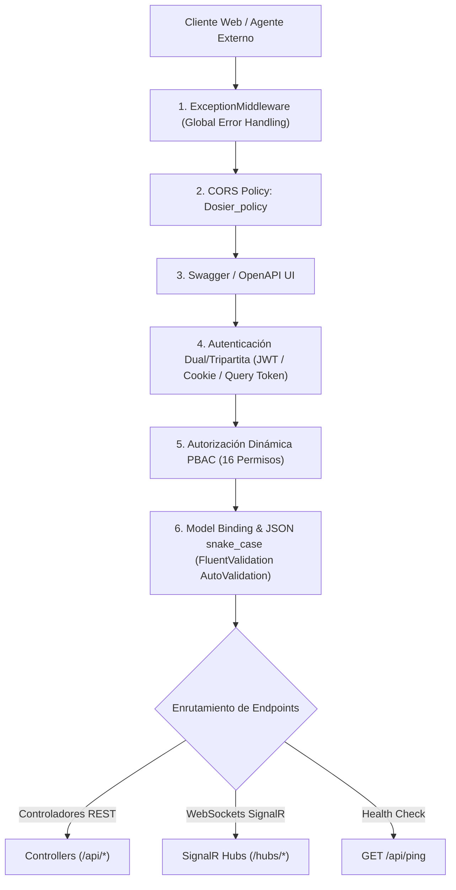

# Pipeline HTTP, Middlewares y Background Services (API Host Layer)

## 1. Arquitectura del Host ASP.NET Core 8.0

El punto de entrada del backend de DOSIER (`dosier_api/Program.cs`) implementa un modelo de host modular monolítico optimizado para alta concurrencia, resiliencia ante contingencias de red institucional y cumplimiento de normativas de seguridad y trazabilidad.

El procesamiento de solicitudes HTTP sigue una tubería estrictamente ordenada donde la captura global de excepciones, la negociación dinámica de políticas de origen cruzado (CORS), la resolución tripartita de credenciales de autenticación y la autorización por permisos (PBAC) operan secuencialmente antes de alcanzar los controladores REST o los concentradores de WebSockets:



---

## 2. Configuración y Orden de Middlewares

El orden de registro en `Program.cs` garantiza que ninguna excepción escape a la serialización controlada y que los encabezados de seguridad de red se apliquen antes de procesar cualquier autenticación o payload.

### 2.1. Manejo Centralizado de Excepciones (`dosier_api/Middleware/ExceptionMiddleware.cs`)

Ubicado como primer eslabón del pipeline, intercepta cualquier excepción no controlada emitida en las capas de aplicación, infraestructura o dominio, transformándola en una respuesta JSON estandarizada bajo convención `lower_snake_case` y codificación directa UTF-8 (`JavaScriptEncoder.UnsafeRelaxedJsonEscaping`):

| Excepción Interceptada | Código HTTP | Formato de Respuesta JSON |
| :--- | :---: | :--- |
| `FluentValidation.ValidationException` | **400 Bad Request** | `{ "status_code": 400, "message": "Error de validación en la solicitud.", "errors": [ { "campo": "...", "error": "..." } ] }` |
| `KeyNotFoundException` | **404 Not Found** | `{ "status_code": 404, "message": "..." }` |
| `UnauthorizedAccessException` | **401 Unauthorized** | `{ "status_code": 401, "message": "..." }` |
| `InvalidOperationException` / `ArgumentException` | **400 Bad Request** | `{ "status_code": 400, "message": "..." }` |
| `DbUpdateConcurrencyException` | **409 Conflict** | `{ "status_code": 409, "message": "Conflicto de edición: El registro ha sido modificado por otro usuario..." }` |
| `Exception` general no controlada | **500 Internal Server Error** | `{ "status_code": 500, "message": "Error interno del servidor." }` *(traza completa expuesta exclusivamente en ambiente de Desarrollo)* |

* **Desacoplamiento Estricto:** Elimina la necesidad de bloques `try-catch` dispersos en los controladores, permitiendo que la capa de aplicación arroje excepciones semánticas tipadas.
* **Telemetría Estructurada:** Todo incidente se registra en el subsistema de logging con ruta HTTP, verbo, parámetros y contexto del usuario actor.

### 2.2. Política Dinámica de CORS (`Dosier_policy`)

Debido a la diversidad de entornos donde opera DOSIER (desarrollo local en Vite, túneles Cloudflare de previsualización, redes inalámbricas del campus institucional y producción en AWS/VPS), la política de CORS implementa un evaluador dinámico de expresiones de red:

```csharp
builder.Services.AddCors(options =>
{
    options.AddPolicy("Dosier_policy", policy =>
    {
        policy.SetIsOriginAllowed(origin =>
        {
            if (string.IsNullOrWhiteSpace(origin)) return false;

            if (Uri.TryCreate(origin, UriKind.Absolute, out var uri))
            {
                // 1. Orígenes locales de desarrollo
                if (uri.Host.Equals("localhost", StringComparison.OrdinalIgnoreCase) ||
                    uri.Host.Equals("127.0.0.1", StringComparison.OrdinalIgnoreCase)) return true;

                // 2. Origen configurado en FrontendUrl (appsettings)
                if (!string.IsNullOrWhiteSpace(frontendUrl) &&
                    Uri.TryCreate(frontendUrl, UriKind.Absolute, out var frontUri))
                {
                    if (uri.Host.Equals(frontUri.Host, StringComparison.OrdinalIgnoreCase) ||
                        origin.TrimEnd('/').Equals(frontendUrl.TrimEnd('/'), StringComparison.OrdinalIgnoreCase)) return true;
                }

                // 3. Dominios Cloudflare Tunnel y dominios de producción institucionales
                if (uri.Host.EndsWith(".trycloudflare.com", StringComparison.OrdinalIgnoreCase) ||
                    uri.Host.Equals("trycloudflare.com", StringComparison.OrdinalIgnoreCase) ||
                    uri.Host.EndsWith("doicela.dev", StringComparison.OrdinalIgnoreCase) ||
                    uri.Host.EndsWith("jorgedoicela.com", StringComparison.OrdinalIgnoreCase) ||
                    uri.Host.EndsWith("istpet.edu.ec", StringComparison.OrdinalIgnoreCase)) return true;

                // 4. Subredes privadas de red de área local (Wi-Fi institucional, LAN docente)
                if (IPAddress.TryParse(uri.Host, out var ip))
                {
                    var bytes = ip.GetAddressBytes();
                    if (bytes.Length == 4)
                    {
                        if (bytes[0] == 192 && bytes[1] == 168) return true; // 192.168.0.0/16
                        if (bytes[0] == 10) return true;                     // 10.0.0.0/8
                        if (bytes[0] == 172 && bytes[1] >= 16 && bytes[1] <= 31) return true; // 172.16.0.0/12
                    }
                }
            }

            // 5. Orígenes explícitos listados en Cors:AllowedOrigins
            return configuredOrigins.Any(o => o.TrimEnd('/').Equals(origin.TrimEnd('/'), StringComparison.OrdinalIgnoreCase));
        })
        .AllowAnyHeader()
        .AllowAnyMethod()
        .WithExposedHeaders("Content-Disposition") // Vital para nombres de archivo en descarga de PDFs
        .AllowCredentials();                       // Obligatorio para handshake SignalR
    });
});
```

### 2.3. Autenticación Tripartita (`JwtBearerEvents.OnMessageReceived`)

Para garantizar compatibilidad simultánea entre la SPA web, herramientas de desarrollo (Swagger/Postman) y conexiones de WebSockets en tiempo real, el gestor de autenticación JWT inspecciona tres canales de transporte en orden jerárquico:

1. **Parámetro Query String (`access_token`):**
   Utilizado exclusivamente cuando la ruta de la solicitud inicia con `/hubs` (ej. `/hubs/collaboration`, `/hubs/notifications`). Los navegadores web no permiten inyectar cabeceras HTTP personalizadas en la API nativa de WebSockets, por lo que SignalR transporta el token en la URL durante el handshake inicial.
2. **Cookie Segura (`dosier_auth`):**
   Inspeccionada para solicitudes de la SPA web en navegadores que configuran cookies HTTP-only con protección contra ataques XSS.
3. **Encabezado HTTP Estándar (`Authorization: Bearer <token>`):**
   Utilizado por consumidores REST directos, Swagger UI, aplicaciones móviles y microservicios externos.

---

## 3. Serialización JSON, Model Binding y Validación Automática

* **Política Global de Serialización:**
  `JsonNamingPolicy.SnakeCaseLower`. Todas las propiedades devueltas por los controladores REST se transforman automáticamente a `snake_case` (ej. `fecha_registro`, `nombre_completo`).
* **Deserialización Resiliente:**
  `PropertyNameCaseInsensitive = true`. Permite aceptar propiedades en cualquier variación de casing enviada por clientes HTTP sin provocar fallos de binding.
* **Bloqueo Automático en Validación (*Production-Lock*):**
  `options.SuppressModelStateInvalidFilter = false`. La API intercepta automáticamente cualquier payload que no cumpla las validaciones de `FluentValidation` o anotaciones de datos antes de alcanzar la lógica interna del controlador, respondiendo de inmediato con `400 Bad Request`.

---

## 4. Concurrencia y Configuración Especializada de SignalR

El subsistema en tiempo real está configurado para permitir la co-redacción concurrente y la transferencia de anexos en el editor:
* **`MaximumReceiveMessageSize`:** Fijado en `2 * 1024 * 1024` bytes (2 Megabytes) para permitir el transporte de imágenes Base64, diagramas y snapshots de Yjs dentro de los paquetes de WebSocket sin exceder los límites de seguridad contra denegación de servicio (DoS).
* **Rutas de Hubs Oficiales:**
  - `/hubs/collaboration`: Sincronización CRDT de documentos microcurriculares, presencia activa de cursores y chat de sección.
  - `/hubs/notifications`: Despacho multicanal de notificaciones institucionales y alertas de workflow curricular.

---

## 5. Resiliencia de Persistencia y Auto-Seeding en MySQL

El host de la aplicación incorpora mecanismos de alta disponibilidad contra intermitencias en la red institucional o el servidor de base de datos:
* **Reintentos Transitorios:**
  `EnableRetryOnFailure(maxRetryCount: 5, maxRetryDelay: TimeSpan.FromSeconds(5), errorNumbersToAdd: null)`. Si la conexión a MySQL parpadea o sufre latencia, el proveedor ejecuta hasta 5 reintentos automáticos antes de abortar la transacción.
* **División de Consultas (*Split Query*):**
  `QuerySplittingBehavior.SplitQuery`. Previene la explosión cartesiana en consultas complejas que involucran colecciones anidadas (ej. PEA con unidades, temas, actividades prácticas y evaluaciones).
* **Inicializador Resiliente de Base de Datos (*Auto-Seeder*):**
  Al levantar el servicio, un scope de inicialización ejecuta `DocumentTemplateSeeder.SeedTemplatesAsync` con un bucle de reintento de hasta 10 iteraciones (espera de 2 segundos entre intentos), garantizando que la API espere pacientemente a que MySQL complete su arranque en despliegues con Docker Compose o reinicios de servidor.

---

## 6. Catálogo de Servicios en Segundo Plano (`BackgroundService` / `IHostedService`)

El host ejecuta 5 procesos en segundo plano de manera continua para el mantenimiento, gobernanza y despacho automatizado de tareas:

| Servicio Hosted | Frecuencia / Activación | Responsabilidad Técnica y Operativa |
| :--- | :--- | :--- |
| `BackupBackgroundService` | Diario a las 02:00 UTC | Genera un respaldo estructural y de datos de la base de datos `sigafi_es`, calcula la suma de verificación SHA-256 del archivo generado y registra la evidencia en `doc_backup_logs`. |
| `CalendarioAlertasJob` | Cada 15 minutos | Evalúa el cronograma académico institucional y los plazos de entrega del PEA, despachando alertas preventivas por correo a docentes y coordinadores ante vencimientos inminentes. |
| `DocumentGarbageCollectorBackgroundService` | Diario a las 04:00 UTC | Realiza la purga forense de archivos binarios PDF antiguos asociados a instancias documentales cuyas plantillas hayan sido actualizadas (`IsFilePurged = true`), preservando los registros de auditoría y hashes SHA-256 en base de datos. |
| `EmailBackgroundProcessorService` | Continuo (Cola en memoria) | Consume la cola en memoria de correos electrónicos transaccionales pendientes, despachándolos en lotes controlados para optimizar el rendimiento y prevenir bloqueos por tasa de envío (*rate-limiting*) en el servidor SMTP. |
| `EmailBounceListenerService` | Cada 30 minutos | Monitorea y clasifica rebotes de correo electrónico (Hard Bounces y Soft Bounces), actualizando el estado de entrega en `doc_email_historial` y marcando direcciones inválidas. |

---

## 7. Endpoints de Diagnóstico y Salud del Host

* **`GET /api/ping`:**
  Endpoint ultraligero mapeado directamente con Minimal APIs que retorna `{ "status": "healthy", "timestamp": "..." }` con código HTTP 200. Utilizado por balanceadores de carga (AWS ALB, Nginx) y monitores de Cloudflare para verificar la disponibilidad inmediata del proceso sin golpear la base de datos.
* **`GET /api/health`:**
  Inspección operativa detallada en `HealthController` para pruebas de conectividad de clientes y diagnóstico de dependencias.
