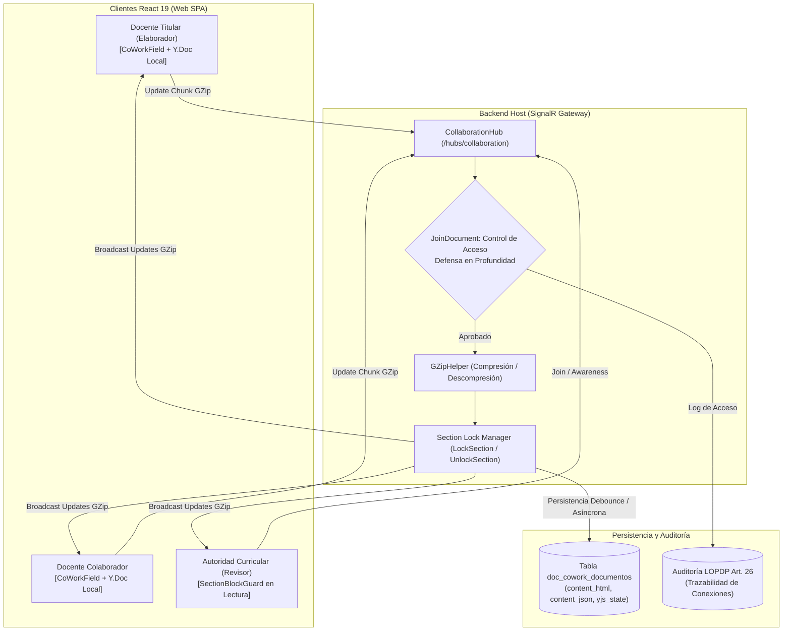

# Motor Colaborativo en Tiempo Real (CoWork)

## 1. Visión General del Subsistema CoWork

El motor colaborativo CoWork proporciona la infraestructura de sincronización y concurrencia en tiempo real que faculta a múltiples docentes de una misma asignatura, área de conocimiento o comisión curricular a redactar simultáneamente las secciones del **Programa de Estudio de la Asignatura (PEA)** y documentos oficiales de planificación en el Instituto Superior Tecnológico Mayor Pedro Traversari (ISTPET).

El subsistema articula cuatro pilares de ingeniería de software:
1. **WebSockets Bidireccionales sobre SignalR (`CollaborationHub`):** Canal persistente con soporte para reconexión automática y límites ampliados a 2 Megabytes.
2. **Tipos de Datos Replicados Libres de Conflicto (Yjs CRDTs):** Resolución matemática determinista de concurrencia a nivel de caracteres sin bloqueos pesimistas en base de datos.
3. **Compresión Binaria de Carga Útil (`GZipHelper`):** Minimización de la huella de red mediante compresión GZip de los deltas y vectores de estado.
4. **Control de Acceso por Defensa en Profundidad y Bloqueo Granular:** Validación criptográfica de identidad, gobernanza de roles institucionales y bloqueo visual reactivo mediante `<SectionBlockGuard>`.

---

## 2. Arquitectura de Sincronización y Flujo de Datos



---

## 3. Protocolo de Comunicación y Componentes del Motor

### 3.1. Gateway de Comunicación (`CollaborationHub`)

El hub `CollaborationHub` (`backend/dosier_infrastructure/Collaboration/CollaborationHub.cs`) centraliza las salas de colaboración bajo el endpoint `/hubs/collaboration`:

* **Topología de Salas (*Rooms*):** Los clientes se suscriben a canales aislados definidos por el identificador del documento (`{instanceUuid}_{section}`) o por salas curriculares de carrera (`sala_carrera_{idCarrera}_{idPeriodo}`).
* **Transmisión de Deltas Yjs (`SendUpdate`):** Recibe buffers binarios comprimidos de Yjs, valida la integridad del mensaje, los persiste asíncronamente y los retransmite a los demás colaboradores del grupo mediante `Clients.OthersInGroup(documentId).SendAsync("ReceiveUpdate", update)`.
* **Presencia y Cursores (*Awareness Protocol* - `SendAwareness`):** Retransmite en tiempo real la posición del cursor, selección de texto, color identificador y nombre del docente activo, permitiendo visualizar la interacción de los co-redactores sobre el texto enriquecido de Tiptap.

### 3.2. Compresión de Carga Útil (`GZipHelper`)

Dado que las estructuras CRDT generan deltas frecuentes de actualización a medida que el docente tipea en el editor, `GZipHelper` comprime los arrays de bytes (`Uint8Array`) en el navegador antes de viajar por el WebSocket. En el servidor, los bytes se procesan de forma eficiente en flujos de memoria (`MemoryStream`), reduciendo el consumo de ancho de banda hasta en un 85% y mitigando la saturación en redes institucionales concurrentes.

---

## 4. Control de Acceso por Defensa en Profundidad (`JoinDocument`)

Al invocarse `JoinDocument(documentId, userName, userUuid, userRole)`, el hub ejecuta un estricto protocolo de verificación de identidad y roles institucionales antes de otorgar acceso a la sala:

1. **Resolución Criptográfica de Identidad:**
   Extrae la cédula o identificador institucional directamente desde los claims del token JWT (`ClaimTypes.NameIdentifier` o `"id_sigafi"`), impidiendo la suplantación de identidad mediante parámetros manipulados en el cliente.
2. **Jerarquía de Permisos en el PEA:**
   * **Docente Titular (`isElaborador`):** Verificado contra `doc_pea.IdDocenteElaborador`. Posee plenos privilegios de redacción, invocación de herramientas de IA y envío a revisión.
   * **Autoridades Curriculares (`isCurricularAuthority`):** Docentes con roles `DOSIER_ADMIN`, `DOSIER_COORD_CARRERA`, `DOSIER_COORD_ACAD`, `DOSIER_VICERRECTOR` o designación activa en `doc_autoridades_curriculares`. Ingresan a la sala en modo de supervisión institucional, añadiéndose automáticamente el sufijo de trazabilidad `(Revisión)`.
   * **Docente Colaborador Autorizado (`isAuthorizedColaborador`):** Requiere que el docente titular haya aprobado formalmente una solicitud de colaboración intercurricular (`EstadoColaboracion == "Aprobada"` en `doc_pea` o en el registro serializado `ColaboradoresJson`). Ingresa con el sufijo `(Colaborador)`.
   * **Terceros no Autorizados:** El hub deniega tajantemente el acceso arrojando `HubException("Se requiere que el docente titular acepte previamente su solicitud de colaboración para ingresar a este PEA.")`.
3. **Bloqueo Inmutable por Estado (*State Locking*):**
   Si la instancia documental se encuentra legalizada o en fases avanzadas (`instance.State >= 3`), el hub restringe la conexión automáticamente a modo de solo lectura (`isReadOnly = true`), deshabilitando cualquier broadcast de mutación.

---

## 5. Bloqueo Granular de Secciones (`SectionBlockGuard`)

Para evitar colisiones de edición cuando dos docentes intentan alterar simultáneamente la misma sección microcurricular, el frontend y backend implementan el protocolo `SectionBlockGuard`:

* **Adquisición del Bloqueo (`LockSection`):** Al posicionar el cursor o enfocar un campo colaborativo (`<CoWorkField>`), el cliente emite una señal notificando el identificador de la sección.
* **Propagación a Terceros:** El servidor notifica a los demás clientes conectados (`SectionLocked`), desplegando un indicador visual con el nombre y color del docente que mantiene el bloqueo y conmutando el bloque a modo lectura para el resto.
* **Liberación Automática (`UnlockSection`):** Al perder el foco el editor o desconectarse el WebSocket, el servidor emite `SectionUnlocked`, liberando el bloque para otros usuarios.

---

## 6. Persistencia Dual e Integración con el Motor Documental

El estado colaborativo se almacena periódicamente en la tabla `doc_cowork_documentos` de MySQL:

```sql
CREATE TABLE doc_cowork_documentos (
    id BIGINT AUTO_INCREMENT PRIMARY KEY,
    entidad_uuid VARCHAR(36) NOT NULL,    -- Identificador del PEA, DocumentInstance o Sala de Carrera
    campo_nombre VARCHAR(100) NOT NULL,   -- Sección específica (ej. 'resultados_aprendizaje', 'contenidos')
    content_html LONGTEXT NULL,           -- Marcado HTML resultante de la co-redacción para compilación PDF
    content_json LONGTEXT NULL,           -- Estructura JSON para lectura declarativa y schemas
    yjs_state LONGBLOB NULL,              -- Snapshot binario del estado CRDT para reconstrucción concurrente
    updated_at_utc DATETIME NOT NULL,     -- Marca de tiempo inmutable UTC
    updated_by VARCHAR(255) NOT NULL      -- Cédula o identificador del docente autor
);
```

### Integración en el Pipeline de Impresión:
Al momento de solicitar la compilación oficial del PDF, `DocumentDataOrchestrator` consulta `doc_cowork_documentos`. Si existen secciones co-redactadas en CoWork, estas se inyectan dinámicamente en el DTO maestro que alimenta a `DocumentEngine`, garantizando que el PDF oficial refleje de manera transparente los últimos aportes colegiados.

---

## 7. Salas Curriculares de Carrera en Tiempo Real (`sala_carrera_{idCarrera}_{idPeriodo}`)

El motor CoWork expande su capacidad de la asignatura individual al trabajo colegiado de comisiones de carrera:

1. **Topología de Sala de Carrera:**
   Agrupa al Coordinador de Carrera y a los docentes asignados en una sala interactiva identificada por la clave institucional `sala_carrera_{idCarrera}_{idPeriodo}`.
2. **Validación de Pertinencia Docente:**
   El hub verifica que el docente que intenta conectarse a la sala mantenga asignaciones académicas vigentes en asignaturas asociadas a la malla curricular de dicha carrera (`Mallas` $\to$ `DetalleMallas` $\to$ `AsignacionesProfesores`).
3. **Pizarra Interactiva Colegiada (`pizarra_interactiva`):**
   Espacio visual en tiempo real para acuerdos de armonización microcurricular, articulación del perfil de egreso y seguimiento de resultados de aprendizaje.
   * **Persistencia Dual en `doc_cowork_documentos`:** Almacena simultáneamente el JSON estructurado de notas adhesivas y elementos gráficos en `content_json` y el binario comprimido de Yjs en `yjs_state`.
   * **Sincronización Inteligente:** Implementa sincronización continua con debounce de 2.5 segundos y soporte para forzado manual desde el cliente web.

---

## 8. Cumplimiento LOPDP y Trazabilidad Forense (Art. 26)

Conforme al artículo 26 de la Ley Orgánica de Protección de Datos Personales (LOPDP), cada evento de conexión, apertura de sala, mutación colaborativa o desconexión en `CollaborationHub` registra una traza forense inalterable conteniendo:
* Identificador institucional del usuario (`IdSigafi` y `IdUsuario`).
* Dirección IP de origen (IPv4 / IPv6) y encabezado de navegador (User-Agent).
* Identificador unívoco del documento y sección intervenida.
* Marca temporal en tiempo universal coordinado (UTC).

Esta bitácora garantiza el principio de no-repudio y permite certificar ante el CACES la autoría intelectual compartida en la elaboración de los programas de estudio institucionales.
