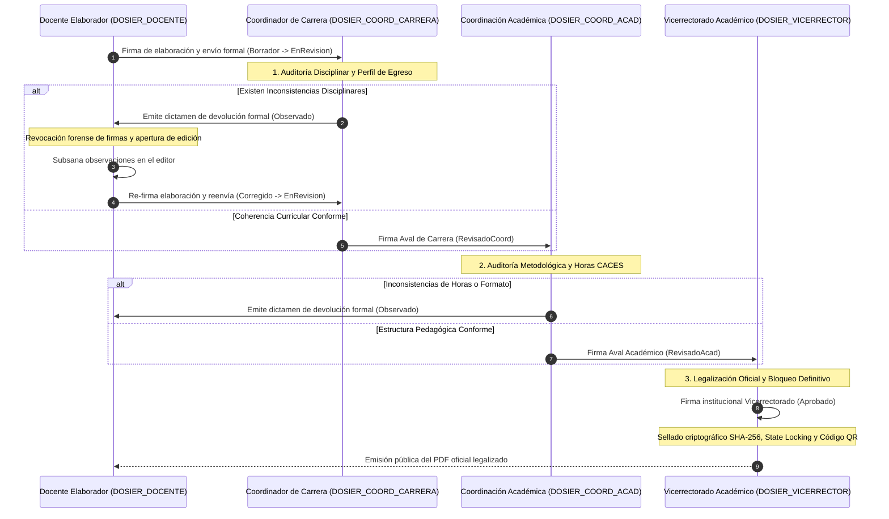

# Motor de Revisión y Validación Colegiada Curricular

## 1. Visión General del Subsistema

El motor de revisión colegiada curricular administra el proceso institucional de auditoría pedagógica, control de observaciones y emisión de avales formales sobre el **Programa de Estudio de la Asignatura (PEA)** y el portafolio microcurricular en el Instituto Superior Tecnológico Mayor Pedro Traversari (ISTPET).

La revisión y legalización responde a la cadena de responsabilidades establecida en el **Reglamento del Sistema de Seguimiento, Control y Evaluación del Proceso Docente (Resolución ISTPET-OCS-SE-2022-019)** y en el formato oficial del PEA (Sección k). El subsistema garantiza que ninguna asignatura sea impartida sin haber superado los tres filtros colegiados de pertinencia disciplinar, consistencia metodológica y legalización institucional.

---

## 2. Flujo Secuencial de Revisión y Avales Institucionales

---

## 3. Responsabilidades Diferenciadas por Autoridad Curricular

### 3.1. Coordinación de Carrera (`DOSIER_COORD_CARRERA`)
* **Pertinencia Disciplinar:** Verifica la actualidad de los contenidos mínimos aprobados por el CES y la congruencia técnica del campo de formación.
* **Articulación al Perfil de Egreso:** Comprueba que cada Resultado de Aprendizaje de la Asignatura (RDA) tribute efectivamente a las competencias profesionales de la carrera.
* **Consistencia de Prerrequisitos:** Valida que las asignaturas antecedentes y simultáneas coincidan con la versión de la malla activa en SIGAFI.
* **Emisión de Aval:** Su firma digital certifica la coherencia técnica del PEA y habilita la transición al estado `RevisadoCoord`.

### 3.2. Coordinación Académica General (`DOSIER_COORD_ACAD`)
* **Integridad Metodológica:** Verifica que las estrategias pedagógicas y recursos didácticos se alineen con el Modelo Educativo Institucional del ISTPET.
* **Cuadre Horario y Créditos (CES Art. 21):** Valida la equivalencia estricta de 48 horas por crédito académico y la distribución de los componentes: docencia (CD), práctico-experimental (APE) y trabajo autónomo (TA).
* **Mecanismos de Evaluación:** Comprueba que la ponderación de las notas parciales y el examen final sumen 10.0 puntos según el reglamento interno de evaluación.
* **Emisión de Aval:** Su firma digital certifica el cumplimiento normativo institucional y eleva el PEA a Vicerrectorado bajo el estado `RevisadoAcad`.

### 3.3. Vicerrectorado Académico (`DOSIER_VICERRECTOR`)
* **Máxima Legalización Institucional:** Ejerce la potestad legal de aprobación definitiva de los instrumentos microcurriculares del Instituto.
* **Sello Oficial e Inmutabilidad:** Su firma digital estampa el código de trazabilidad institucional `DFRM-XXXX`, calcula el hash SHA-256 sobre los bytes del PDF y activa el bloqueo permanente de modificación (*State Locking*).
* **Acreditación CACES:** Autoriza la publicación del documento foliado y habilita la consulta pública mediante código QR para auditorías externas.

---

## 4. Gestión de Observaciones, Dictamen Formal y Reapertura Curricular

Para garantizar la máxima transparencia y evitar revisiones informales en hojas dispersas:

### 4.1. Registro Atómico de Observaciones (`doc_pea_observaciones`)
El revisor formula observaciones directamente vinculadas a la sección correspondiente (ej. `Objetivos`, `Unidades Temáticas`, `Actividades Prácticas`, `Evaluación`, `Bibliografía`):
* **Privacidad Preliminar:** Mientras el PEA permanezca en `EnRevision`, las notas registradas son visibles exclusivamente para la autoridad evaluadora, impidiendo que el docente altere el documento antes de que la auditoría haya concluido.
* **Dictamen Atómico de Devolución:** El cambio de estado a `Observado` ocurre de forma controlada cuando la autoridad confirma el dictamen formal en `FinalizeAuditModal.tsx` vía `PATCH /api/pea/uuid/{uuid}/estado`.

### 4.2. Protocolo de Reapertura y Revocación Forense de Firmas
Al formalizarse la devolución a `Observado`, el sistema ejecuta un protocolo de reapertura controlada:
1. **Anulación de Firmas en `doc_pea`:** Se anulan los avales emitidos (`FirmaRevisadoCoord = null`, `FirmaRevisadoAcad = null`) y la firma de elaboración del docente (`FirmaElaboradoDocente = null`, `FechaElaborado = null`).
2. **Revocación Forense en `doc_documentos_firmas`:** Los registros históricos de firma previa pasan al estado `EsValida = false`, estampando marca temporal de revocación en UTC y motivo normativo (`"Reapertura para subsanación de observaciones curriculares"`).
3. **Identificación Visual:** En el bloque de firmas (`SignatureBlock.tsx`), las firmas revocadas se señalan inequívocamente como `Firma Revocada (Por Subsanar)`.
4. **Rehabilitación del Pipeline:** Se desbloquea la edición para el docente titular y se habilita la generación en caliente de un nuevo PDF para re-firma, transitando nuevamente a `EnRevision`.

### 4.3. Bloqueo de Aprobación por Observaciones Pendientes
La máquina de estados en el backend (`PeaService.cs`) prohíbe terminantemente la emisión de avales o la aprobación final si el documento mantiene observaciones en estado `Pendiente`. El docente debe responder formalmente a cada hallazgo para marcarlo como `Subsanada`.

---

## 5. Catálogo de Endpoints REST del Motor de Revisión

El controlador `PeaController` (`dosier_api/Controllers/PeaController.cs`) expone las siguientes rutas dedicadas al circuito colegiado:

| Verbo | Ruta HTTP | Autorización RBAC | Propósito Técnico |
| :--- | :--- | :--- | :--- |
| `POST` | `/api/pea/uuid/{uuid}/observaciones` | `DOSIER_COORD_CARRERA`, `DOSIER_COORD_ACAD` | Registra una nueva observación vinculada a una sección específica del PEA. |
| `GET` | `/api/pea/{idPea}/observaciones` | `DOSIER_DOCENTE`, Coordinadores, Vicerrector | Obtiene la lista completa de observaciones y su estado de subsanación. |
| `PUT` | `/api/pea/observaciones/{id}/subsanar` | `DOSIER_DOCENTE` | Registra la respuesta y justificación del docente, marcando el hallazgo como `Subsanada`. |
| `DELETE` | `/api/pea/observaciones/{id}` | `DOSIER_COORD_CARRERA`, `DOSIER_COORD_ACAD` | Permite al revisor retirar una observación preliminar formulada por error. |
| `PATCH` | `/api/pea/uuid/{uuid}/estado` | Coordinadores, Vicerrector | Aplica transiciones de estado formales (`RevisadoCoord`, `RevisadoAcad`, `Observado`, `Aprobado`). |
| `POST` | `/api/pea/{idPea}/firmar` | `DOSIER_DOCENTE`, Coordinadores, Vicerrector | Ejecuta la suscripción criptográfica (DFRM o PKCS#12) y avanza el circuito normativo. |

---

## 6. Entorno de Trabajo de Revisión Técnica (`/documentacion/revision-curricular/:uuid`)

Para evitar la dispersión de herramientas, DOSIER unifica la auditoría microcurricular en un único entorno de trabajo sobre un riel plano continuo de tres pestañas integradas:

1. **Revisión del PEA (Interactivo):**
   Renderizado continuo de las 11 secciones oficiales del microcurrículo con validadores matemáticos del Artículo 21 del CES en vivo y formulario flotante para anotación de observaciones por bloque.
2. **Documento Oficial PDF:**
   Visor embebido del documento foliado oficial generado por `DocumentEngine`, permitiendo constatar la apariencia exacta de impresión y el membrete institucional.
3. **Historial y Firmas (`AdminRevisionHistoryPanel.tsx`):**
   Panel a ancho completo que despliega la bitácora cronológica inmutable de `doc_pea_trazabilidad`, hashes criptográficos SHA-256 de cada versión previa, detalle de firmas digitales emitidas o revocadas y razones técnicas de transiciones.
