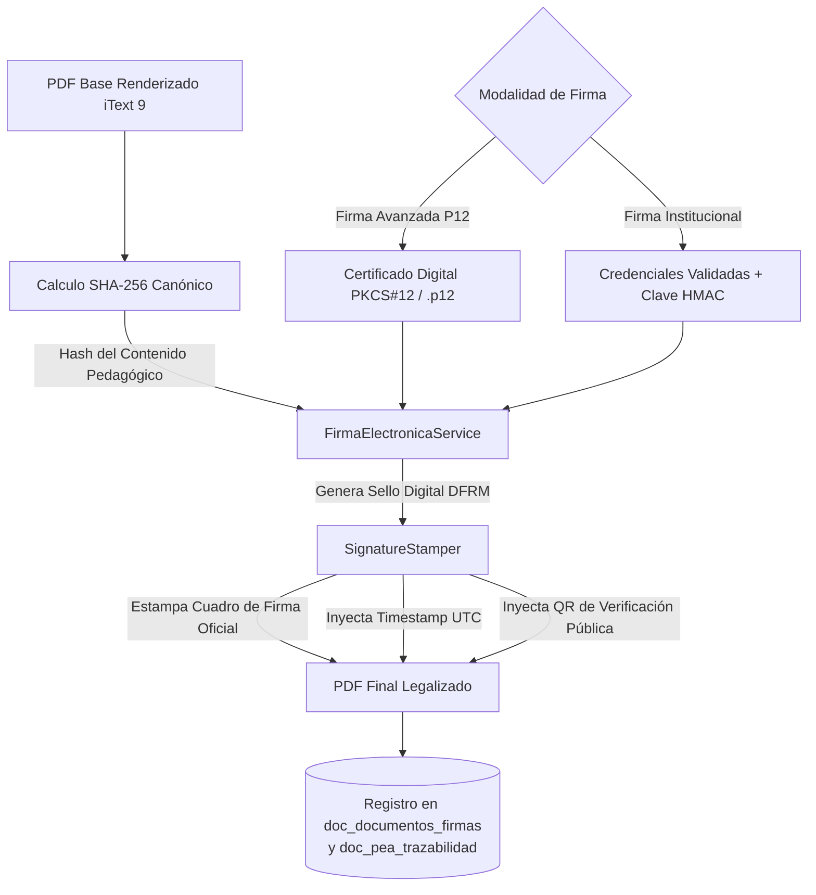

# Motor de Firma Digital, Criptografía y Sellos

## 1. Visión General del Subsistema de Firma

El motor de firma y sellado de DOSIER (`Signatures`) proporciona la infraestructura para validar la autoría, integridad y no repudio legal sobre los instrumentos curriculares emitidos por el Instituto Superior Tecnológico Mayor Pedro Traversari (ISTPET), en estricta conformidad con la **Ley de Comercio Electrónico, Firmas Electrónicas y Mensajes de Datos (Ley 67 de la República del Ecuador)**.

El subsistema integra la validación de certificados digitales en formato PKCS#12 (.p12) / FirmaEC, el sellado criptográfico HMAC-SHA256 institucional, el cálculo de huellas digitales de integridad SHA-256 y el estampado visual de sellos DFRM y códigos QR en documentos PDF.

---

## 2. Arquitectura del Proceso de Firma



---

## 3. Modalidades de Firma Soportadas

### 3.1. Firma Electrónica Avanzada (PKCS#12 / .p12 / FirmaEC)
* **Mecanismo:** El docente o directivo carga su archivo de certificado digital emitido por una entidad de certificación autorizada (BCE, Security Data, ANF, UANATACA) en formato Base64 o binario, junto con su contraseña privada.
* **Procesamiento:** `FirmaElectronicaService` utiliza **BouncyCastle** para abrir el almacén PKCS#12, validar la cadena de confianza X.509, verificar la vigencia temporal y comprobar la correspondencia del titular con el firmante en sesión.

### 3.2. Firma Digital Institucional (Sello HMAC-SHA256)
* **Mecanismo:** Para el flujo interno cotidiano de validación y avales en borrador, el docente autentica su identidad mediante verificación estricta de contraseña (BCrypt) contra su cuenta docente en SIGAFI.
* **Procesamiento:** El servidor genera un token de sellado firmado con la clave criptográfica del sistema (`DosierFirma:SigningSecret`), garantizando que la firma solo pudo ser generada por el servidor tras la verificación del docente.

---

## 4. Estampado Visual y Código DFRM (`SignatureStamper`)

El servicio de estampado gráfico sobre el archivo PDF utiliza **iText 9** para posicionar el sello institucional en la Sección K (Firmas de responsabilidad) o bloques de firma de plantillas generales.

### 4.1. Modalidades de Presentación del Estampado (Preferencia de Usuario)

El sistema provee dos modalidades configurables en el perfil de firma de cada usuario (`tipo_sello` en `doc_user_signature_profiles`):

1. **Sello Institucional Completo (`completo` - Predeterminado):**
   * **Diseño Visual:** Tarjeta estructurada con cabecera superior azul institucional (`#0A3264`) y texto blanco centrado *"FIRMA INSTITUCIONAL DOSIER"*.
   * **Cuerpo de 3 Columnas:**
     * Columna 1: Trazo manuscrito digitalizado del usuario o iniciales formateadas.
     * Columna 2: Metadatos institucionales oficiales (Nombre completo, Cargo, Departamento/Área, C.I., Fecha/hora UTC y Código DFRM en azul eléctrico `#0070F3`).
     * Columna 3: Código QR de alta resolución con enlace directo a la verificación pública criptográfica (`/verificacion/{firmaCode}`) y etiqueta inferior *"VERIFICAR"*.
   * **Pie de Seguridad:** Franja inferior con leyenda normativa *"Certificado Digital DOSIER · CACES / LOPDP"*.

2. **Solo Firma Digital (`solo_firma`):**
   * **Diseño Visual:** Estampado limpio y directo que posiciona únicamente el trazo manuscrito digitalizado (imagen PNG transparente) centrado en el casillero de firma correspondiente.
   * **Ausencia de Artefactos Gráficos:** No renderiza la cabecera azul institucional, ni los metadatos textuales ni el código QR en la celda del documento, preservando la estética tradicional de firma manuscrita sobre la línea documental.
   * **Trazabilidad Preservada:** La validez jurídica, el hash SHA-256 del PDF y el registro criptográfico HMAC-SHA256 continúan almacenándose de forma inmutable en `doc_documentos_firmas` con el metadato `"tipo_sello": "solo_firma"`.

### 4.2. Especificaciones de Geometría y Estampado iText 9

* **Código Oficial DFRM:** Generación de un identificador institucional único de trazabilidad (ej. `DFRM-2026-D9F7C872`).
* **Datos del Sello Visual:**
  * Nombre completo del firmante (obtenido de su registro oficial en SIGAFI).
  * Cargo institucional formal (`Docente`, `Coordinador de Carrera`, `Coordinador Académico`, `Vicerrectorado`).
  * Fecha y hora exacta de firmado en estándar UTC.
  * Código hash abreviado y algoritmo criptográfico utilizado.
* **Geometría Adaptativa de Matriz Curricular:**
  * En documentos con matriz normada de 4 firmas (PEA, Sección K), `SignatureStamper` detecta las columnas mediante `DocumentSignatureLayoutLocator` y genera un sello compacto de alta fidelidad (`94.0 pt` x `44.0 pt`) centrado en la fila `FIRMA` de la columna correspondiente:
    1. **Columna 1 (Elaborado):** Docente titular responsable de la asignatura.
    2. **Columna 2 (Revisado 1):** Coordinador de Carrera (pertinencia técnica y disciplinar).
    3. **Columna 3 (Revisado 2):** Coordinador Académico (alineación curricular transversal).
    4. **Columna 4 (Aprobado):** Vicerrectorado (legalización institucional).
  * En plantillas de dos firmas (Proyectos de Investigación), emplea el bloque horizontal tradicional de `190.0 pt` x `55.0 pt`.
* **Estampado Acumulativo y Autosanación de Archivos:**
  * Cada firma sucesiva invalida la copia previa del archivo final mediante `docInstancia.SetFinalPdfPath(null)`.
  * `DocumentInstanceService.ValidateStorageIntegrityAsync` regenera el documento base a partir del snapshot JSON y estampa de manera acumulativa todas las firmas válidas vigentes registradas en `doc_documentos_firmas`.
  * Esto garantiza que el PDF siempre contenga todos los sellos oficiales sin degradación gráfica ni sobreescrituras corruptas.
* **Código QR Dinámico:** Integrado dentro del sello oficial con enlace directo a la ruta pública de verificación `/verificacion/{firmaCode}`.

---

## 5. Estructura de Persistencia de Firmas (`doc_documentos_firmas`)

Cada firma electrónica ejecutada se persiste de forma inmutable en la base de datos:

```sql
CREATE TABLE doc_documentos_firmas (
    id_firma INT AUTO_INCREMENT PRIMARY KEY,
    id_documento_instancia INT NOT NULL,
    id_usuario INT NOT NULL,
    rol_firmante VARCHAR(50) NOT NULL,        -- DOSIER_DOCENTE, DOSIER_COORD_CARRERA, etc.
    tipo_firma VARCHAR(30) NOT NULL,          -- P12_PADES_ECUADOR, HMAC_SHA256_INSTITUCIONAL
    hash_documento VARCHAR(64) NOT NULL,      -- Hash SHA-256 del contenido firmado
    codigo_dfrm VARCHAR(50) NOT NULL,         -- Código de trazabilidad impreso
    fecha_firma DATETIME NOT NULL,            -- Timestamp UTC
    ip_origen VARCHAR(45) NOT NULL,
    user_agent VARCHAR(255) NULL,
    FOREIGN KEY (id_documento_instancia) REFERENCES doc_documentos_instancias(id_documento_instancia)
);
```
