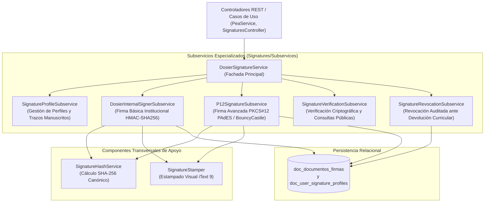
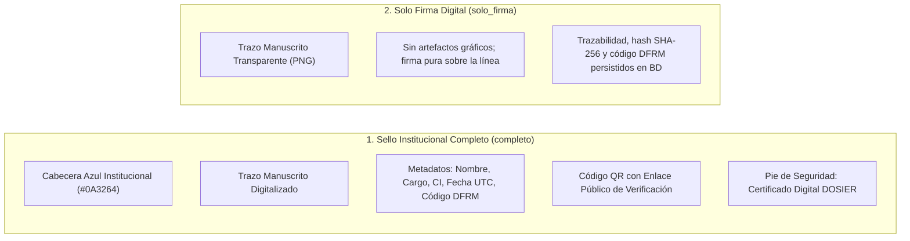

# Motor de Firma Digital, Criptografía y Sellos

## 1. Visión General del Subsistema de Firma

El motor de firma y sellado de DOSIER (`Signatures`) proporciona la infraestructura para validar la autoría, integridad y no-repudio legal sobre los instrumentos curriculares emitidos por el Instituto Superior Tecnológico Mayor Pedro Traversari (ISTPET), en estricta conformidad con la **Ley de Comercio Electrónico, Firmas Electrónicas y Mensajes de Datos (Ley 67 de la República del Ecuador)**.

El subsistema integra:
1. Validación de certificados digitales en formato PKCS#12 (.p12 / FirmaEC) emitidos por entidades acreditadas (Banco Central del Ecuador, Security Data, ANF, UANATACA).
2. Firma digital institucional basada en HMAC-SHA256 con código único de trazabilidad DFRM.
3. Cálculo canónico de huellas digitales de integridad SHA-256 sobre el contenido pedagógico y los bytes compilados.
4. Estampado visual de sellos con código QR de verificación pública en documentos PDF mediante iText 9.
5. Protocolo de revocación forense de firmas ante reaperturas curriculares colegiadas.

---

## 2. Arquitectura de Firma y Patrón Fachada (Facade Pattern)

El motor implementa el patrón de diseño Facade a través de la clase `DosierSignatureService` (`backend/dosier_infrastructure/Signatures/DosierSignatureService.cs`), la cual implementa la interfaz de aplicación `IDosierSignatureService` y orquesta 5 subservicios altamente especializados:



---

## 3. Modalidades de Firma Soportadas

### 3.1. Firma Electrónica Avanzada (PKCS#12 / .p12 / FirmaEC)
* **Contrato:** Ejecutada a través de `P12SignatureSubservice.SignDocumentWithP12Async`.
* **Procesamiento:** El usuario suministra los bytes de su certificado digital en formato binario (`.p12` o `.pfx`) y su contraseña secreta en memoria:
  1. `P12SignatureSubservice` utiliza **BouncyCastle** (`Org.BouncyCastle.Pkcs.Pkcs12Store`) para desencriptar el almacén de claves sin persistir la clave privada en disco.
  2. Valida la vigencia temporal del certificado (`NotBefore` $\le \text{UtcNow} \le$ `NotAfter`).
  3. Verifica la correspondencia de identidad entre el titular del certificado y el usuario autenticado en la sesión activa.
  4. Extrae la clave privada y la cadena de certificados X.509, calculando la firma digital PAdES sobre el documento.

### 3.2. Firma Digital Institucional DOSIER (HMAC-SHA256)
* **Contrato:** Ejecutada a través de `DosierInternalSignerSubservice.SignDocumentAsync`.
* **Procesamiento:** Diseñada para la validación interna y el avance del flujo colegiado ordinario:
  1. Valida la sesión activa y opcionalmente re-autentica las credenciales del docente contra el hash seguro en base de datos.
  2. Genera un token criptográfico HMAC-SHA256 utilizando la clave secreta del servidor (`DosierFirma:SigningSecret`).
  3. Genera un código de trazabilidad institucional único con formato `DFRM-{AÑO}-{UUID8}` (ej. `DFRM-2026-D9F7C872`).

---

## 4. Modalidades de Presentación del Estampado Visual (`SignatureStamper`)

El motor de estampado gráfico sobre el archivo PDF utiliza **iText 9** (`backend/dosier_infrastructure/Signatures/SignatureStamper.cs`) para posicionar el sello institucional en la matriz de firmas (Sección k). El usuario puede configurar su modalidad de presentación en `doc_user_signature_profiles.tipo_sello`:



### 4.1. Sello Institucional Completo (`completo` - Predeterminado)
* **Cabecera:** Franja superior azul oscuro (`#0A3264`) con texto blanco centrado *"FIRMA INSTITUCIONAL DOSIER"*.
* **Cuerpo de 3 Columnas:**
  - **Columna 1:** Imagen del trazo manuscrito digitalizado del docente o monograma formal generado.
  - **Columna 2:** Metadatos institucionales: nombre completo, cargo formal, cédula institucional, marca de tiempo UTC y código DFRM en azul técnico (`#0070f3`).
  - **Columna 3:** Código QR de alta resolución con etiqueta inferior *"VERIFICAR"* generado dinámicamente con `QRCoder`.
* **Pie Normativo:** Leyenda institucional *"Certificado Digital DOSIER · CACES / LOPDP"*.

### 4.2. Solo Firma Digital (`solo_firma`)
* **Presentación Limpia:** Estampa exclusivamente el trazo manuscrito digitalizado del firmante (imagen PNG con canal alfa transparente) centrado sobre la línea del casillero.
* **Preservación Estética:** No imprime recuadros, cabeceras azules ni códigos QR visibles en la celda del documento, emulando la firma documental tradicional.
* **Plena Validez Legal:** La validez jurídica, el hash SHA-256 del PDF y el registro criptográfico permanecen inalterables en `doc_documentos_firmas` con el metadato `"tipo_sello": "solo_firma"`.

---

## 5. Geometría Adaptativa en Matriz Curricular (Sección k)

En el PEA institucional, la Sección k requiere un diseño de 4 firmas simultáneas en una única tabla horizontal. `SignatureStamper` detecta las columnas mediante `DocumentSignatureLayoutLocator` y adapta la geometría del sello:

| Columna | Responsabilidad Normativa | Actor Institucional | Dimensiones del Sello |
| :---: | :--- | :--- | :---: |
| **Columna 1** | **Elaborado por:** | Docente Titular de la Asignatura | `94.0 pt` $\times$ `44.0 pt` |
| **Columna 2** | **Revisado por (Carrera):** | Coordinador de Carrera | `94.0 pt` $\times$ `44.0 pt` |
| **Columna 3** | **Revisado por (Académica):** | Coordinación Académica General | `94.0 pt` $\times$ `44.0 pt` |
| **Columna 4** | **Aprobado por:** | Vicerrectorado Académico | `94.0 pt` $\times$ `44.0 pt` |

* Para documentos bicolumnares (ej. Proyectos de Investigación Formativa), emplea el bloque horizontal estándar de `190.0 pt` $\times$ `55.0 pt`.

---

## 6. Estampado Acumulativo y Autosanación de Archivos

Para evitar la degradación de calidad o la sobreescritura de sellos en documentos con múltiples firmas en momentos distintos:

1. **Invalidación de Caché:** Cada firma sucesiva borra la ruta del archivo pre-renderizado previo mediante `docInstancia.SetFinalPdfPath(null)`.
2. **Reconstrucción Determinista:** El servicio `DocumentInstanceService.ValidateStorageIntegrityAsync` regenera el PDF base a partir del snapshot inmutable de datos (`data_snapshot_json`) y re-estampa en caliente todas las firmas válidas vigentes registradas en `doc_documentos_firmas`.
3. **Integridad Gráfica:** Este procedimiento garantiza que la adición de una firma posterior no corrompa los sellos gráficos previamente insertados por otras autoridades.

---

## 7. Protocolo de Revocación Forense de Firmas

Cuando un instrumento microcurricular es devuelto a estado `Observado`, `SignatureRevocationSubservice.RevokeAsync` ejecuta la revocación formal:

* **Marcado Inmutable:** El registro en `doc_documentos_firmas` cambia a `EsValida = false`.
* **Metadatos de Revocación:** Registra la marca de tiempo UTC de la revocación, el usuario responsable y el motivo normativo (`"Reapertura para subsanación de observaciones curriculares"`).
* **Identificación Visual:** En el visor web y bloque de firmas, se visualiza como `Firma Revocada (Por Subsanar)`, impidiendo falsos estados de aprobación previa.

---

## 8. Estructura de Persistencia en Base de Datos (`doc_documentos_firmas`)

```sql
CREATE TABLE doc_documentos_firmas (
    id_firma INT AUTO_INCREMENT PRIMARY KEY,
    id_documento_instancia INT NOT NULL,
    id_usuario INT NOT NULL,
    rol_firmante VARCHAR(50) NOT NULL,        -- DOSIER_DOCENTE, DOSIER_COORD_CARRERA, etc.
    tipo_firma VARCHAR(30) NOT NULL,          -- P12_PADES_ECUADOR, HMAC_SHA256_INSTITUCIONAL
    hash_documento VARCHAR(64) NOT NULL,      -- Hash SHA-256 del contenido curricular firmado
    codigo_dfrm VARCHAR(50) NOT NULL,         -- Código de trazabilidad impreso
    fecha_firma DATETIME NOT NULL,            -- Marca temporal UTC inmutable
    es_valida TINYINT(1) DEFAULT 1 NOT NULL,  -- Flag de vigencia (0 = revocada)
    fecha_revocacion DATETIME NULL,
    motivo_revocacion TEXT NULL,
    ip_origen VARCHAR(45) NOT NULL,
    user_agent VARCHAR(255) NULL,
    FOREIGN KEY (id_documento_instancia) REFERENCES doc_documentos_instancias(id_documento_instancia)
);
```

---

## 9. Verificación Pública Criptográfica sin Sesión

Cualquier evaluador externo o auditor del CACES puede verificar la legitimidad de un documento escaneando el código QR o accediendo a la URL pública:

$$\texttt{https://dosier.istpet.edu.ec/documentos/verificar/}\text{codigo\_dfrm}$$

El servicio `SignatureVerificationSubservice.VerifyAsync` consulta el código DFRM, valida que la firma no haya sido revocada (`EsValida == true`), contrasta el hash SHA-256 del PDF y devuelve la ficha con los datos del firmante, cargo oficial y marca temporal sin requerir inicio de sesión ni credenciales institucionales.
