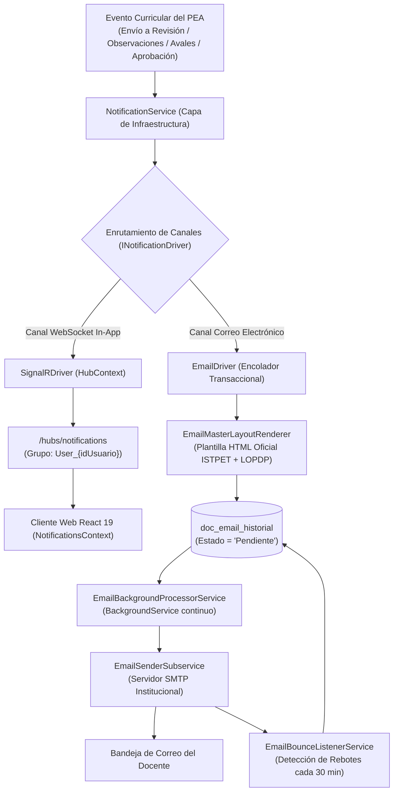

# Motor de Notificaciones Multicanal

## 1. Visión General del Subsistema de Notificaciones

El subsistema de notificaciones (`Notifications` / `EmailEngine`) administra la distribución automatizada de alertas operativas, convocatorias a revisión, recordatorios normativos del CACES y eventos del ciclo de vida del Programa de Estudio de la Asignatura (PEA) en el Instituto Superior Tecnológico Mayor Pedro Traversari (ISTPET).

El motor implementa el patrón de diseño Provider a través de la interfaz extensible `INotificationDriver` (`backend/dosier_application/Common/Notifications/INotificationDriver.cs`), articulando dos canales de transporte complementarios:
1. **Canal de Notificaciones en Tiempo Real (In-App):** Despachadas mediante WebSockets sobre SignalR (`SignalRDriver`) con entrega instantánea hacia el cliente web activo.
2. **Canal de Correo Electrónico Transaccional Asíncrono (SMTP):** Procesado en dos fases mediante encolamiento relacional (`EmailDriver`) y despacho desacoplado por un servicio en segundo plano (`EmailBackgroundProcessorService`) para garantizar alta disponibilidad y tolerancia a fallos.

---

## 2. Arquitectura de Despacho Multicanal



---

## 3. Canales de Comunicación y Drivers Registrados

### 3.1. Canal WebSocket In-App (`SignalRDriver`)

Implementa `INotificationDriver` para la transmisión instantánea de eventos hacia la interfaz de usuario:
* **Punto de Enlace:** Mapeado en el host ASP.NET Core bajo la ruta `/hubs/notifications` (`NotificationHub`).
* **Segmentación por Grupos de Usuario:** El cliente web se suscribe automáticamente a su grupo privado identificado por su ID interno (`$"User_{recipient}"`).
* **Evento Emitido:** Dispara el evento `ReceiveNotification` con un payload tipado:
  ```json
  {
    "title": "Observaciones formuladas en PEA",
    "body": "La Coordinación de Carrera ha devuelto el PEA con requerimientos de subsanación.",
    "url": "/documentacion/revision-curricular/3a9f1b2c-...",
    "fecha": "2026-09-15T14:30:00Z"
  }
  ```
* **Impacto en el Frontend:** El contexto `NotificationsContext` en React actualiza de forma reactiva el contador de no leídos e inserta la alerta en el centro de notificaciones de la barra superior.

### 3.2. Canal de Correo Transaccional Desacoplado (`EmailDriver`)

Para evitar bloqueos en el hilo HTTP y prevenir que la latencia del servidor SMTP degrade la experiencia de usuario en las transiciones de estado:
1. **Renderizado Institucional (`EmailMasterLayoutRenderer`):**
   Encapsula el cuerpo del mensaje en la plantilla HTML maestra del ISTPET:
   * Encabezado institucional con logotipos vectoriales de alta definición.
   * Saludo personalizado al destinatario y contenido formal en prosa.
   * Botón de acción directa (*Call-to-Action*) con URL absoluta resuelta por `IAppUrlService`.
   * Pie de página legal con cláusula de confidencialidad y protección de datos LOPDP.
2. **Encolamiento en Base de Datos:**
   El driver no establece conexión de red con el servidor de correos de forma síncrona. En su lugar, persiste el correo renderizado en la tabla `doc_email_historial` con estado inicial `'Pendiente'`.
3. **Despacho Asíncrono en Segundo Plano (`EmailBackgroundProcessorService`):**
   El job en segundo plano procesa la cola periódicamente, consumiendo los registros pendientes y enviándolos en lotes controlados a través de `EmailSenderSubservice` (utilizando SMTP seguro institucional con TLS/SSL), actualizando el estado a `'Enviado'` o `'Fallido'` con el código de error correspondiente.
4. **Supervisión de Rebotes (`EmailBounceListenerService`):**
   Monitorea cada 30 minutos los buzones de rebote institucionales (Hard Bounces y Soft Bounces), actualizando `doc_email_historial` para evitar reenvíos a casillas inexistentes y alertar a Secretaría Académica.

---

## 4. Disparadores Automáticos en el Workflow del PEA (`PeaService.cs`)

Cada transición normativa en el ciclo de vida del PEA desencadena notificaciones coordinadas mediante el método interno `NotificarHitoWorkflowPeaAsync`:

| Hito Curricular | Transición de Estado | Destinatarios Notificados | Propósito del Mensaje |
| :--- | :--- | :--- | :--- |
| **Envío a Revisión** | `Borrador` $\to$ `EnRevision` | Coordinador de Carrera y Administradores | Informa que el docente elaborador ha firmado el PEA y solicita iniciar la auditoría disciplinar. |
| **Dictamen de Devolución** | `EnRevision` $\to$ `Observado` | Docente Titular Elaborador | Notifica la formulación de observaciones técnicas y apertura del editor para subsanación. |
| **Envío de Corrección** | `Observado` $\to$ `Corregido` | Coordinador de Carrera | Informa que el docente ha respondido a los hallazgos y re-suscrito el documento. |
| **Aval de Carrera** | `EnRevision` $\to$ `RevisadoCoord` | Docente, Coordinación Académica, Vicerrectorado | Certifica el aval técnico de carrera y transfiere el expediente al despacho de Coordinación Académica. |
| **Aval Académico** | `RevisadoCoord` $\to$ `RevisadoAcad` | Docente, Coordinación de Carrera, Vicerrectorado | Certifica el aval metodológico y eleva el PEA a Vicerrectorado para legalización final. |
| **Aprobación Definitiva** | `RevisadoAcad` $\to$ `Aprobado` | Docente, Carrera, Autoridades Institucionales | Confirma la legalización formal con firma DFRM bajo Ley 67, generando el código QR público. |

---

## 5. Estructura de Persistencia en Base de Datos

El subsistema utiliza dos tablas complementarias para la trazabilidad y la consulta de notificaciones:

### 5.1. Notificaciones en la Aplicación (`doc_notificaciones`)
```sql
CREATE TABLE doc_notificaciones (
    id_notificacion INT AUTO_INCREMENT PRIMARY KEY,
    id_usuario INT NOT NULL,                  -- Usuario receptor
    titulo VARCHAR(255) NOT NULL,
    mensaje TEXT NOT NULL,
    tipo VARCHAR(50) NOT NULL,                -- INFO, SUCCESS, WARNING, URGENT
    url_redireccion VARCHAR(500) NULL,        -- Enlace relativo al módulo o PEA
    leida TINYINT(1) NOT NULL DEFAULT 0,      -- 0 = No leída, 1 = Leída
    fecha_creacion DATETIME NOT NULL,         -- Marca temporal UTC
    FOREIGN KEY (id_usuario) REFERENCES usuarios(idUsuario)
);
```

### 5.2. Historial de Correos Transaccionales (`doc_email_historial`)
```sql
CREATE TABLE doc_email_historial (
    idEmailHistorial INT AUTO_INCREMENT PRIMARY KEY,
    uuid VARCHAR(36) NOT NULL,
    destinatario VARCHAR(255) NOT NULL,
    idUsuarioDestinatario INT NULL,
    asunto VARCHAR(255) NOT NULL,
    cuerpo LONGTEXT NOT NULL,                 -- HTML completo renderizado con membrete institucional
    estado ENUM('Pendiente', 'Enviado', 'Fallido', 'Rebotado') NOT NULL DEFAULT 'Pendiente',
    errorMensaje TEXT NULL,
    fechaEnvio TIMESTAMP NOT NULL DEFAULT CURRENT_TIMESTAMP,
    adjuntosJson JSON NULL,
    metadataJson JSON NULL,
    FOREIGN KEY (idUsuarioDestinatario) REFERENCES usuarios(idUsuario) ON DELETE SET NULL
);
```

---

## 6. Motor de Correos Curriculares (`EmailEngine`)

El módulo de gestión de correos institucionales (`/emails` en frontend, `/api/Admin/email-engine` en backend) aplica control de acceso basado en roles (RBAC) y aislamiento por alcance de carrera:

| Rol Institucional | Alcance de Envío y Destinatarios | Plantillas (`doc_email_templates`) | Historial (`doc_email_historial`) |
| :--- | :--- | :--- | :--- |
| `DOSIER_ADMIN` | Global institucional (todos los roles, carreras y PEAs). | Ver, crear, editar y eliminar. | Auditoría global completa. |
| `DOSIER_VICERRECTOR` / `DOSIER_COORD_ACAD` | Global institucional (todos los roles, carreras y PEAs). | Ver, crear y editar (eliminación reservada a Admin). | Auditoría global completa. |
| `DOSIER_COORD_CARRERA` | Restringido estrictamente a docentes y PEAs de sus carreras coordinadas (`doc_autoridades_curriculares`). Difusión masiva limitada únicamente al rol `DOSIER_DOCENTE` dentro de su carrera. | Solo lectura y uso en redacción. | Únicamente sus propios envíos (`senderUserId`). |

El backend expone `GET /api/Admin/email-engine/scope` para informar las capacidades efectivas del actor autenticado y `GET /api/Admin/email-engine/recipients` para buscar destinatarios dentro de su alcance permitido, validando en `EmailSenderSubservice` cada solicitud de despacho antes de encolarla (respondiendo `403 Forbidden` ante cualquier intento fuera de alcance).

### 6.1. Catálogo de Plantillas Sembradas (`doc_email_templates`)
El script `scripts/base_datos/01_sistema_base.sql` inicializa siete plantillas curriculares orientadas al flujo de gestión de PEAs y calendario CACES:

| Código | Propósito | Contexto Recomendado |
| :--- | :--- | :--- |
| `COMUNICADO_CURRICULAR` | Comunicado institucional general a docentes, autoridades o carreras. | General |
| `PEA_RECORDATORIO_ELABORACION` | Recordatorio de formulación y entrega de PEA antes de la fecha límite. | `PEA` |
| `PEA_OBSERVACIONES_SUBSANACION` | Aviso de observaciones curriculares para subsanación docente. | `PEA` |
| `PEA_SOLICITUD_AVAL` | Solicitud de revisión y emisión de aval para Coordinación o Vicerrectorado. | `PEA` |
| `PEA_APROBACION_OFICIAL` | Confirmación de legalización definitiva del PEA con firma y código QR CACES. | `PEA` |
| `PERIODO_APERTURA_DISTRIBUTIVO` | Apertura de período académico y habilitación de planificación de PEAs. | `Periodo` |
| `CALENDARIO_ALERTA_EVENTO` | Alerta automática ejecutada por `CalendarioService` para hitos normativos. | Calendario |

### 6.2. Contexto Dinámico y Adjuntos Autogenerados (`EmailSenderSubservice`)
Al vincular una entidad del sistema en el envío (`EntityType` y `EntityUuid`), `EmailSenderSubservice` consulta las tablas de DOSIER y SIGAFI en modo solo lectura (`.AsNoTracking()`) para inyectar automáticamente los tokens curriculares:
* **Contexto `PEA`:** `[[pea_asignatura]]`, `[[pea_codigo]]`, `[[pea_carrera]]`, `[[pea_periodo]]`, `[[pea_nivel]]`, `[[pea_modalidad]]`, `[[pea_estado]]`, `[[pea_docente]]`, `[[pea_docente_email]]`, `[[pea_horas_totales]]`, `[[pea_creditos]]`, `[[pea_workspace_url]]`, `[[pea_revision_url]]`.
* **Contexto `Periodo`:** `[[periodo_codigo]]`, `[[periodo_nombre]]`, `[[periodo_fecha_inicio]]`, `[[periodo_fecha_fin]]`, `[[periodo_estado]]`.
* **Adjunto PDF Autogenerado (`SYSTEM:PEA_OFICIAL`):** Cuando se vincula un `PEA` y se activa la generación al vuelo, `EmailSenderSubservice` renderiza el PDF oficial una sola vez por lote mediante `IDocumentEngine` (aplicando firma PKCS#12 opcional con `IFirmaElectronicaService` si se provee certificado `.p12`) y lo almacena en `email_attachments/` para su despacho asíncrono por `EmailBackgroundProcessorService`.
* **Difusión por Carrera y Segmentación por Grupos (`TargetModalidadIds`, `TargetCarreraIds`, `TargetRole`, `TargetPeaEstado`, `TargetPeriodoId`):** Permite conformar grupos combinables por modalidad de estudio (`modalidades` y `modalidades_carreras` de SIGAFI), selección múltiple de carreras, rol institucional y estado de avance del PEA (`Borrador`, `Observado`, `EnRevision`, `RevisadoCoord`, `RevisadoAcad`, `Aprobado`). Antes del envío, el endpoint `POST /api/Admin/email-engine/audience/preview` calcula el conteo exacto y una muestra de destinatarios aplicando las mismas reglas RBAC del despacho real.

