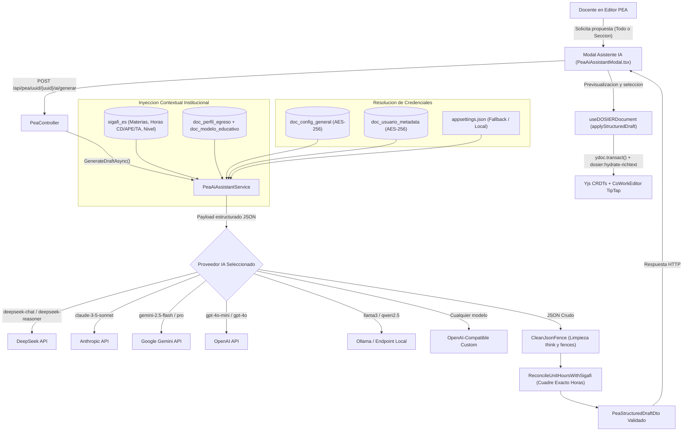

# Motor del Asistente Curricular de Inteligencia Artificial

## 1. Proposito y Alcance

El Motor del Asistente Curricular de Inteligencia Artificial de DOSIER proporciona soporte automatizado a los docentes en la estructuracion, redaccion y coherencia pedagogica del Programa de Estudio de la Asignatura (PEA). Su diseno arquitectonico es agnostico a proveedores, permitiendo conectarse con cualquier modelo de lenguaje del mercado (DeepSeek, Google Gemini, OpenAI, Anthropic Claude, Groq, OpenRouter o modelos locales desplegados en Ollama/vLLM), garantizando en todo momento la proteccion criptografica de las credenciales y el cuadre matematico estricto con la carga horaria oficial del sistema academico SIGAFI.



---

## 2. Componentes del Backend

### 2.1. Boveda Criptografica de API Keys (`IDataProtectionProvider`)
Las credenciales de acceso a las APIs de inteligencia artificial se protegen mediante el subsistema criptografico de ASP.NET Core (`IDataProtector`) con el proposito `Dosier.PeaAiAssistant.ApiKey.v1`.

- **Ambito Global Institucional (`doc_config_general`)**: Claves administradas exclusivamente por usuarios con rol `DOSIER_ADMIN` (`AI_ASSISTANT_API_KEY`, `AI_ASSISTANT_PROVIDER`, `AI_ASSISTANT_MODEL`, `AI_ASSISTANT_BASE_URL`).
- **Ambito Personal por Docente (`doc_usuario_metadata`)**: Almacenadas en la columna JSON `configuracion` bajo las claves `ai_api_key_protected`, `ai_provider`, `ai_model` y `ai_base_url`.
- **Ambito de Infraestructura (`appsettings.json`)**: Configuracion directa sin persistencia en base de datos, util para entornos locales o despliegues contenerizados:
  ```json
  "AiAssistant": {
    "Provider": "deepseek",
    "Model": "deepseek-chat",
    "BaseUrl": "",
    "ApiKey": ""
  }
  ```

### 2.2. Agnosticismo de Proveedores y Protocolos
El servicio `PeaAiAssistantService` implementa adaptadores de protocolo para garantizar interoperabilidad con cualquier servicio de inferencia:

| Proveedor | Endpoint Base Predeterminado | Protocolo de Invocacion | Modelos de Referencia |
| :--- | :--- | :--- | :--- |
| **DeepSeek** | `https://api.deepseek.com/chat/completions` | OpenAI Chat Completions | `deepseek-chat`, `deepseek-reasoner` |
| **OpenRouter** | `https://openrouter.ai/api/v1/chat/completions` | OpenAI Chat Completions | Claude, Llama 3, Mistral, Qwen |
| **Google Gemini** | `https://generativelanguage.googleapis.com` | Google Generative Language v1beta | `gemini-2.5-flash`, `gemini-2.5-pro` |
| **Anthropic** | `https://api.anthropic.com/v1/messages` | Anthropic Messages API (`x-api-key`) | `claude-3-5-sonnet-latest`, `claude-3-5-haiku` |
| **OpenAI** | `https://api.openai.com/v1/chat/completions` | OpenAI Chat Completions | `gpt-4o-mini`, `gpt-4o`, `o3-mini` |
| **Groq** | `https://api.groq.com/openai/v1/chat/completions` | OpenAI Chat Completions | `llama-3.3-70b-versatile` |
| **Ollama** | `http://localhost:11434/v1/chat/completions` | OpenAI Chat Completions (sin auth obligatoria) | `llama3`, `qwen2.5`, `deepseek-r1` |
| **Custom** | URL configurable por el usuario | OpenAI Chat Completions | Cualquier modelo compatible |

### 2.3. Resiliencia y Manejo de Modelos de Razonamiento
1. **Limpieza Quirurgica de Bloques `<think>`**: Modelos con cadena de pensamiento (DeepSeek R1, QwQ) emiten explicaciones dentro de `<think>...</think>` previas a la salida estructural. La funcion `CleanJsonFence` elimina estos bloques y extrae unicamente el objeto JSON delimitado por `{ ... }`.
2. **Normalizacion de URLs**: Detecta si la URL base ingresada por el usuario carece de `/chat/completions` y la completa automaticamente, admitiendo rutas relativas `/v1`.
3. **Manejo de Fallback ante Error HTTP 400/422**: Si un modelo (como OpenAI `o1`/`o3` o servidores locales estrictos) rechaza parametros como `temperature` o `response_format: json_object`, el cliente reintenta la solicitud automaticamente en modo de payload minimo.

### 2.4. Reconciliacion Matematica de Horas SIGAFI y Distribucion Balanceada
La normativa institucional y de acreditacion del CACES exige que las horas por componente de aprendizaje (Contacto Docente - CD, Aprendizaje Practico Experimental - APE y Trabajo Autonomo - TA) cuadren de forma exacta con la malla curricular aprobada.

Cuando una asignatura en `detallemallas` de SIGAFI solo registra el total de horas (ej. 144) con `horasDocente = 0` y `horasPracticoExperimental = 0`, el motor calcula de manera automatica una distribucion equitativa en tercios normativos:
- $\text{Horas CD} = \lfloor \frac{\text{Horas Totales}}{3} \rfloor$
- $\text{Horas APE} = \lfloor \frac{\text{Horas Totales}}{3} \rfloor$
- $\text{Horas TA} = \text{Horas Totales} - \text{Horas CD} - \text{Horas APE}$

Esto previene que una asignatura quede con 0 horas de docencia, 0 de practico y 144 de autonomo. Posteriormente, la funcion `ReconcileUnitHoursWithSigafi` distribuye estas horas entre las 4 unidades tematicas garantizando que cada unidad cuente con valores estrictamente positivos en sus 3 componentes:
$$\text{Proporcional}_i = \text{round}\left( \frac{\text{HorasGeneradas}_i}{\sum \text{HorasGeneradas}} \times \text{HorasOficialesSIGAFI} \right)$$
El remanente acumulado se asigna a la ultima unidad tematica, asegurando que:
$$\sum_{i=1}^{N} \text{HorasUnidad}_{i} \equiv \text{HorasMallaSIGAFI}$$

### 2.5. Desacoplamiento Arquitectonico: Motor Extractor de Documentos (`IPeaDocumentExtractorService`)
El procesamiento de archivos preexistentes esta desacoplado del asistente generador en su propio servicio e interfaz especializada:
- **Servicio Backend**: `PeaDocumentExtractorService.cs` implementando `IPeaDocumentExtractorService`.
- **Ruta Oficial de Ingestion**: `POST /api/pea/uuid/{uuid}/importar-documento` (con alias `/ai/importar-archivo` para compatibilidad retroactiva).
- **Formatos Digitales Admitidos**:
  1. **PDF con Texto Digital (`.pdf`)**: Extraccion nativa pagina por pagina mediante `iText 9` (`PdfTextExtractor` con `SimpleTextExtractionStrategy`).
  2. **Microsoft Word OpenXML (`.docx`)**: Descompresion nativa en memoria mediante `System.IO.Compression.ZipArchive` y recorrido jerarquico de `word/document.xml` con `XDocument`, extrayendo parrafos (`<w:p>`) y celdas de tablas curriculares (`<w:tbl>`, `<w:tr>`, `<w:tc>`).
- **Exclusion Estricta de Imagenes y Escaneos**:
  - Tanto el frontend (`PeaDocumentImportModal.tsx`) como el backend (`ExtractDigitalDocumentText`) rechazan de forma determinista cualquier archivo de imagen (`.png`, `.jpg`, `.jpeg`, `.webp`, `.gif`, `.bmp`, `.tiff`, `.svg` o MIME `image/*`).
  - Si un archivo `.pdf` carece de capa de texto seleccionable (menos de 50 caracteres alfanumericos extraidos), la operacion se rechaza indicando que solo se admiten documentos digitales con texto seleccionable.
- **Blindaje de Datos Generales Bloqueados**: Los campos de la Seccion 1 (nombre de asignatura, codigo, carrera, modalidad, unidad de organizacion, periodo, semestre, total de horas y creditos) son de **solo contexto**. Ni el asistente IA ni el extractor pueden sobreescribir estos campos en el PEA ni redactar encabezados redundantes de datos generales.
- **Matriz de Prerrequisitos**: Se filtran filas vacias y se normalizan los nombres y observaciones tanto en snake_case (`nombre_asignatura`, `observaciones`) como en PascalCase (`Asignatura`, `Observacion`) garantizando que nunca se generen filas vacias en la tabla.

### 2.6. Principio de Fidelidad Textual del Extractor vs Generacion Creativa del Asistente IA
Es imperativo distinguir el rol operativo de cada subsistema:
1. **Asistente Curricular IA ("Autocompletar seccion con IA")**:
   - Actua como redactor pedagogico interactivo.
   - Utiliza la asignatura activa (`ctx.NombreAsignatura`), carrera y perfil de egreso para redactar y sugerir objetivos, temas y practicas desde cero.
2. **Extractor e Importador de PEA ("Importar PEA PDF/Word")**:
   - Actua exclusivamente como un analizador sintactico (Parser) y extractor fidedigno de documentos digitales existentes.
   - Extrae con estricta exactitud textual lo que el autor escribio en el archivo subido (objetivos, prerrequisitos, unidades, etc.), sin inventar, alucinar ni sustituir la materia del archivo por otra.
   - Las cabeceras institucionales bloqueadas de SIGAFI del PEA en edicion se mantienen intactas; unicamente se importan y pueblan las secciones curriculares seleccionadas por el docente.

---

## 3. Integracion en el Frontend

### 3.1. Servicios Desacoplados (`peaAiService.ts` y `peaDocumentExtractorService.ts`)
- **`peaAiService.ts`**: Fachada para configuracion de API Keys (`/api/pea/ai/config`) y generacion de borradores pedagogicos (`/api/pea/uuid/{uuid}/ai/generar`). Provee la funcion de mapeo `convertDraftToEditorFields`.
- **`peaDocumentExtractorService.ts`**: Modulo dedicado exclusivamente a la extraccion y mapeo de documentos digitales (`/api/pea/uuid/{uuid}/importar-documento`).

### 3.2. Experiencia de Usuario en el Editor (`DOSIERBuilderShell.tsx`)
La barra de herramientas superior del editor del PEA expone dos acciones claramente diferenciadas:
1. **"Importar PEA (PDF / Word)"** (icono `FileUp`): Abre `PeaDocumentImportModal.tsx` para docentes que desean migrar un silabo o PEA previo en PDF o Word.
2. **"Autocompletar sección con IA"** (icono `Sparkles`): Abre `PeaAiAssistantModal.tsx` para redactar, proponer y pulir objetivos, unidades tematicas, actividades practicas y evaluaciones con soporte de modelos de lenguaje.

### 3.3. Hidratacion Atomica en Tiempo Real (`useDOSIERDocument.ts`)
La inyeccion de los datos generados o importados al editor concurrente se ejecuta en una sola transaccion `ydoc.transact()` sobre los tipos compartidos de Yjs:
- Arreglos estructurados mediante `Y.Array` (`Unidades`, `Prerrequisitos`, `ActividadesPracticas`, `Evaluaciones`, `Bibliografias`) y sincronizacion de claves indexadas en `Y.Text` (`Prerrequisitos[0].Asignatura`, etc.).
- Textos planos mediante `Y.Text`.
- Editores enriquecidos TipTap (`Y.XmlFragment`): se limpia el fragmento previo para habilitar re-hidratacion en pestañas aun no montadas y se emite el evento global `dosier:hydrate-richtext` para que los editores activos consuman el contenido en caliente.

