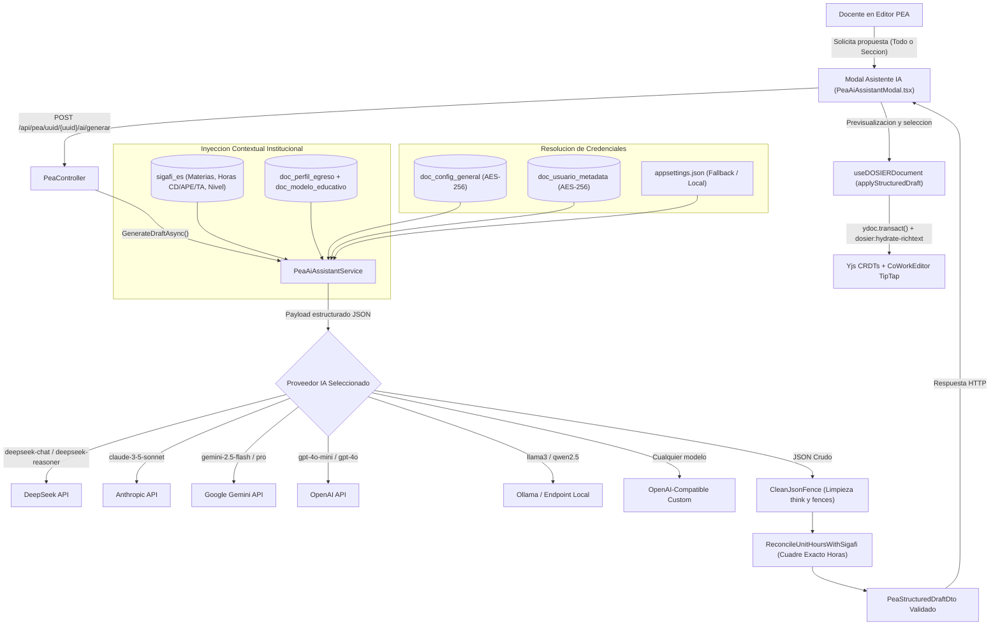

# Motor del Asistente Curricular de Inteligencia Artificial

## 1. Proposito y Alcance

El Motor del Asistente Curricular de Inteligencia Artificial de DOSIER proporciona soporte automatizado a los docentes en la estructuracion, redaccion y coherencia pedagogica del Programa de Estudio de la Asignatura (PEA). Su diseno arquitectonico es agnostico a proveedores, permitiendo conectarse con cualquier modelo de lenguaje del mercado (DeepSeek, Google Gemini, OpenAI, Anthropic Claude, Groq, OpenRouter o modelos locales desplegados en Ollama/vLLM), garantizando en todo momento la proteccion criptografica de las credenciales y el cuadre matematico estricto con la carga horaria oficial del sistema academico SIGAFI.



---

## 2. Componentes del Backend

### 2.1. Boveda Criptografica de API Keys (`IDataProtectionProvider`)
Las credenciales de acceso a las APIs de inteligencia artificial se protegen mediante el subsistema criptografico de ASP.NET Core (`IDataProtector`) con el proposito `Dosier.PeaAiAssistant.ApiKey.v1`.

- **Ambito Global Institucional (`doc_config_general`)**: Claves administradas exclusivamente por usuarios con rol `DOSIER_ADMIN` (`AI_ASSISTANT_API_KEY`, `AI_ASSISTANT_PROVIDER`, `AI_ASSISTANT_MODEL`, `AI_ASSISTANT_BASE_URL`).
- **Ambito Personal por Docente (`doc_usuario_metadata`)**: Almacenadas en la columna JSON `configuracion` bajo las claves `ai_api_key_protected`, `ai_provider`, `ai_model` y `ai_base_url`.
- **Ambito de Infraestructura (`appsettings.json`)**: Configuracion directa sin persistencia en base de datos, util para entornos locales o despliegues contenerizados:
  ```json
  "AiAssistant": {
    "Provider": "deepseek",
    "Model": "deepseek-chat",
    "BaseUrl": "",
    "ApiKey": ""
  }
  ```

### 2.2. Agnosticismo de Proveedores y Protocolos
El servicio `PeaAiAssistantService` implementa adaptadores de protocolo para garantizar interoperabilidad con cualquier servicio de inferencia:

| Proveedor | Endpoint Base Predeterminado | Protocolo de Invocacion | Modelos de Referencia |
| :--- | :--- | :--- | :--- |
| **DeepSeek** | `https://api.deepseek.com/chat/completions` | OpenAI Chat Completions | `deepseek-chat`, `deepseek-reasoner` |
| **OpenRouter** | `https://openrouter.ai/api/v1/chat/completions` | OpenAI Chat Completions | Claude, Llama 3, Mistral, Qwen |
| **Google Gemini** | `https://generativelanguage.googleapis.com` | Google Generative Language v1beta | `gemini-2.5-flash`, `gemini-2.5-pro` |
| **Anthropic** | `https://api.anthropic.com/v1/messages` | Anthropic Messages API (`x-api-key`) | `claude-3-5-sonnet-latest`, `claude-3-5-haiku` |
| **OpenAI** | `https://api.openai.com/v1/chat/completions` | OpenAI Chat Completions | `gpt-4o-mini`, `gpt-4o`, `o3-mini` |
| **Groq** | `https://api.groq.com/openai/v1/chat/completions` | OpenAI Chat Completions | `llama-3.3-70b-versatile` |
| **Ollama** | `http://localhost:11434/v1/chat/completions` | OpenAI Chat Completions (sin auth obligatoria) | `llama3`, `qwen2.5`, `deepseek-r1` |
| **Custom** | URL configurable por el usuario | OpenAI Chat Completions | Cualquier modelo compatible |

### 2.3. Resiliencia y Manejo de Modelos de Razonamiento
1. **Limpieza Quirurgica de Bloques `<think>`**: Modelos con cadena de pensamiento (DeepSeek R1, QwQ) emiten explicaciones dentro de `<think>...</think>` previas a la salida estructural. La funcion `CleanJsonFence` elimina estos bloques y extrae unicamente el objeto JSON delimitado por `{ ... }`.
2. **Normalizacion de URLs**: Detecta si la URL base ingresada por el usuario carece de `/chat/completions` y la completa automaticamente, admitiendo rutas relativas `/v1`.
3. **Manejo de Fallback ante Error HTTP 400/422**: Si un modelo (como OpenAI `o1`/`o3` o servidores locales estrictos) rechaza parametros como `temperature` o `response_format: json_object`, el cliente reintenta la solicitud automaticamente en modo de payload minimo.

### 2.4. Reconciliacion Matematica de Horas SIGAFI
La normativa institucional y de acreditacion del CACES exige que las horas por componente de aprendizaje (Contacto Docente - CD, Aprendizaje Practico Experimental - APE y Trabajo Autonomo - TA) cuadren de forma exacta con la malla curricular aprobada.

La funcion `ReconcileUnitHoursWithSigafi` aplica un algoritmo proporcional con redondeo por residuo:
$$\text{Proporcional}_i = \text{round}\left( \frac{\text{HorasGeneradas}_i}{\sum \text{HorasGeneradas}} \times \text{HorasOficialesSIGAFI} \right)$$
El remanente acumulado se asigna a la ultima unidad tematica, asegurando que:
$$\sum_{i=1}^{N} \text{HorasUnidad}_{i} \equiv \text{HorasMallaSIGAFI}$$

---

## 3. Integracion en el Frontend

### 3.1. Fachada de Servicios (`peaAiService.ts`)
Encapsula las llamadas HTTP a `/api/pea/ai/config` y `/api/pea/uuid/{uuid}/ai/generar`, normalizando las respuestas con tipado estricto y proveyendo el mapeador `convertDraftToEditorFields` que traduce la propuesta generada a los identificadores nativos del esquema de la plantilla `PEA_OFICIAL`:
- `ObjetivoAsignatura`
- `RdaCarrera`
- `ResultadosAprendizaje`
- `Prerrequisitos`
- `UnidadesTematicas`
- `MetodologiaEnsenanza`
- `RecursosDidacticos`
- `ActividadesPracticas`
- `Evaluaciones`
- `BibliografiaBasica` y `BibliografiaConsulta`

### 3.2. Modal Interactivo (`PeaAiAssistantModal.tsx`)
- **Estilo Visual Modern Enterprise Docs**: Fondos 100% solidos sin transparencias (`bg-white` en modo claro, `bg-zinc-950` en modo oscuro).
- **Riel Plano de Navegacion**: Pestañas *Generar contenido curricular* y *Configuracion de API Key*.
- **Selector de Alcance**: Permite regenerar todo el documento o una seccion puntual seleccionada.
- **Previsualizacion Granular con Checkboxes**: El docente inspecciona los contenidos generados antes de aplicarlos y puede desmarcar secciones individuales.
- **Verificacion de Cuadre Horario**: Muestra una insignia de validacion confirmando el balance matematico con SIGAFI.

### 3.3. Hidratacion Atomica en Tiempo Real (`useDOSIERDocument.ts`)
La inyeccion de los datos generados al editor concurrente se ejecuta en una sola transaccion `ydoc.transact()` sobre los tipos compartidos de Yjs:
- Arreglos estructurados mediante `Y.Array` (Unidades, Prerrequisitos, Practicas, Evaluaciones).
- Textos planos mediante `Y.Text`.
- Editores enriquecidos TipTap (`Y.XmlFragment`): se actualiza el estado local y se emite el evento global `dosier:hydrate-richtext` para que los editores montados consuman el contenido en caliente sin perdida de concurrencia.
