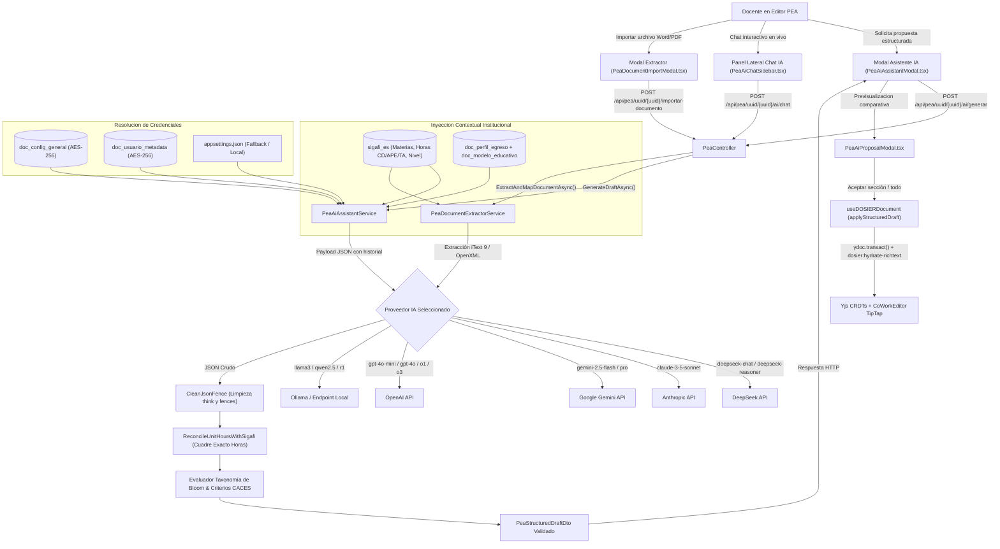

# Motor del Asistente Curricular de Inteligencia Artificial y Extractor Documental

## 1. Proposito y Alcance

El Motor del Asistente Curricular de Inteligencia Artificial de DOSIER proporciona soporte automatizado a los docentes en la estructuración, redacción y coherencia pedagógica del Programa de Estudio de la Asignatura (PEA). Su diseño arquitectónico es agnóstico a proveedores, permitiendo conectarse con cualquier modelo de lenguaje del mercado (DeepSeek, Google Gemini, OpenAI, Anthropic Claude, Groq, OpenRouter o modelos locales desplegados en Ollama/vLLM), garantizando en todo momento la protección criptográfica de las credenciales, el control del esfuerzo de razonamiento (`reasoning_effort`) y el cuadre matemático estricto con la carga horaria oficial del sistema académico SIGAFI.

Asimismo, integra un subsistema extractor desacoplado (`IPeaDocumentExtractorService`) que analiza sintácticamente documentos digitales preexistentes en formatos Microsoft Word (`.docx`) y Adobe PDF (`.pdf`), extrayendo unidades temáticas, horas, prácticas y bibliografía bajo el principio de fidelidad textual estricta.



---

## 2. Componentes del Backend

### 2.1. Bóveda Criptográfica de API Keys (`IDataProtectionProvider`)
Las credenciales de acceso a las APIs de inteligencia artificial se protegen mediante el subsistema criptográfico de ASP.NET Core (`IDataProtector`) con el propósito `Dosier.PeaAiAssistant.ApiKey.v1`.

- **Ámbito Global Institucional (`doc_config_general`)**: Claves administradas exclusivamente por usuarios con rol `DOSIER_ADMIN` (`AI_ASSISTANT_API_KEY`, `AI_ASSISTANT_PROVIDER`, `AI_ASSISTANT_MODEL`, `AI_ASSISTANT_BASE_URL`, `AI_ASSISTANT_REASONING_EFFORT`).
- **Ámbito Personal por Docente (`doc_usuario_metadata`)**: Almacenadas en la columna JSON `configuracion` bajo las claves `ai_api_key_protected`, `ai_provider`, `ai_model`, `ai_base_url` y `ai_reasoning_effort`.
- **Ámbito de Infraestructura (`appsettings.json`)**: Configuración directa sin persistencia en base de datos para entornos locales:
  ```json
  "AiAssistant": {
    "Provider": "deepseek",
    "Model": "deepseek-chat",
    "BaseUrl": "",
    "ApiKey": "",
    "ReasoningEffort": "medium"
  }
  ```

### 2.2. Agnosticismo de Proveedores y Control de Razonamiento
El servicio `PeaAiAssistantService` implementa adaptadores de protocolo para garantizar interoperabilidad con cualquier servicio de inferencia:

| Proveedor | Endpoint Base Predeterminado | Protocolo de Invocación | Modelos de Referencia |
| :--- | :--- | :--- | :--- |
| **DeepSeek** | `https://api.deepseek.com/chat/completions` | OpenAI Chat Completions | `deepseek-chat`, `deepseek-reasoner` |
| **OpenRouter** | `https://openrouter.ai/api/v1/chat/completions` | OpenAI Chat Completions | Claude, Llama 3, Mistral, Qwen |
| **Google Gemini** | `https://generativelanguage.googleapis.com` | Google Generative Language v1beta | `gemini-2.5-flash`, `gemini-2.5-pro` |
| **Anthropic** | `https://api.anthropic.com/v1/messages` | Anthropic Messages API (`x-api-key`) | `claude-3-5-sonnet-latest`, `claude-3-5-haiku` |
| **OpenAI** | `https://api.openai.com/v1/chat/completions` | OpenAI Chat Completions | `gpt-4o-mini`, `gpt-4o`, `o1`, `o3-mini` |
| **Groq** | `https://api.groq.com/openai/v1/chat/completions` | OpenAI Chat Completions | `llama-3.3-70b-versatile` |
| **Ollama** | `http://localhost:11434/v1/chat/completions` | OpenAI Chat Completions (sin auth obligatoria) | `llama3`, `qwen2.5`, `deepseek-r1` |
| **Custom** | URL configurable por el usuario | OpenAI Chat Completions | Cualquier modelo compatible |

* **Parámetro `ReasoningEffort` (`low` | `medium` | `high`):** Para modelos con cadena de pensamiento o inferencia extendida (OpenAI o1/o3, DeepSeek R1), el backend inyecta dinámicamente el parámetro de esfuerzo de razonamiento según la configuración del docente o la directiva institucional.

### 2.3. Resiliencia, Sanitización y Conversación Multi-Turno
1. **Limpieza Quirúrgica de Bloques `<think>`**: En modelos con cadena de pensamiento (DeepSeek R1, QwQ), la función `CleanJsonFence` remueve las explicaciones previas dentro de `<think>...</think>` y aísla el bloque JSON delimitado por `{ ... }`.
2. **Memoria Conversacional Continua (`PeaAiChatMessageDto`)**: El endpoint `POST /api/pea/uuid/{uuid}/ai/chat` y el generador admiten el arreglo `ConversationHistory`, permitiendo que el modelo recuerde ajustes previos solicitados en el chat lateral.
3. **Manejo de Fallback ante Error HTTP 400/422**: Si un modelo estricto rechaza parámetros auxiliares como `temperature` o `response_format`, el cliente reintenta de inmediato la solicitud en modo de payload mínimo garantizando continuidad operativa.

### 2.4. Reconciliación Matemática de Horas SIGAFI (CD, APE, TA)
La normativa institucional y de acreditación del CACES exige que las horas por componente de aprendizaje (Contacto Docente - CD, Aprendizaje Práctico Experimental - APE y Trabajo Autónomo - TA) cuadren de forma exacta con la malla curricular aprobada.

Cuando una asignatura en `detallemallas` de SIGAFI solo registra el total de horas (ej. 144) con componentes en cero, el motor calcula de manera automática una distribución equitativa en tercios normativos:
- $\text{Horas CD} = \lfloor \frac{\text{Horas Totales}}{3} \rfloor$
- $\text{Horas APE} = \lfloor \frac{\text{Horas Totales}}{3} \rfloor$
- $\text{Horas TA} = \text{Horas Totales} - \text{Horas CD} - \text{Horas APE}$

Posteriormente, la función `ReconcileUnitHoursWithSigafi` distribuye estas horas entre las 4 unidades temáticas mediante redondeo proporcional:
$$\text{Proporcional}_i = \text{round}\left( \frac{\text{HorasGeneradas}_i}{\sum \text{HorasGeneradas}} \times \text{HorasOficialesSIGAFI} \right)$$
El remanente acumulado se asigna a la última unidad temática, garantizando que:
$$\sum_{i=1}^{N} \text{HorasUnidad}_{i} \equiv \text{HorasMallaSIGAFI}$$

### 2.5. Evaluador de Taxonomía de Bloom y Criterios CACES
El motor analiza la validez pedagógica del borrador generado antes de retornarlo al cliente:
1. **Detección de Verbos de Bloom (`IsBloomVerbValid`, `BloomVerbDetected`):** Identifica el verbo de acción en infinitivo con el que inicia el objetivo formativo general y cada resultado de aprendizaje (ej. *Analizar*, *Diseñar*, *Evaluar*, *Implementar*), verificando su correspondencia con el nivel académico de la asignatura.
2. **Conformidad de Prácticas APE (`ArePracticesCompliant`):** Si la asignatura contempla horas prácticas, valida que la matriz contenga talleres o laboratorios con horas y escenarios asignados.
3. **Conformidad Bibliográfica APA (`IsBibliographyCompliant`):** Verifica que existan referencias básicas y complementarias con estructura formal y fecha de publicación.
4. **Notas de Cumplimiento (`ComplianceNotes`):** Si se detectan inconsistencias menores, el motor adjunta advertencias pedagógicas en el DTO para orientar al docente sin bloquear el borrador.

### 2.6. Motor Extractor Desacoplado (`PeaDocumentExtractorService`)
El procesamiento de archivos preexistentes está desacoplado del asistente generador en su propio servicio e interfaz especializada:
- **Servicio Backend**: `PeaDocumentExtractorService.cs` implementando `IPeaDocumentExtractorService`.
- **Ruta Oficial de Ingestión**: `POST /api/pea/uuid/{uuid}/importar-documento` (con alias `/ai/importar-archivo`).
- **Formatos Digitales Admitidos**:
  1. **PDF con Texto Digital (`.pdf`)**: Extracción nativa página por página mediante `iText 9` (`PdfTextExtractor` con `SimpleTextExtractionStrategy`).
  2. **Microsoft Word OpenXML (`.docx`)**: Descompresión nativa en memoria mediante `System.IO.Compression.ZipArchive` y recorrido jerárquico de `word/document.xml` con `XDocument`, extrayendo párrafos (`<w:p>`) y celdas de tablas curriculares (`<w:tbl>`, `<w:tr>`, `<w:tc>`).
- **Algoritmos Especializados de Sanitización de Tablas**:
  - `CleanContenidosOrphanNumbers`: Remueve numeraciones flotantes huérfanas derivadas de saltos de página en tablas curriculares.
  - `CompleteTruncatedUnitTitle`: Reconstruye títulos de unidades temáticas interrumpidos por celdas combinadas.
  - `SanitizeRedundantHeading`: Elimina encabezados duplicados redundantes mediante expresiones regulares.
- **Exclusión Determinista de Imágenes**: Rechaza cualquier archivo `.png`, `.jpg`, `.jpeg`, `.webp` o PDF escaneado sin texto seleccionable (menos de 50 caracteres alfanuméricos extraídos).
- **Principio de Fidelidad Textual:** El extractor opera estrictamente como analizador sintáctico (Parser) del texto subido. Las cabeceras institucionales de SIGAFI (nombre oficial de materia, código, horas, carrera) se mantienen inmutables y nunca son sobreescritas por el contenido del archivo.

---

## 3. Integración en el Frontend

### 3.1. Servicios Desacoplados (`peaAiService.ts` y `peaDocumentExtractorService.ts`)
- **`peaAiService.ts`**: Fachada para configuración de API Keys (`/api/pea/ai/config`), generación de borradores pedagógicos (`/api/pea/uuid/{uuid}/ai/generar`) y chat interactivo (`/api/pea/uuid/{uuid}/ai/chat`). Incluye la función de mapeo reactivo `convertDraftToEditorFields`.
- **`peaDocumentExtractorService.ts`**: Módulo especializado para la carga de archivos `multipart/form-data` y extracción de PEAs digitales (`/api/pea/uuid/{uuid}/importar-documento`).

### 3.2. Experiencia de Usuario en el Editor (`DOSIERBuilderShell.tsx`)
1. **"Importar PEA (PDF / Word)"** (icono `FileUp`): Abre `PeaDocumentImportModal.tsx` para docentes que desean migrar un sílabo preexistente con selección granular de secciones a poblar.
2. **"Autocompletar sección con IA"** (icono `Sparkles`): Abre `PeaAiAssistantModal.tsx` para redactar, proponer y pulir objetivos, unidades temáticas, actividades prácticas y evaluaciones.
3. **Modal de Propuesta Curricular (`PeaAiProposalModal.tsx`)**: Despliega una comparativa visual clara entre la propuesta de la IA y el estado actual del documento, permitiendo aceptar secciones individuales o el borrador integral.
4. **Chat Pedagógico en Barra Lateral (`PeaAiChatSidebar.tsx`)**: Asistente conversacional interactivo integrado en el menú derecho con historial contextual sobre la asignatura activa.
5. **Dropzone Rápido en `CollaborationSidebar.tsx`**: Zona de arrastre ampliada para cargar archivos `.pdf` o `.docx` directamente desde el panel lateral sin salir del lienzo.

### 3.3. Hidratación Atómica en Tiempo Real (`useDOSIERDocument.ts`)
La inyección de los datos generados o importados al editor concurrente se ejecuta en una sola transacción `ydoc.transact()` sobre los tipos compartidos de Yjs:
- Arreglos estructurados mediante `Y.Array` (`Unidades`, `Prerrequisitos`, `ActividadesPracticas`, `Evaluaciones`, `Bibliografias`).
- Textos planos mediante `Y.Text`.
- Editores enriquecidos TipTap (`Y.XmlFragment`): se limpia el fragmento previo y se emite el evento global `dosier:hydrate-richtext` para que los editores activos actualicen el contenido en caliente.
