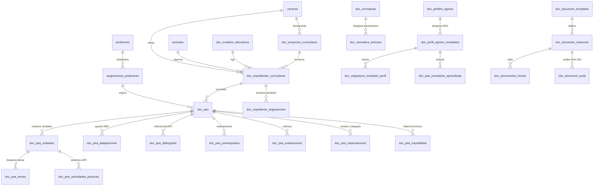

# Esquema Relacional de Base de Datos e Integración SIGAFI

## 1. Visión General del Modelo de Persistencia

La persistencia de **DOSIER** opera sobre el motor relacional **MariaDB 10.5+ / MySQL 8.0+** en la base de datos institucional **`sigafi_es`** (puerto `3306`), utilizando el cotejamiento estándar `utf8mb4_general_ci`.

El sistema implementa una arquitectura de persistencia desacoplada en dos fronteras netamente diferenciadas:
1. **Frontera SIGAFI (Solo Lectura Estricta):** Esquema transaccional preexistente del instituto. Provee catálogos de carreras (`WHERE esInstituto = 1`), períodos académicos, mallas por cohorte (`mallas_periodos`), distributivos y cargas docentes (`asignaciones_profesores`). DOSIER tiene prohibido alterar, insertar o eliminar registros en estas tablas, consumiéndolas exclusivamente con la directiva `.AsNoTracking()`.
2. **Esquema Curricular y Documental DOSIER (Lectura / Escritura con prefijo `doc_*`):** Tablas creadas y gobernadas exclusivamente por los 4 scripts oficiales en `scripts/base_datos/`, administrando el PEA institucional en sus 11 secciones, gobernanza curricular, expedientes de carrera, firmas electrónicas, bitácoras forenses inmutables y colaboración concurrente.

---

## 2. Mapa Relacional de la Arquitectura de Datos

---

## 3. Catálogo de Tablas de la Frontera SIGAFI (Solo Lectura)

| Tabla SIGAFI | Columnas Principales | Regla de Integración / Filtro Inviolable en DOSIER |
| :--- | :--- | :--- |
| `carreras` | `idCarrera`, `carrera`, `codigo`, `esInstituto` | Filtro estricto `WHERE esInstituto = 1` para aislar las carreras técnicas y tecnológicas del ISTPET y excluir a la Escuela de Conducción. |
| `periodos` | `idPeriodo`, `detalle`, `fecha_inicial`, `fecha_final`, `esInstituto`, `esConduccion`, `periodoactivoinstituto`, `activo` | Delimita los períodos académicos activos y vigentes del ISTPET. Se aplica filtro estricto `(esConduccion = 0 OR esConduccion IS NULL)` y la invariante de período activo único (`IPeriodoInstitucionalResolver`). |
| `profesores` | `idProfesor` (cédula), `nombres`, `apellidos`, `correo` | Registro oficial de la planta docente. Se utiliza para el JIT Provisioning en el sistema ID 6 y validación de autoría de firmas. |
| `mallas` | `idMalla`, `idCarrera`, `descripcion`, `codigoResolucion` | Mallas curriculares aprobadas institucionalmente. |
| `mallas_periodos` | `idMallaPeriodo`, `idMalla`, `idPeriodo` | Tabla pivote de resolución de cohorte curricular activa por período lectivo. |
| `detallemallas` | `idDetalleMalla`, `idMalla`, `idAsignatura`, `horasDocencia`, `horasApe`, `horasAutonomo`, `creditos` | Regla matemática inalterable de distribución horaria oficial según proyecto de carrera del CES. |
| `asignaturas` | `idAsignatura`, `asignatura`, `codigo` | Catálogo de asignaturas del plan de estudios. |
| `asignaciones_profesores` | `idAsignacion`, `idProfesor`, `idPeriodo`, `idAsignatura`, `idCarrera`, `paralelo`, `numeroHoras`, `horasPracticoExperimental`, `extraCurricular` | Carga horaria docente asignada. Es el punto de partida para instanciar el PEA. Mapea horas semanales de distributivo y discrimina actividades curriculares de cargas institucionales de acompañamiento (`extraCurricular = 1`). |

---

## 4. Capa Anticorrupción (ACL) y Resiliencia ante Inconsistencias de SIGAFI

Debido a que la base de datos `sigafi_es` es de solo lectura y su administración operativa depende de Secretaría Académica y Sistemas del instituto, DOSIER implementa mecanismos de resiliencia en la capa anticorrupción (`AcademicContextResolver`, `AsignaturasDocenteService` y `PeaService`):

1. **Resolución Jerárquica de Mallas Curriculares:**
   * Cuando un período lectivo (ej. `OCT2026`) no cuenta aún con registros en `mallas_periodos`, el sistema recurre automáticamente a la malla activa general de la carrera.
   * Si una asignatura asignada pertenece a una versión previa (cohorte superior en malla no activa), el motor busca automáticamente en cualquier malla histórica de esa carrera que contenga la asignatura y nivel, previniendo fallos de instanciación del PEA.
2. **Reconciliación de Horas en Tercios Normativos:**
   * Cuando en `detallemallas` una asignatura registra su total de horas (ej. 96 o 144) pero los componentes parciales reportan cero, el motor calcula de manera automática una distribución equitativa en tercios enteros:
     $$\text{CD} = \lfloor \frac{\text{Total}}{3} \rfloor, \quad \text{APE} = \lfloor \frac{\text{Total}}{3} \rfloor, \quad \text{TA} = \text{Total} - \text{CD} - \text{APE}$$
3. **Aislamiento de la Escuela de Conducción:**
   * Todas las consultas sobre períodos y carreras aplican filtros combinados sobre `esConduccion` y `esInstituto`, impidiendo que las asignaturas del sindicato o licencias profesionales contaminen el catálogo académico del instituto.

---

## 5. Esquema DOSIER (Escritura): Los 4 Scripts DDL Oficiales

La totalidad de tablas propias de DOSIER utilizan el prefijo obligatorio `doc_*` y son inicializadas por los 4 scripts oficiales en `scripts/base_datos/`:

### 5.1. `01_sistema_base.sql` (Núcleo Documental, CoWork y Auditoría)
* **Plantillas e Instancias:** `doc_document_templates`, `doc_documentos_instancias`, `doc_documento_secciones_metadata`.
* **CoWork Concurrente Yjs:** `doc_cowork_documentos` (persistencia dual de HTML, JSON y blob Yjs), `doc_cowork_updates`, `doc_cowork_sesiones`, `doc_collaboration_comments`.
* **Configuración y Metadatos:** `doc_usuarios_metadata` (bóveda criptográfica de IA y consentimientos de firma), `doc_config_general`.
* **Comunicaciones y Almacenamiento:** `doc_notificaciones`, `doc_email_historial`, `doc_email_plantillas`, `doc_backup_logs`.

### 5.2. `02_gobernanza_y_antecedentes_curriculares.sql` (Marco Institucional)
* **Normativa Externa y Modelos Educativos:** `doc_normativas`, `doc_normativa_articulos`, `doc_modelos_educativos`.
* **Proyectos de Carrera y Perfiles de Egreso:** `doc_proyectos_curriculares`, `doc_perfiles_egreso`, `doc_perfil_egreso_resultados`, `doc_asignatura_resultado_perfil` (matriz de tributación).
* **Expedientes de Carrera y Salas Sincronizadas:** `doc_expedientes_curriculares`, `doc_expediente_asignaciones`, `doc_autoridades_curriculares`.

### 5.3. `03_curriculum_pea_oficial.sql` (Las 11 Secciones Microcurriculares)
* **Entidad Raíz del PEA:** `doc_pea` (carátula, estado curricular, horas oficiales, flags de colaboración, avales y sellos).
* **Bloques Pedagógicos Normalizados:**
  - `doc_pea_unidades`: Unidades temáticas con horas por componente.
  - `doc_pea_temas`: Desglose pormenorizado de temas y subtemas.
  - `doc_pea_actividades_practicas`: Talleres, laboratorios y escenarios APE.
  - `doc_pea_adaptaciones`: Ajustes para estudiantes con necesidades educativas específicas (segregados por LOPDP).
  - `doc_pea_evaluaciones`: Matriz y momentos de evaluación diagnóstica, formativa y sumativa.
  - `doc_pea_bibliografia`: Referencias APA clasificadas en Básica, Consulta y Virtual.
  - `doc_pea_prerrequisitos`: Asignaturas antecedentes y simultáneas.
  - `doc_pea_observaciones`: Historial atómico de observaciones colegiadas por sección.
  - `doc_pea_trazabilidad`: Bitácora inmutable de transiciones de estado con hash SHA-256.

### 5.4. `04_seguridad_rbac_roles_curriculares.sql` (Seguridad y Firmas)
* **RBAC Institucional (Sistema ID 6):**
  - `rbac_rol`: Los 5 roles curriculares oficiales (`DOSIER_ADMIN`, `DOSIER_DOCENTE`, `DOSIER_COORD_CARRERA`, `DOSIER_COORD_ACAD`, `DOSIER_VICERRECTOR`).
  - `rbac_permiso` y `rbac_rol_permiso`: Las 16 políticas de permisos PBAC.
  - `rbac_usuario_rol`: Asignación de roles aislados a usuarios en el Sistema ID 6.
* **Firmas y Trazabilidad LOPDP:**
  - `doc_documentos_firmas`: Sellos DFRM y firmas PKCS#12 con marcas de revocación.
  - `doc_document_audit`: Registro forense de emisión documental con hash SHA-256.
  - `doc_audit_admin`: Bitácora administrativa con deltas JSON (`ValoresAnteriores` / `ValoresNuevos`).
  - `doc_lopdp_auditoria_datos`: Registro inalterable de acceso a datos sensibles.

---

## 6. Integridad Referencial y Orden de Eliminación en Cascada

Para garantizar consistencia y prevenir bloqueos de clave foránea en MySQL (`errno 1451 / 1452`):
1. **Sincronización en Dos Fases:**
   Al actualizar la estructura curricular en `PeaService`, el sistema purga primero los temas hijos en `doc_pea_temas` antes de sincronizar o eliminar unidades en `doc_pea_unidades`.
2. **Aislamiento de Identidad (`idUsuario` vs `idSigafi`):**
   Las claves foráneas hacia `usuarios(idUsuario)` requieren resolución numérica interna. El backend mapea el claim `"id_usuario"` con fallback al usuario resuelto por cédula antes de persistir cualquier registro en `doc_pea_trazabilidad` o `doc_audit_admin`.
3. **Inmutabilidad Post-Aprobación:**
   Cuando un PEA alcanza el estado `Aprobado`, las reglas de negocio a nivel de base de datos y de servicio impiden la ejecución de operaciones `DELETE` o `UPDATE` sobre el grafo microcurricular.
