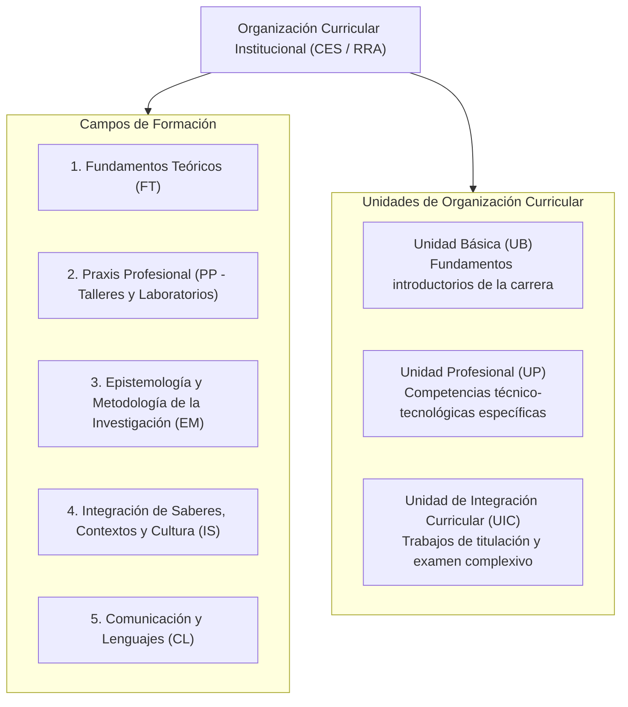
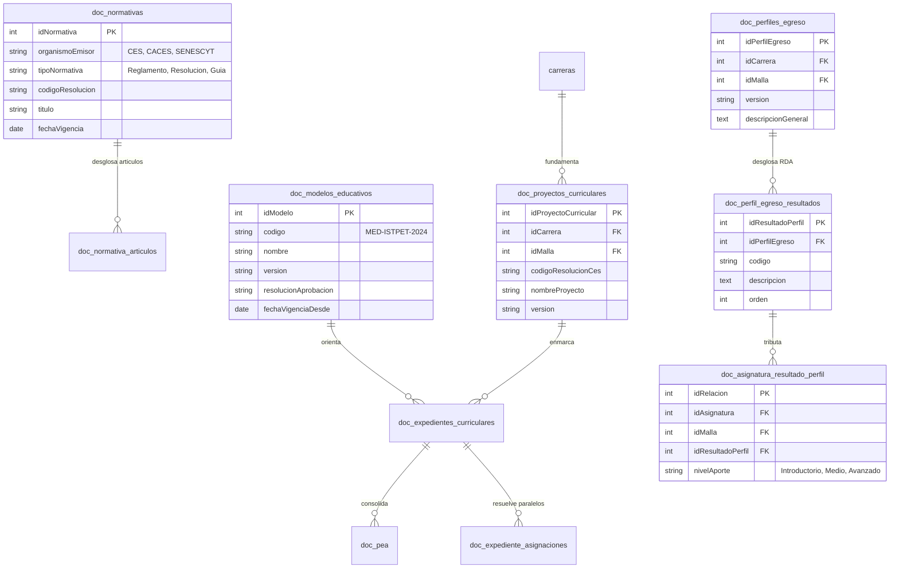

# Catálogos Institucionales y Normativa Curricular del Ecuador (CES / CACES / SENESCYT)

## 1. Marco Jurídico y Normativo de la Educación Superior Ecuatoriana

La plataforma **DOSIER** sustenta su motor de gobernanza microcurricular en el ordenamiento legal vigente para Institutos Superiores Técnicos y Tecnológicos en la República del Ecuador:

1. **Ley Orgánica de Educación Superior (LOES):** Mandato de pertinencia académica, libertad de cátedra responsable, articulación formativa y aseguramiento continuo de la calidad de los programas técnicos y tecnológicos.
2. **Reglamento de Régimen Académico (RRA - Consejo de Educación Superior CES):** Regula la estructura y organización del currículo, la distribución horaria de los componentes de aprendizaje (Art. 21), la definición de créditos académicos y las modalidades de estudio.
3. **Modelo de Evaluación y Acreditación de Institutos Superiores Técnicos y Tecnológicos (CACES):** Establece los criterios e indicadores normativos para la dimensión de docencia, coherencia microcurricular, portafolios de asignatura, rigor pedagógico y preservación de evidencias durante 10 años.
4. **Lineamientos Técnicos de la SENESCYT:** Normas operativas para la titulación técnica y tecnológica, codificación y registro institucional de mallas, y formulación de perfiles de egreso.

---

## 2. Campos de Formación y Unidades de Organización Curricular

El sistema categoriza cada asignatura de la malla institucional según las directrices establecidas por el Consejo de Educación Superior:

### Impacto de los Campos de Formación en la Planificación Docente:
* **Tipificación Pedagógica:** El campo de formación determina la proporción pedagógica recomendada entre horas teóricas de docencia, horas prácticas de taller/laboratorio (APE) y horas de trabajo autónomo.
* **Coherencia con el Perfil de Egreso:** En la formulación del PEA (Sección d y e), cada Resultado de Aprendizaje de la Asignatura (RDA) debe articularse a las competencias declaradas en el proyecto de carrera aprobado por el CES.

---

## 3. Componentes de Aprendizaje y Validación Matemática de Créditos

Conforme al Artículo 21 del Reglamento de Régimen Académico del CES, el sistema implementa la regla matemática determinista e inalterable para la equivalencia de créditos y balance de carga horaria:

$$\text{Total Horas Asignatura} = \text{Horas Docencia (CD)} + \text{Horas Práctico-Experimental (APE)} + \text{Horas Trabajo Autónomo (TA)}$$

$$\text{Créditos Académicos} = \frac{\text{Total Horas Asignatura}}{48}$$

### 3.1. Desglose Normativo de Componentes

| Componente de Aprendizaje | Siglas | Definición Normativa CES | Validación Automatizada en DOSIER |
| :--- | :--- | :--- | :--- |
| **Aprendizaje en Contacto con el Docente** | CD | Actividades sincrónicas o presenciales, conferencias, seminarios, clases magistrales y talleres guiados. | Verifica que la suma en las unidades temáticas coincida exactamente con las horas registradas en `detallemallas.horasDocencia`. |
| **Aprendizaje Práctico-Experimental** | APE | Actividades prácticas en talleres, laboratorios, simulaciones y escenarios de práctica tecnológica. | Verifica que la matriz de prácticas de la Sección g cubra la totalidad de horas de `detallemallas.horasApe`. |
| **Aprendizaje Autónomo** | TA | Horas dedicadas por el estudiante a la lectura, investigación formativa, resolución de problemas y proyectos. | Verifica que la suma de horas autónomas en las unidades coincida con `detallemallas.horasAutonomo`. |

---

## 4. Estructura Relacional de Gobernanza Curricular (`02_gobernanza_y_antecedentes_curriculares.sql`)

El script oficial `02_gobernanza_y_antecedentes_curriculares.sql` despliega el repositorio de articulación entre la normativa externa y los antecedentes institucionales del ISTPET:

### 4.1. Repositorio de Normativas (`doc_normativas` y `doc_normativa_articulos`)
Permiten a las comisiones curriculares y evaluadores del CACES referenciar legalmente cada componente del PEA. Cuando un auditor inspecciona una asignatura, el sistema expone la resolución del CES que habilitó la carrera y el articulado aplicable del Reglamento de Régimen Académico.

### 4.2. Filosofía Pedagógica (`doc_modelos_educativos`)
Registra la evolución institucional del Modelo Educativo del ISTPET, asegurando que las metodologías seleccionadas por el docente (clase invertida, aprendizaje basado en proyectos, simulación clínica o talleres tecnológicos) concuerden con el modelo pedagógico oficial vigente en el período lectivo.

### 4.3. Matriz de Tributación Curricular (`doc_perfiles_egreso` y `doc_asignatura_resultado_perfil`)
Estructura la articulación formal de competencias. Al formular el PEA, el docente vincula los Resultados de Aprendizaje de la Asignatura (RDA) contra los resultados institucionales del perfil de egreso, definiendo el nivel de aporte disciplinar:
* `'Introductorio'`: Asignaturas de niveles iniciales que sientan las bases conceptuales.
* `'Medio'`: Asignaturas de aplicación profesional y talleres tecnológicos intermedios.
* `'Avanzado'`: Asignaturas terminales y proyectos de integración curricular (UIC).

---

## 5. El Expediente Curricular Maestro (`DocExpedienteCurricular`)

Como entidad integradora central, `DocExpedienteCurricular` consolida en un único registro relacional:
1. El marco del Proyecto de Carrera aprobado por el CES (`IdProyectoCurricular`).
2. El Perfil de Egreso y su matriz de competencias (`IdPerfilEgreso`).
3. El Modelo Educativo vigente en el período lectivo (`IdModeloEducativo`).
4. La oferta académica y distributivo de SIGAFI (`IdCarrera`, `IdMalla`, `IdAsignatura`, `IdPeriodo`, `IdDocenteResponsable`).
5. La resolución de paralelos múltiples asignados a distintos docentes (`doc_expediente_asignaciones`).
6. El estado y metadatos de las **Salas Curriculares de Carrera en Tiempo Real** (`SalaColaborativaActiva`, `SalaSesionMetadataJson`), permitiendo comités de armonización curricular con sincronización concurrente Yjs.
