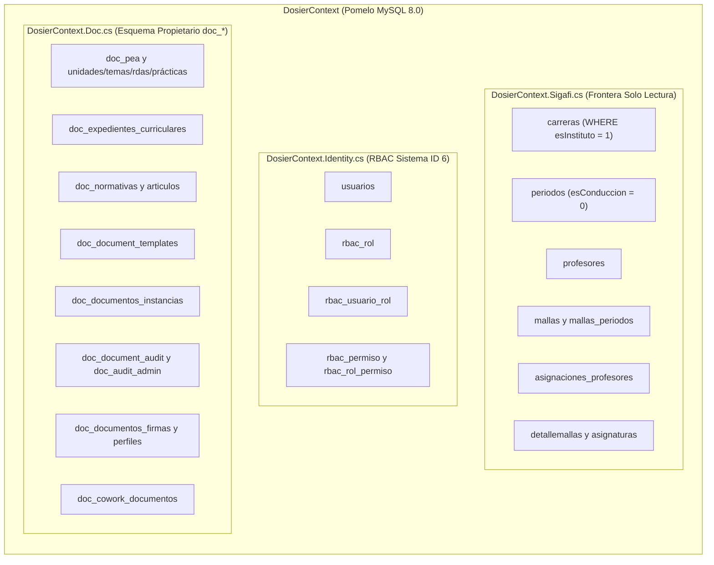
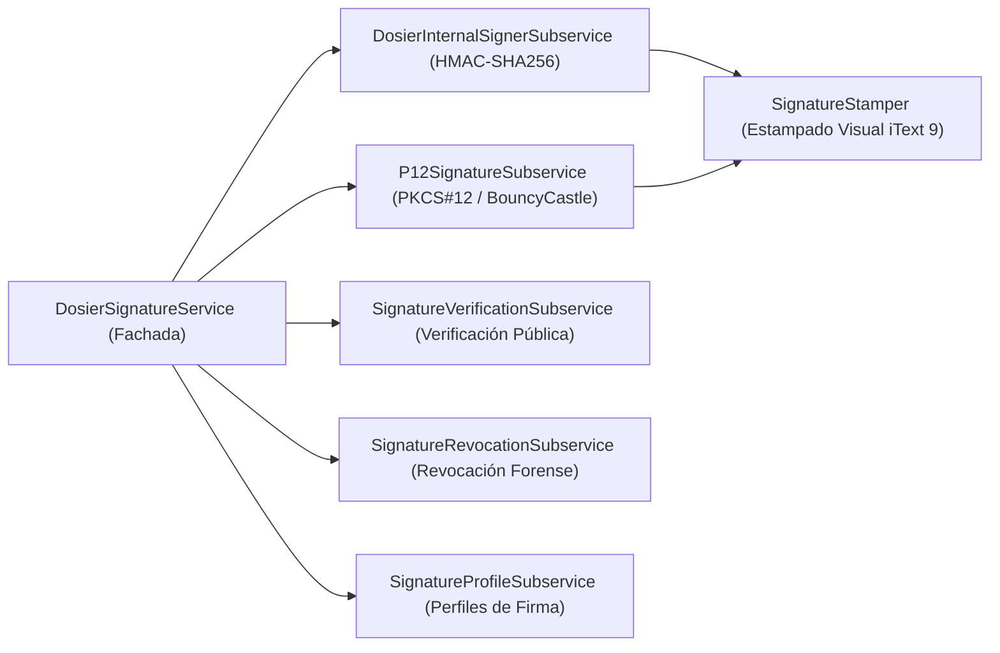

# Infraestructura de Persistencia, EF Core y Repositorios (Infrastructure Layer)

## 1. Visión General de la Capa de Infraestructura

La capa de infraestructura (`dosier_infrastructure`) implementa los contratos de servicio, repositorios y abstracciones definidos en `dosier_application`, gestionando la comunicación de bajo nivel con los recursos tecnológicos externos del sistema **DOSIER**:

* **Motor de Persistencia Relacional:** **Entity Framework Core 9** con el proveedor optimizado **Pomelo.EntityFrameworkCore.MySql** sobre la base de datos `sigafi_es` (MySQL 8.0 / MariaDB 10.5+, puerto 3306), con resiliencia transitoria (`EnableRetryOnFailure`) y división de consultas (`SplitQuery`).
* **Hub en Tiempo Real:** **SignalR Core** (`CollaborationHub` y `NotificationHub`) para la co-redacción concurrente de asignaturas mediante CRDTs (Yjs) con compresión `GZip`.
* **Motor Documental y Compilación PDF:** **Handlebars.Net** (`HandlebarsTemplateEngine`) para la interpolación dinámica e **iText 9** (`iText.Html2pdf` e `iText.Kernel`) para el renderizado vectorial y estampado forense.
* **Criptografía y Firmas Digitales:** Servicio de firma institucional HMAC-SHA256 y certificados digitales avanzados **PKCS#12 (.p12 / FirmaEC)** con BouncyCastle.
* **Servicios de Comunicación:** WebSockets in-app (`SignalRDriver`) y despachador de correo institucional transaccional (`EmailDriver` y `EmailSenderSubservice`).

---

## 2. Arquitectura Modular del Contexto de Datos: `DosierContext`

El acceso a datos se centraliza en `DosierContext` (`backend/dosier_infrastructure/data/models/Dosier/DosierContext.cs`), estructurado mediante cuatro archivos parciales (`partial class`) que segregan las responsabilidades del modelo relacional:

### 2.1. Desglose de los 4 Archivos Parciales de `DosierContext`

1. **`DosierContext.cs`:**
   Declara los `DbSet<T>` institucionales y propietarios, el constructor con `DbContextOptions<DosierContext>` y los métodos de ciclo de vida transaccional.
2. **`DosierContext.Sigafi.cs` (`OnModelCreatingSigafi`):**
   * Mapea las tablas preexistentes de SIGAFI consumidas en modo de solo lectura.
   * Aplica filtros globales de consulta para aislar las carreras del ISTPET (`carreras.esInstituto = 1`), excluyendo a la Escuela de Conducción.
   * Mapea la resolución de mallas por cohorte (`mallas_periodos`) y distributivos docentes (`asignaciones_profesores`).
3. **`DosierContext.Identity.cs` (`OnModelCreatingIdentity`):**
   * Mapea el subsistema de identidad en las tablas institucionales `usuarios`, `rbac_rol` y `rbac_usuario_rol`.
   * Restringe la resolución de roles al identificador de sistema institucional `idSistema = 6` de DOSIER.
   * Mapea columnas `DateOnly` para interoperabilidad nativa con columnas `DATE` de MySQL.
4. **`DosierContext.Doc.cs` (`OnModelCreatingDosier`):**
   * Registra las configuraciones de entidad Fluent API independientes (`Configurations/Doc*Configuration.cs`) para las tablas del esquema `doc_*`.
   * Define llaves foráneas, índices únicos en columnas `uuid` y políticas de integridad referencial (`ON DELETE RESTRICT` / `CASCADE` según criticidad pedagógica).

---

## 3. Implementación de Servicios Curriculares Transaccionales

### 3.1. Motor Curricular del PEA (`Curriculum/PeaService.cs`)

`PeaService` gestiona la persistencia atómica y el ciclo de vida de las 11 secciones del microcurrículo:

* **Instanciación desde Asignación SIGAFI (`CrearDesdeAsignacionAsync`):**
  1. Invoca `IAcademicContextResolver` para consultar la asignación docente en SIGAFI.
  2. Extrae las horas oficiales de docencia (CD), prácticas (APE) y trabajo autónomo (TA), calculando automáticamente los créditos correspondientes (Art. 21 RRA).
  3. Crea el registro en `doc_pea` con `Version = 1` y estado `Borrador`.
  4. Crea o vincula el `DocExpedienteCurricular` correspondiente a la asignatura y período lectivo.
* **Persistencia Atómica y Supresión en Dos Fases (`GuardarPeaAsync`):**
  1. Inicia una transacción explícita (`using var transaction = await _context.Database.BeginTransactionAsync()`).
  2. Ejecuta la validación matemática de balance: la suma de horas de las unidades didácticas debe cuadrar exactamente con el total de horas de la asignatura registrado en la malla.
  3. Purga primero los temas dependientes en `doc_pea_temas` antes de sincronizar unidades en `doc_pea_unidades`, eliminando bloqueos de clave foránea (`errno 1451`).
  4. Sincroniza en cascada unidades, temas, RDAs, actividades prácticas, bibliografía normalizada en APA y criterios de evaluación.
  5. Confirma la transacción con `await transaction.CommitAsync()`.
* **Máquina de Estados y Trazabilidad Criptográfica (`CambiarEstadoAsync`):**
  1. Valida que la transición solicitada cumpla el circuito curricular colegiado (`Borrador` $\to$ `EnRevision` $\to$ `RevisadoCoord` $\to$ `RevisadoAcad` $\to$ `Aprobado`).
  2. Calcula el hash SHA-256 sobre el contenido pedagógico completo.
  3. Inserta un registro inmutable en `doc_pea_trazabilidad` con estado anterior, nuevo, usuario actor y hash de integridad.

### 3.2. Capa Anticorrupción de Solo Lectura (`Academico/AcademicContextResolver.cs`)

* Ejecuta consultas optimizadas con `.AsNoTracking()` sobre `asignaciones_profesores`, uniendo con `carreras`, `periodos`, `mallas_periodos`, `detallemallas` y `asignaturas`.
* Garantiza que los datos maestros provengan exclusivamente de SIGAFI y no puedan ser manipulados por clientes HTTP. Cualquier discrepancia entre la carga del docente y la malla se registra en la lista de advertencias del DTO de contexto.

---

## 4. Motor de Co-Redacción Concurrente (`Collaboration/CollaborationHub.cs`)

Provee la infraestructura de concurrencia en tiempo real sobre WebSockets para docentes co-diseñadores:

* **Punto de Enlace:** Mapeado en `/hubs/collaboration`.
* **Sincronización CRDT (Yjs):** Recibe deltas binarios de actualización Yjs y los retransmite a los demás colaboradores del canal mediante `Clients.OthersInGroup(docGroup).SendAsync("ReceiveUpdate", update)`.
* **Compresión GZip (`GZipHelper.cs`):** Comprime y descomprime en memoria los deltas transmitidos por la red, optimizando la latencia y reduciendo el consumo de ancho de banda hasta en un 85%.
* **Persistencia Periódica:** Los deltas se consolidan periódicamente en la tabla `doc_cowork_documentos` con almacenamiento dual (HTML para compilación PDF y binario Yjs para reconstrucción concurrente).

---

## 5. Subsistema Criptográfico y Motor de Firma Digital (`Signatures/`)

Implementa el patrón de diseño Fachada a través de `DosierSignatureService`, coordinando 5 subservicios especializados:

* **Firma Institucional DOSIER:** Emite código de trazabilidad único con formato `DFRM-{AÑO}-{UUID8}`, calcula la prueba criptográfica HMAC-SHA256 y persiste el registro en `doc_documentos_firmas` con estado válido.
* **Firma PKCS#12 (.p12 / FirmaEC):** Valida la vigencia temporal y cadena de confianza del certificado X.509 utilizando BouncyCastle, aplicando la firma PAdES sobre el documento.
* **Estampado Visual iText 9 (`SignatureStamper.cs`):** Adapta la geometría visual del sello a la matriz de 4 firmas de la Sección k (`94.0 pt` $\times$ `44.0 pt`) o bloque horizontal estándar (`190.0 pt` $\times$ `55.0 pt`), incrustando código QR de verificación pública sin sesión.

---

## 6. Motor Documental y Purga Forense de Almacenamiento (`Common/Documents/`)

### 6.1. Pipeline de Compilación (`DocumentEngine.cs`)
* **Interpolación con Handlebars.Net (`HandlebarsTemplateEngine`):** Normaliza colecciones pedagógicas, genera tablas editoriales de contenidos y sanitiza encabezados redundantes.
* **Compilación a PDF con iText 9 (`ITextHtmlPdfRenderer`):** Convierte el HTML enriquecido a PDF vectorial, controlando numeración dinámica (`Página X de Y`) y directivas anti-huérfanos mediante `DocumentEventHandler`.
* **Registro Forense:** Inserta la emisión en `doc_document_audit` con el snapshot de datos y el hash SHA-256 del archivo.

### 6.2. Diagnóstico y Purga de Binarios Obsoletos (`DocumentInstanceService.cs`)
* **`GetObsoleteDocumentDiagnosisAsync`:** Detecta documentos generados con versiones obsoletas de plantillas maestras.
* **`PurgeObsoleteFileByUuidAsync` / `PurgeAllObsoleteDocumentFilesAsync`:**
  - Elimina físicamente los archivos PDF obsoletos del disco en el servidor para liberar almacenamiento.
  - **Principio de Custodia Forense CACES:** El registro en base de datos no se elimina; la columna `IsFilePurged` se establece en `true`, registrando la fecha (`PurgedAt`) y el operador (`PurgedBy`), conservando intactos el hash SHA-256 original y la bitácora de auditoría.

---

## 7. Notificaciones y Comunicación Multicanal (`Common/Notifications/`)

* **`NotificationService.cs`:** Distribuidor unificado que registra alertas en `doc_notificaciones` y las despacha a los drivers registrados.
* **`SignalRDriver.cs`:** Transmisión inmediata vía WebSockets hacia `/hubs/notifications` al grupo del usuario (`User_{idUsuario}`).
* **`EmailDriver.cs`:** Encola correos en `doc_email_historial` tras renderizar el mensaje con membrete institucional en `EmailMasterLayoutRenderer.cs`.
* **`EmailBackgroundProcessorService.cs`:** Procesa la cola en segundo plano enviando correos mediante SMTP seguro institucional (`EmailSenderSubservice.cs`).
