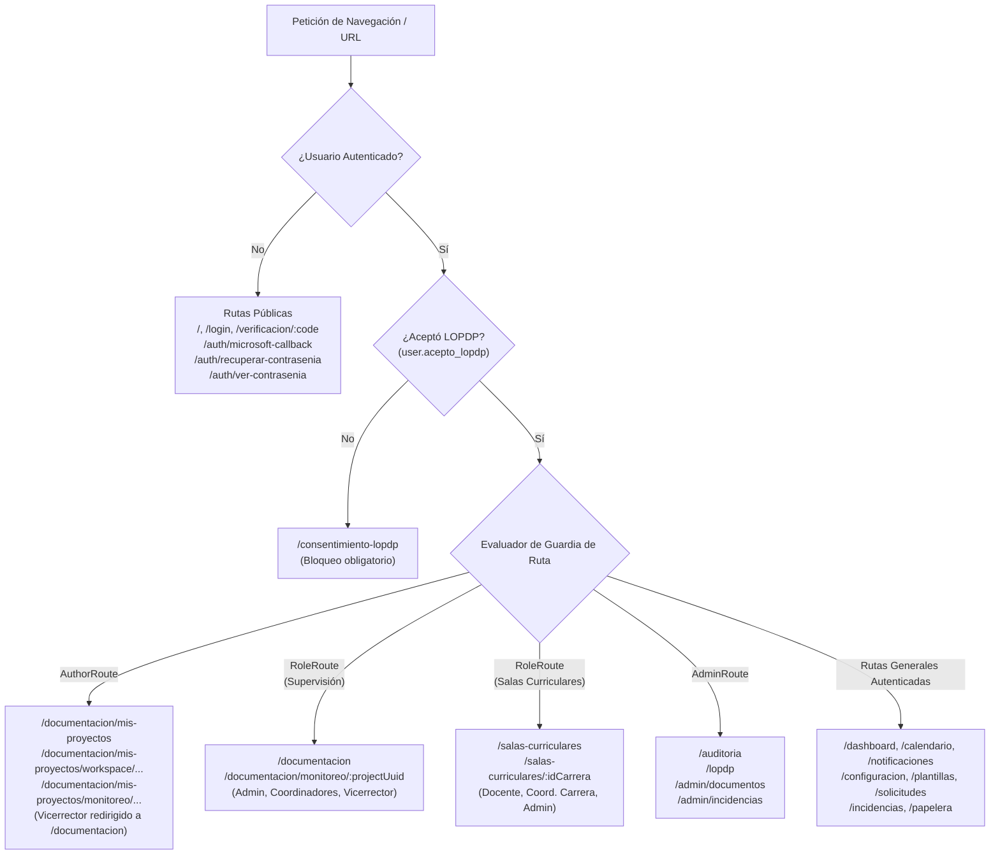

# Arquitectura Frontend Web (React 19 + Vite + TypeScript)

## 1. Visión General y Definición Canónica

El cliente web de DOSIER (`dosier_web`) adopta de manera estricta la arquitectura **Feature-Based Modular SPA con Service Layer**. Esta arquitectura organiza el código por dominios funcionales, desacopla la infraestructura de red mediante fachadas de servicios tipadas y delega los requerimientos de co-edición y gobernanza documental a dos motores de infraestructura ubicados en `src/core/`.

### Stack Tecnológico Oficial

* **Librería Base:** React 19 (`^19.2.5`) con TypeScript (`~6.0.2`).
* **Enrutamiento:** React Router v7 (`^7.14.1`) con carga diferida (`React.lazy` y `Suspense`).
* **Empaquetador y Servidor Local:** Vite 8 (`^8.0.9`) con `@vitejs/plugin-react` (`^6.0.1`) y plugin nativo `@tailwindcss/vite` (`^4.2.2`).
* **Estilos y Sistema Visual:** Tailwind CSS v4 integrado con variables semánticas en `src/styles/base.css`.
* **Lenguaje Visual Institucional:** **Modern Enterprise Docs System**, inspirado en la estética técnica de Stripe Docs, Linear y Mintlify. Utiliza tipografía **Inter Puro** (`@fontsource-variable/inter`) con características OpenType documentales (`cv02`, `cv03`, `cv04`, `cv11`), acento corporativo azul técnico `#0070f3`, navegación sobre riel plano continuo y delimitación estricta de folios curriculares.
* **Colaboración Concurrente:** Motor CRDT en tiempo real basado en Yjs (`^13.6.30`), Tiptap 3 (`3.31.3`) y cliente WebSockets de `@microsoft/signalr` (`^10.0.0`).
* **Validación y Formularios:** React Hook Form (`^7.72.1`) junto con Zod (`^4.3.6`) y `@hookform/resolvers`.
* **Entorno de Pruebas:** Vitest (`^4.1.11`) junto con `@testing-library/react` (`^16.3.2`).

> [!IMPORTANT]
> **Mandato Universal de Modern Enterprise Docs:**
> Este estándar visual aplica de forma rigurosa en todas las pantallas del sistema: Dashboards de los 5 roles institucionales, Workspace del PEA, Editor de Plantillas, Salas Curriculares, Calendario, Usuarios, Auditoría, Correos, Analíticas, Notificaciones, Solicitudes, Incidencias y Configuración. No se permiten componentes decorativos superfluos, elementos de marketing, segmented controls tipo iOS/macOS ni bordes de acento estilo callout.

> [!IMPORTANT]
> **El Motor Documental (`core/documents/`) NO es el centro de la arquitectura:**
> Es un motor de infraestructura auxiliar, análogo al motor de colaboración (`core/cowork/`). El centro del negocio es el dominio curricular: el flujo de elaboración, revisión y aprobación del PEA del ISTPET con su ciclo de vida institucional (Borrador -> EnRevision -> RevisadoCoord -> RevisadoAcad -> Aprobado). Los motores en `core/` están al servicio de ese dominio y no lo gobiernan.

---

## 2. Regla Cardinal de Diseño Visual: Cero Transparencias y Fondos 100% Sólidos

Por directriz de diseño institucional y usabilidad técnica, el frontend implementa la siguiente norma obligatoria:

* Todos los modales (`src/pages/Dashboard/Roles/Modals/`, modales de confirmación, etc.), popovers, menús desplegables (`GeistSelect`), selectores de fecha (`GeistDatePicker`), drawers, tooltips y paneles de diálogo deben poseer fondos **100% sólidos y opacos**.
* **Modo Claro:** Fondo sólido `bg-white` (`#ffffff`) sobre lienzo documental `#f1f3f6`. Cabeceras y pies en `bg-zinc-50`.
* **Modo Oscuro:** Fondo sólido `bg-[#131720]` o `bg-[#0b0e14]`. Cabeceras y pies en `bg-zinc-900`.
* Queda terminantemente prohibido el uso de clases translúcidas con opacidades intermedias (tales como `bg-white/80`, `bg-black/60` o `backdrop-blur-md` sin color de fondo pleno) en elementos de interacción, a fin de evitar el sangrado de texto (*text bleed-through*) y la contaminación visual de elementos subyacentes.

---

## 3. Estructura de Directorios del Código Fuente (`dosier_web/src/`)

La estructura física del frontend refleja la separación estricta de responsabilidades:

```text
dosier_web/src/
├── api/                   # Cliente Axios configurado, interceptores JWT, serialización snake_case y contextos globales
│   ├── api.ts             # Instancia principal de Axios y configuración de baseURL
│   ├── AuthContext.tsx    # Contexto global de autenticación, JWT y roles RBAC
│   ├── ConfirmContext.tsx # Proveedor de diálogos de confirmación modales opacos
│   └── NotificationsContext.tsx # Proveedor de alertas y notificaciones SignalR
├── components/            # Componentes de interfaz de usuario organizados por ámbito
│   ├── Common/            # Modales opacos, GeistSelect, GeistDatePicker, FullscreenLoader, botones Geist
│   ├── DOSIER/            # Componentes específicos del PEA oficial
│   │   ├── sections/      # Renderers y editores de las secciones oficiales (Secciones A a K)
│   │   └── shell/         # DOSIERBuilderShell, Stepper curricular de avance y cabecera de documento
│   ├── Feedback/          # Modales y formularios de retroalimentación de usuarios
│   ├── Layout/            # DashboardLayout, Sidebar institucional, Header, Help, WelcomeModal
│   └── Notifications/     # Feed documental continuo de alertas y eventos
├── core/                  # Motores de infraestructura desacoplados del negocio
│   ├── cowork/            # Motor de concurrencia CRDT (Yjs) sobre SignalR WebSockets
│   │   ├── components/    # <CoWorkField>, indicadores de presencia de usuarios y cursores remotos
│   │   ├── extensions/    # Extensiones Tiptap para colaboración y comentarios en línea
│   │   ├── hooks/         # useCoWork, useSignalRCollab
│   │   ├── transport/     # Proveedor de transporte WebSockets hacia /collabHub
│   │   └── utils/         # Serializadores y utilidades binarias Yjs (lib0)
│   ├── documents/         # Motor documental de plantillas desacopladas
│   │   ├── context/       # DocumentContext y DocumentInstanceContext
│   │   ├── hooks/         # useDocumentInstance, useTemplateSchema
│   │   └── registry/      # DocumentTemplateRegistry (JSON puro) y DocumentComponentRegistry
│   └── events/            # Bus de eventos desacoplado para sincronización interna
├── hooks/                 # Custom React Hooks compartidos (useBreakpoint, useCanEditPea, useDebounce)
├── pages/                 # Vistas del enrutador de React (enrutadas en App.tsx)
│   ├── Admin/             # Consola de administración: UsersPage, AuditPage, DocumentMaintenancePage,
│   │                      # DocumentTemplatesPage, EmailEnginePage, AdminFeedbackPage
│   ├── Analytics/         # Métricas institucionales, cumplimiento CACES y cobertura curricular
│   ├── Auth/              # Vistas auxiliares de acceso (ResetAlertPage)
│   ├── Calendario/        # Calendario académico ISTPET y fechas límite de entrega
│   ├── Curriculum/        # Vistas de gestión curricular: MisAsignaturasPage, SupervisionCurricularPage,
│   │                      # RevisionCurricularPage, MonitoreoCurricularPage, SalaCarreraPage, Workspace/
│   ├── Dashboard/         # Tablero principal adaptativo según los 5 roles del sistema
│   ├── Feedback/          # Portal de incidencias del docente (UserFeedbackPage)
│   ├── Landing/           # Página institucional pública
│   ├── Login/             # Formulario de autenticación local, MicrosoftCallback, recuperación de claves
│   ├── Lopdp/             # Gestión de consentimientos LOPDP (LopdpConsentPage, LopdpAdminPage)
│   ├── Notificaciones/    # Bandeja unificada de notificaciones institucionales
│   ├── Public/            # Verificación forense pública de autenticidad documental vía código QR
│   ├── RecycleBin/        # Papelera de reciclaje y recuperación de registros eliminados lógicamente
│   ├── Settings/          # Preferencias del usuario y parámetros normativos institucionales
│   └── Solicitudes/       # Bandeja de trámites y solicitudes docentes
├── services/              # Capa de abstracción REST (Service Layer) con fachadas tipadas hacia la API
├── styles/                # base.css con tokens HSL, directrices de diseño Geist y utilidades semánticas
├── test/                  # Configuración de Vitest y utilidades de renderizado para pruebas unitarias
├── utils/                 # Funciones auxiliares de formateo de fechas, sanitización DOMPurify y algoritmos
├── App.tsx                # Definición central de rutas, guardias RBAC y enrutador de React
├── index.css              # Importación de fuentes tipográficas y estilos base globales
└── main.tsx               # Punto de entrada de la aplicación React en el DOM
```

---

## 4. Enrutamiento y Control de Acceso por Roles (RBAC)

El enrutamiento se gestiona centralizadamente en `src/App.tsx` utilizando **React Router v7** con carga diferida (`React.lazy`) y renderizado condicional con guardias especializados:



### 4.1. Catálogo de Guardias de Seguridad

1. **`ProtectedRoute`:** Verifica que exista una sesión activa válida. Si el usuario no ha aceptado los términos de la Ley Orgánica de Protección de Datos Personales (`user?.acepto_lopdp === false`), lo redirige obligatoriamente a `/consentimiento-lopdp`. Si el usuario ya aceptó y trata de reingresar al formulario de consentimiento, lo redirige automáticamente a `/dashboard`.
2. **`AuthorRoute`:** Controla el acceso a las rutas donde se elaboran asignaturas y documentos propios (`/documentacion/mis-proyectos/*`). Aplica la regla institucional estricta: **el Vicerrector no redacta documentos curriculares**, por lo que cualquier intento de acceso por parte de este rol es redirigido a `/documentacion` (bandeja de supervisión institucional).
3. **`RoleRoute`:** Evalúa el rol activo o efectivo (`activeRole` o roles asignados en el token JWT). Maneja la exclusión institucional del Vicerrector de las salas curriculares de carrera (`/salas-curriculares`). Admite el valor especial `'ANY'` para permitir el acceso a cualquier usuario autenticado (por ejemplo, en el catálogo de plantillas oficiales).
4. **`AdminRoute`:** Restringe el acceso exclusivamente a usuarios con rol `DOSIER_ADMIN`. Si no se cumple la condición, redirige a `/dashboard`.
5. **`PermissionRoute`:** Verifica permisos granulares por módulo y código de operación mediante el método `hasPermission(module, op)`.
6. **`AuthenticatedRedirect`:** Se utiliza en rutas públicas (`/`, `/login`) para redirigir a `/dashboard` a usuarios que ya cuentan con una sesión activa.

### 4.2. Matriz Exhaustiva de Rutas en el Cliente Web (`App.tsx`)

| Ruta Frontend | Guardia / Acceso | Componente Asociado | Funcionalidad Operativa |
| :--- | :--- | :--- | :--- |
| `/` | `AuthenticatedRedirect` | `Landing` | Presentación institucional pública del sistema. |
| `/login` | `AuthenticatedRedirect` | `Login` | Acceso con credenciales locales o inicio de flujo Microsoft 365. |
| `/auth/microsoft-callback` | Público | `MicrosoftCallback` | Procesamiento del token OAuth de Microsoft Azure AD. |
| `/auth/recuperar-contrasenia` | Público | `RecuperarContrasenia` | Solicitud de restablecimiento de contraseña institucional. |
| `/auth/ver-contrasenia` | Público | `VerContrasenia` | Validación de token y cambio definitivo de contraseña. |
| `/auth/reestablecer-alerta` | Público | `ResetAlertPage` | Pantalla informativa de restablecimiento forzado de credenciales. |
| `/consentimiento-lopdp` | `ProtectedRoute` | `LopdpConsentPage` | Aceptación obligatoria del consentimiento informado LOPDP. |
| `/dashboard` | `ProtectedRoute` | `Dashboard` | Tablero principal con métricas, accesos y acciones según rol. |
| `/calendario` | `ProtectedRoute` | `CalendarioPage` | Cronograma de actividades académicas y plazos del PEA. |
| `/papelera` | `ProtectedRoute` | `RecycleBinPage` | Visualización y restauración de registros en borrado lógico. |
| `/configuracion` | `ProtectedRoute` | `SettingsPage` | Ajustes de cuenta, perfil, firmas y parámetros normativos. |
| `/settings` | `ProtectedRoute` | Redirección | Redirige de forma permanente a `/configuracion`. |
| `/parametros-normativos` | `ProtectedRoute` | Redirección | Redirige a `/configuracion?tab=parametros`. |
| `/lopdp` | `AdminRoute` | `LopdpAdminPage` | Supervisión de consentimientos y atención de derechos ARCO. |
| `/analiticas` | `RoleRoute` (`ADMIN`, `COORD_CARRERA`, `COORD_ACAD`, `VICERRECTOR`) | `AnalyticsPage` | Indicadores de avance curricular y acreditación CACES. |
| `/notificaciones` | `ProtectedRoute` | `NotificationsPage` | Feed unificado de alertas y avisos en tiempo real. |
| `/usuarios` | `RoleRoute` (`ADMIN`, `COORD_ACAD`, `VICERRECTOR`) | `UsersPage` | Administración de usuarios, asignación de roles y estados. |
| `/auditoria` | `AdminRoute` | `AuditPage` | Registro forense de auditoría de transacciones del sistema. |
| `/emails` | `RoleRoute` (`ADMIN`, `COORD_ACAD`, `VICERRECTOR`) | `EmailEnginePage` | Plantillas de correo, eventos de notificación y pruebas SMTP. |
| `/admin/documentos` | `AdminRoute` | `DocumentMaintenancePage` | Mantenimiento y depuración de instancias documentales. |
| `/plantillas` | `RoleRoute` (`ANY`) | `DocumentTemplatesPage` | Catálogo de formatos oficiales para docentes o editor para directivos. |
| `/formatos`, `/formatos-oficiales`, `/templates`, `/admin/plantillas` | `ProtectedRoute` | Redirección | Redirigen de forma transparente a `/plantillas`. |
| `/solicitudes`, `/solicitud` | `ProtectedRoute` | `SolicitudesPage` | Gestión de solicitudes académicas y curriculares docentes. |
| `/incidencias`, `/feedback`, `/sugerencias` | `ProtectedRoute` | `FeedbackRouteDispatcher` | Despachador de incidencias: `AdminFeedbackPage` o `UserFeedbackPage`. |
| `/admin/incidencias` | `AdminRoute` | `AdminFeedbackPage` | Gestión centralizada de reportes e incidencias técnicas. |
| `/mis-incidencias` | `ProtectedRoute` | `UserFeedbackPage` | Historial y radicación de incidencias por parte del docente. |
| `/salas-curriculares` | `RoleRoute` (`DOCENTE`, `COORD_CARRERA`, `ADMIN`) | `SalaCarreraPage` | Espacio colegiado de trabajo entre docentes y coordinadores. |
| `/salas-curriculares/:idCarrera` | `RoleRoute` (`DOCENTE`, `COORD_CARRERA`, `ADMIN`) | `SalaCarreraPage` | Sala curricular contextualizada a una carrera específica. |
| `/documentacion/carrera/:idCarrera/sala-curricular` | `RoleRoute` (`DOCENTE`, `COORD_CARRERA`, `ADMIN`) | `SalaCarreraPage` | Alias de navegación directa para la sala curricular de carrera. |
| `/documentacion` | `RoleRoute` (`ADMIN`, `COORD_CARRERA`, `COORD_ACAD`, `VICERRECTOR`) | `SupervisionCurricularPage` | Consola de supervisión de expedientes curriculares. |
| `/documentacion/monitoreo/:projectUuid` | `RoleRoute` (`ADMIN`, `COORD_CARRERA`, `COORD_ACAD`, `VICERRECTOR`) | `MonitoreoCurricularPage` | Seguimiento visual de avance y estados del flujo curricular. |
| `/documentacion/revision-tecnica/:projectUuid` | `ProtectedRoute` | `RevisionCurricularPage` | Panel de revisión técnica colegiada y emisión de observaciones. |
| `/documentacion/workspace/:templateCode/:projectUuid` | `ProtectedRoute` | `DocumentWorkspace` | Editor curricular concurrente para supervisores o directivos. |
| `/documentacion/mis-proyectos` | `AuthorRoute` | `MisAsignaturasPage` | Asignaturas asignadas al docente autenticado en el periodo activo. |
| `/documentacion/mis-proyectos/workspace/:templateCode/:projectUuid` | `AuthorRoute` | `DocumentWorkspace` | Espacio de elaboración activa del PEA oficial por el docente autor. |
| `/documentacion/mis-proyectos/monitoreo/:projectUuid` | `AuthorRoute` | `MonitoreoCurricularPage` | Seguimiento de avance curricular desde la perspectiva del docente. |
| `/proyectos/:projectUuid` | `ProtectedRoute` | `NavigateToProjectDetail` | Redirige inteligentemente al monitoreo según el rol del usuario. |
| `/documentacion/proyectos` | `ProtectedRoute` | `NavigateToCurriculumProjects` | Redirige a `/documentacion` o `/documentacion/mis-proyectos`. |
| `/verificacion`, `/verificar-firma`, `/verify` | `ProtectedRoute` | `VerifyDocument` | Comprobación forense de autenticidad documental dentro de la app. |
| `/verificacion/:code` | Público | `VerifyDocument` | Validación forense pública con acceso directo mediante código QR. |
| `/verificar-firma/:code`, `/verify/:code` | Público | Redirección | Redirecciones públicas hacia `/verificacion/:code`. |
| `*` | Cualquiera | Redirección | Captura rutas no existentes y redirige a `/dashboard`. |

---

## 5. Gestión del Estado de la Aplicación

El cliente web no depende de gestores de estado monolíticos externos (como Redux), sino que articula cuatro capas de estado altamente especializadas:

1. **Estado de Sesión e Infraestructura Global (`src/api/`):**
   * `AuthContext`: Centraliza el estado de autenticación, almacenamiento del token JWT, expiración de sesión, información del usuario activo y los métodos de comprobación de roles (`isAdmin`, `isDocente`, `isCoordCarrera`, `isCoordAcad`, `isVicerrector`) y permisos por módulo.
   * `NotificationsContext`: Gestiona la conexión persistente SignalR hacia `/notificacionesHub`, almacenando el historial de notificaciones transaccionales y el conteo de elementos no leídos.
   * `ConfirmContext`: Proporciona una interfaz declarativa (`confirm(...)`) para abrir cuadros de diálogo modales opacos de confirmación sin contaminar el JSX con estados booleanos locales.
2. **Estado Local de Formularios y Validación (`react-hook-form` + `zod`):**
   * Cada sección del PEA oficial implementa formularios reactivos con validación tipada vía esquemas Zod, garantizando validación síncrona en cliente antes del envío de datos.
3. **Estado Colaborativo Distribuido (Yjs CRDT + SignalR en `src/core/cowork/`):**
   * Gestiona la sincronización en tiempo real en los campos de edición asistida mediante el componente `<CoWorkField>`. Utiliza estructuras CRDT libres de conflictos que resuelven concurrencias automáticamente sin bloqueos pesimistas en el servidor.
4. **Estado Documental Desacoplado (`src/core/documents/`):**
   * `DocumentContext` y `DocumentInstanceContext`: Sincronizan el estado de los esquemas declarativos en JSON puro (`DocumentTemplateRegistry`) y el catálogo de renderers modulares (`DocumentComponentRegistry`).

---

## 6. Patrón de Escalabilidad para Nuevos Documentos Institucionales

Cuando el ISTPET requiera incorporar nuevos formatos documentales (informes de mitad de semestre, guías de prácticas, reportes de vinculación, etc.), se sigue estrictamente el siguiente protocolo sin alterar la arquitectura central:

1. **Paso 1 — Registrar la Plantilla:**
   * Backend: Registrar la definición en `doc_document_templates` con su esquema de datos JSON.
   * Frontend: Registrar el identificador `templateCode` en `src/core/documents/registry/DocumentTemplateRegistry.ts` con sus campos y metadatos.
2. **Paso 2 — Crear la Fachada en la Capa de Servicios:**
   * Crear el archivo correspondiente en `src/services/` (por ejemplo, `src/services/guiaPracticasService.ts`) extendiendo la instancia de Axios de `src/api/api.ts`.
   * Queda estrictamente prohibido realizar llamadas HTTP directas desde los componentes JSX.
3. **Paso 3 — Crear la Página del Dominio Curricular:**
   * Ubicar la vista en `src/pages/Curriculum/` reutilizando automáticamente el contenedor `DOSIERBuilderShell` y el componente `DocumentWorkspace`.
   * Registrar las rutas correspondientes en `src/App.tsx` asignando los guardias de seguridad pertinentes (`AuthorRoute` o `RoleRoute`).
