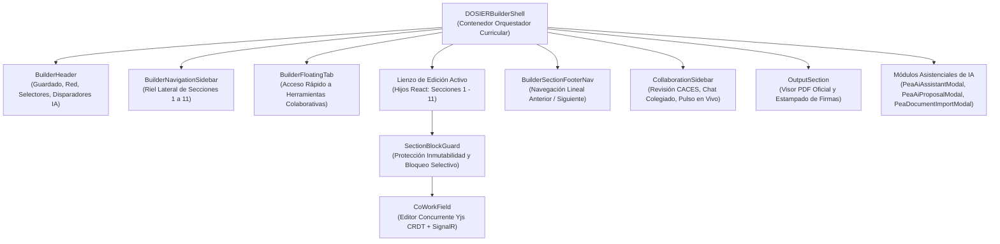

# Componentes UI Especializados, Sistema Modern Enterprise Docs y Shell del PEA

## 1. Visión General del Constructor Curricular

La experiencia central de usuario en DOSIER se articula alrededor del **Constructor del Programa de Estudio de la Asignatura (PEA)**, una interfaz avanzada para la planificación curricular docente, validación matemática de carga horaria en tiempo real, co-redacción concurrente entre docentes y revisión colegiada por comisiones institucionales.

El diseño y comportamiento de todos los componentes se rige por el estándar **Modern Enterprise Docs** (inspirado en la sobriedad técnica de Stripe Docs, Linear y Mintlify), garantizando:
* Densidad de datos óptima y confort visual para sesiones prolongadas.
* Navegación fluida sobre riel plano continuo (`border-b border-border`).
* Cero segmented controls tipo iOS/macOS y cero elementos decorativos innecesarios.
* **Regla Cardinal Innegociable: Fondos 100% sólidos y opacos** en todos los modales, popovers, selectores desplegables y drawers para evitar la contaminación y sangrado de texto (*text bleed-through*).

---

## 2. Jerarquía Modular del Shell Curricular (`DOSIERBuilderShell`)

El contenedor principal del entorno de edición curricular es `DOSIERBuilderShell` (`src/components/DOSIER/DOSIERBuilderShell.tsx`), el cual descompone su lógica interna en una arquitectura de hooks y subcomponentes modulares ubicados en `src/components/DOSIER/shell/`:

### 2.1. Descomposición en Hooks Especializados (`shell/hooks/`)

Para preservar el umbral de mantenibilidad y aislar responsabilidades, el shell delega su funcionamiento a cinco hooks específicos:

1. **`useDOSIERBuilderShell`:** Orquestador principal que consolida y expone las interfaces de layout, persistencia, generación de PDF y conectividad.
2. **`useBuilderLayout`:** Controla la visibilidad y estado colapsado del menú lateral de navegación, panel de colaboración y pestaña activa en el editor.
3. **`useBuilderAutoSave`:** Gestiona el autoguardado en segundo plano con técnica de debounce, rastreando el estado sucio (*dirty state*) y evitando pérdida de información durante la edición.
4. **`useBuilderPdfAndSign`:** Coordina la solicitud de compilación del PDF preliminar u oficial ante el backend y orquesta el flujo de firma digital (institucional o PKCS#12).
5. **`useBuilderNetworkMonitor`:** Supervisa la calidad de la conexión con el WebSocket de SignalR (`/collabHub`), emitiendo alertas visuales ante desconexiones y facilitando la reconexión automática.

### 2.2. Subcomponentes del Shell (`shell/components/`)

* **`BuilderHeader.tsx`:** Barra superior del workspace con el título de la asignatura, código, estado del flujo curricular, contador de cambios remotos, indicador de presencia de co-docentes y disparador del modal de asistencia curricular de IA.
* **`BuilderNavigationSidebar.tsx`:** Riel lateral numérico de navegación directa entre las 11 secciones oficiales del PEA, indicando el estado de completitud de cada bloque.
* **`BuilderFloatingTab.tsx`:** Acceso directo flotante para alternar entre el modo de edición de contenido, el panel de revisión y el visor del documento compilado.
* **`BuilderSectionFooterNav.tsx`:** Barra inferior de navegación secuencial que permite transitar entre secciones (*Anterior* / *Siguiente*) y verificar consistencia antes de avanzar.
* **`OutputSection.tsx`:** Vista dividida en dos columnas: la izquierda dedicada a la gestión de emisión y firmado del documento; la derecha con un visor PDF integrado embebido vía iframe para inspección visual idéntica a la salida oficial.
* **`PeaAiAssistantModal.tsx` & `PeaAiChatSidebar.tsx`:** Asistente conversacional de inteligencia artificial conectado a `peaAiService.ts` para sugerir objetivos, metodologías y contenidos alineados a las directrices pedagógicas del ISTPET.
* **`PeaAiProposalModal.tsx`:** Diálogo modal para evaluar las propuestas estructuradas generadas por la IA, permitiendo aplicar selectivamente parches (`onApplyStructuredDraft`) al formulario activo.
* **`PeaDocumentImportModal.tsx`:** Interfaz para la importación y extracción automatizada de borradores o sílabos existentes en formato PDF o Word (`peaDocumentExtractorService.ts`).

---

## 3. Catálogo de Secciones Modulares del PEA Oficial (1 a 11)

El PEA oficial del ISTPET adopta una estructura unificada en 11 secciones secuenciales ubicadas en `src/components/DOSIER/sections/pea/`:

| No. | Sección | Componente React | Ubicación | Funcionalidad y Validación Técnica |
| :---: | :--- | :--- | :--- | :--- |
| **1** | **Datos Generales de la Asignatura** | `PeaGeneralSection.tsx` | `sections/pea/` | Código, créditos, nivel, modalidad, carrera y horas (CD, APE, TA). Unidad de Organización Curricular desbloqueada para selección interactiva (Básica, Profesional, Integración Curricular). Sincronizada con SIGAFI. |
| **2** | **Objetivo de la Asignatura** | `PeaObjectivesSection.tsx` | `sections/pea/` | Objetivo general formativo editado concurrentemente en `CoWorkField` (`ObjetivoAsignatura`) con directriz pedagógica inductiva. |
| **3** | **Prerrequisitos Curriculares** | `PeaPrerequisitesSection.tsx` | `sections/pea/` | Matriz interactiva de asignaturas previas requeridas según la malla académica de la carrera. |
| **4** | **Resultados de Aprendizaje de la Carrera** | `PeaCareerOutcomesSection.tsx` | `sections/pea/` | Resultados del perfil de egreso aprobados para la carrera a los que tributa la asignatura (`RdaCarrera`). |
| **5** | **Resultados de Aprendizaje de la Asignatura** | `PeaSubjectOutcomesSection.tsx` | `sections/pea/` | Descriptores de logros formativos específicos, evaluables y medibles (`ResultadosAprendizaje`). |
| **6** | **Contenidos de Enseñanza (Unidades)** | `PeaContentsSection.tsx` | `sections/pea/` | Matriz tabular de unidades temáticas con desglose de horas (CD, APE, TA), balance horario automático contra la carga oficial SIGAFI y botón de auto-distribución proporcional. |
| **7** | **Metodología y Recursos Didácticos** | `PeaMethodologySection.tsx` | `sections/pea/` | Métodos didácticos activos orientados a la formación técnica/tecnológica según el Modelo Educativo Institucional (MED) y recursos didácticos de soporte. |
| **8** | **Actividades Prácticas (APE)** | `PeaResourcesSection.tsx` | `sections/pea/` | Registro de prácticas de laboratorio, talleres y actividades de aprendizaje práctico-experimental con ambientes y horas asignadas. |
| **9** | **Evaluación del Aprendizaje** | `PeaEvaluationSection.tsx` | `sections/pea/` | Criterios pedagógicos y matriz oficial de evaluación institucional en tres componentes de 10 puntos (Parcial 1, Parcial 2 y Examen Final). |
| **10** | **Bibliografía** | `PeaBibliographySection.tsx` | `sections/pea/` | Referencias bibliográficas básicas y de consulta bajo norma APA 7.ª edición, vinculadas con la biblioteca virtual institucional. |
| **11** | **Firmas de Responsabilidad** | `PeaSignaturesSection.tsx` | `sections/pea/` | Circuito institucional de 4 firmas (Elaborado, Revisado Comisión/Coord. Carrera, Aprobado Coord. Académica, Legalizado Vicerrector) con inmutabilidad post-firma. |

### Componentes Adicionales y Secciones Agnósticas

* **`PeaCompetenciesSection.tsx` & `PeaCharacterizationSection.tsx`:** Componentes de caracterización y competencias específicas utilizados en mallas anteriores o formatos ampliados.
* **`AgnosticSection.tsx`:** Renderizador de secciones genéricas basado en esquemas declarativos JSON para plantillas institucionales no restringidas al PEA.
* **`BibliographySection.tsx` & `MultiSectionTableSection.tsx`:** Componentes reutilizables para catálogos bibliográficos y matrices tabulares multidimensionales configurables.

---

## 4. Componentes UI Especializados y Regla de Opacidad Sólida

### 4.1. `<CoWorkField>`: Co-Redacción Concurrente en Tiempo Real
* **Ubicación Canónica:** `src/core/cowork/components/CoWorkField.tsx`.
* **Mecanismo:** Basado en **Yjs** (`^13.6.30`), Tiptap 3 y WebSockets mediante `@microsoft/signalr` conectado al endpoint `/collabHub`.
* **Propiedades Operativas:**
  * Edición simultánea libre de bloqueos mediante el algoritmo CRDT (*Conflict-free Replicated Data Type*).
  * Renderizado de cursores remotos con identificación visual de usuario mediante colores distintivos y etiquetas nominativas.
  * Autoguardado con retardo (*debounce*) que minimiza llamadas innecesarias al backend.

### 4.2. `<SectionBlockGuard>`: Control de Inmutabilidad y Bloqueo Selectivo
* **Ubicación:** `src/components/DOSIER/SectionBlockGuard.tsx`.
* **Contextos Asociados:** `SectionGuardContext` y `SectionLockContext` (desde `src/core/documents/context/DocumentDataContext.tsx`).
* **Mecanismo:**
  * Protege las secciones ante ediciones no autorizadas cuando el documento se encuentra en estados avanzados del ciclo de vida (`EnRevision`, `RevisadoCoord`, `RevisadoAcad`, `Aprobado`).
  * Permite a los administradores y directores bloquear o desbloquear secciones específicas de forma interactiva mediante la estructura `formData.BlockedSections[id]`.
  * Inyecta el estado `readOnly` a los componentes descendientes mediante el contexto React sin modificar la jerarquía visual del DOM.

### 4.3. `<CollaborationSidebar>`: Panel Lateral de Revisión Colegiada
* **Ubicación:** `src/components/DOSIER/CollaborationSidebar.tsx`.
* **Pestañas y Funcionalidades:**
  1. **Revisión y Dictámenes:** Verificación de consistencia del PEA e interfaz para emisión de avales o devoluciones con observaciones.
  2. **Chat y Notas de Voz:** Canal de comunicación colegiada con soporte para notas de audio (`AudioBubblePlayer`), respuestas anidadas e indicadores de lectura.
  3. **Estado de Secciones:** Selector de completitud por sección (*Borrador*, *En redacción*, *Completado*) con cálculo porcentual de avance.
  4. **Actividad y Auditoría:** Bitácora en vivo de cambios concurrentes con consolidación temporal de eventos.
  5. **Asistente de IA:** Disparador para la generación automatizada de contenidos curriculares.

### 4.4. `<OutputSection>` y `<SignatureBlock>`: Emisión y Estampado Criptográfico
* **Ubicación:** `src/components/DOSIER/shell/components/OutputSection.tsx` y `src/components/DOSIER/SignatureBlock.tsx`.
* **Capacidades:**
  * Alternador de modo borrador (con marca de agua institucional) o modo definitivo.
  * Validación preventiva de perfil de firma (`getSignatureProfile`): si el usuario no tiene configurado su perfil, bloquea la acción y ofrece un enlace guiado a `/configuracion?editFirma=true`.
  * Admite firma digital institucional (sello electrónico por sesión autenticada) y firma electrónica avanzada basada en certificado PKCS#12 (`.p12` / `.pfx` con contraseña privada).
  * Renderizado del documento oficial compilado vía iframe con opciones de impresión y descarga con nomenclatura normalizada.

---

## 5. Catálogo de Componentes Comunes (`src/components/Common/`)

Todos los componentes reutilizables implementan estrictamente la regla de **fondos 100% sólidos**:

* **`GeistSelect.tsx`:** Selector desplegable accesible. Su menú flotante utiliza exclusivamente la clase `bg-white dark:bg-zinc-950` con bordes nítidos `border border-zinc-200 dark:border-zinc-800`, eliminando transparencias para garantizar contraste óptimo.
* **`GeistDatePicker.tsx` & `GeistCalendar.tsx`:** Selectores de fecha para cronogramas y plazos académicos con paneles opacos.
* **`MemberSearchSelector.tsx`:** Buscador dinámico de co-docentes y revisores institucionales con navegación por teclado y menú flotante opaco.
* **`BentoGrid.tsx`:** Sistema de disposición en cuadrícula responsiva para tableros de formatos, métricas y catálogos.
* **`CommandPalette.tsx`:** Paleta modal de comandos globales para navegación ultrarrápida y ejecución de atajos institucionales.
* **`FullscreenLoader.tsx`:** Pantalla de carga sobria utilizada como fallback universal de `Suspense`.
* **`PageHeader.tsx`:** Cabecera estandarizada para páginas internas con título, descripción y botones de acción principal.
* **`ProximosEventosWidget.tsx`:** Widget de agenda curricular con fechas límite próximas.
* **`StickyNotesFloatingButton.tsx`:** Botón flotante para anotaciones personales y recordatorios rápidos del docente.
* **`TimedSuccessModal.tsx`:** Modal temporal opaco de confirmación con cierre automático tras completar una operación crítica.
* **`UnderDevelopment.tsx`:** Vista de marcador de posición para módulos en fase de homologación normativa.

---

## 6. Componentes de Estructura y Navegación (`src/components/Layout/`)

* **`DashboardLayout.tsx`:** Maquetación global que orquesta la barra lateral (`Sidebar`), la barra superior de acciones (`TopBar`) y el contenedor dinámico (`Outlet`).
* **`Sidebar.tsx` (Modularizado):**
  * `SidebarBrand.tsx`: Identidad corporativa del ISTPET.
  * `SidebarNav.tsx`: Menú jerárquico adaptado al rol autenticado (`DOSIER_ADMIN`, `DOSIER_DOCENTE`, `DOSIER_COORD_CARRERA`, `DOSIER_COORD_ACAD`, `DOSIER_VICERRECTOR`).
  * `SidebarSearch.tsx`: Filtrado reactivo de opciones del menú.
  * `SidebarFooter.tsx`: Acceso a perfil, configuración y cierre de sesión.
  * `NotificationPanel.tsx`: Bandeja desplegable integrada de notificaciones recientes.
  * `useSidebar.ts`: Hook para el control de colapso, persistencia de estado y responsividad móvil.
* **`HelpModal.tsx`:** Sistema de ayuda contextual interactiva con guías temáticas organizadas por perfil (`Help/configs/`: `admin.tsx`, `documentacion.tsx`, `general.tsx`).
* **`WelcomeModal.tsx`:** Modal inductivo opaco para orientar a nuevos docentes y coordinadores sobre los flujos curriculares (`WelcomeModal/welcomeConfigs.tsx`).
* **`NotificationBell.tsx` (`src/components/Notifications/`):** Campana con indicador numérico de no leídos y popover opaco en la barra superior.
* **`FeedbackModal.tsx` (`src/components/Feedback/`):** Diálogo para la radicación de reportes técnicos e incidencias por parte de la comunidad académica.
