# Guía de Extensibilidad y Creación de Nuevos Bloques Curriculares

## 1. Visión General del Patrón Guiado por Metadatos Curriculares

El sistema de estructuración de documentos de DOSIER opera bajo el patrón de arquitectura guiada por metadatos (*Metadata-Driven Architecture*). Los documentos académicos oficiales (Programa de Estudio de la Asignatura PEA, Plan Analítico 2026, Seguimiento de Tutorías e Informe de Acompañamiento Académico de Carrera) se estructuran a partir de bloques modulares e independientes denominados `DocumentBlock`.

La arquitectura separa de forma estricta la definición matemática de los esquemas de datos respecto a los componentes visuales de React:

```mermaid
flowchart TD
    subgraph DataCore ["src/core/documents/ (Motor de Datos Desacoplado)"]
        DTR["DocumentTemplateRegistry.ts\n(Esquemas JSON Puros, Cero React,\nschema, lists, sections)"]
        DCR["DocumentComponentRegistry.ts\n(Catálogo de Componentes React\nFallback: AgnosticSection)"]
        DDC["DocumentDataContext.ts\n(DocumentDataContext, DocumentMetadataContext,\nSectionLockContext, SectionGuardContext)"]
        Hook["useDOSIERDocument.ts\n(Hidratación de Instancia, Mutaciones y Guardado)"]
    end

    subgraph TemplateBuilder ["src/pages/Admin/Templates/ (Diseñador Visual de Plantillas)"]
        Types["types.ts\n(Unión BlockType, BLOCK_METADATA)"]
        Factory["defaultBlocksFactory.ts\n(Generación de Bloques Predeterminados)"]
        Canvas["BlockCanvas.tsx\n(Lienzo de Diseño con Drag and Drop)"]
        Props["BlockProperties.tsx\n(Inspector de Propiedades y Tipografía)"]
        Generators["utils/htmlGenerators/\n(Compilación de HTML para iText 9)"]
    end

    DTR --> DCR
    DCR --> DDC
    DDC --> Hook
    Types --> Factory
    Factory --> Canvas
    Canvas --> Props
    Props --> Generators
```



---

## 2. Desacoplamiento del Motor Documental (`src/core/documents/`)

### 2.1. Registro Declarativo en JSON Puro (`DocumentTemplateRegistry.ts`)
Ubicado en `src/core/documents/registry/DocumentTemplateRegistry.ts`, este archivo tiene la responsabilidad única de definir la estructura y campos de cada tipo de documento institucional. **No importa ningún componente de React**. Esto permite su reutilización directa en:
* Pruebas unitarias sin necesidad de montar un entorno DOM.
* Generadores y validadores síncronos de esquemas en Node.js o CLI.
* Generación automatizada de diccionarios de datos.

Cada plantilla declara:
* `schema`: Objeto inicial clave-valor con todos los campos tipados del documento.
* `lists`: Arreglo de identificadores de colecciones dinámicas (ej: `['Prerrequisitos', 'Unidades', 'ActividadesPracticas', 'Bibliografias']`).
* `sections`: Arreglo de secciones con su identificador único (`id`), etiqueta visual (`label`), ícono de Lucide (`iconName`) y configuración de campos dinámicos para `<AgnosticSection>`.

### 2.2. Registro de Componentes React (`DocumentComponentRegistry.ts`)
Ubicado en `src/core/documents/registry/DocumentComponentRegistry.ts`, vincula los identificadores de sección con sus componentes de renderizado interactivo en React:
* `COMPONENT_MAP`: Diccionario de nombres string hacia componentes funcionales.
* `DocumentComponentRegistry`: Diccionario de `sectionId` hacia su componente oficial (ej: `'pea_general_section' -> PeaGeneralSection`, `'pea_contents_section' -> PeaContentsSection`).
* **Fallback Automático con `<AgnosticSection>`:** Si una sección declarada en `DocumentTemplateRegistry` no posee un componente React específico en `DocumentComponentRegistry`, el motor resuelve automáticamente `<AgnosticSection>`, generando de forma dinámica inputs, textareas, selects o tablas configurables según la metadata declarada en `config.fields`.

### 2.3. Contextos Documentales (`DocumentDataContext.ts`)
Centraliza cuatro contextos esenciales para el ciclo de vida del documento:
1. `DocumentDataContext`: Provee el estado reactivo del formulario (`formData`), disparadores de mutación (`onUpdateField`) y estado de solo lectura (`readOnly`).
2. `DocumentMetadataContext`: Expone metadatos institucionales de la instancia (código de asignatura, carrera, período, versión de plantilla).
3. `SectionLockContext`: Maneja el mapa de secciones bloqueadas (`formData.BlockedSections[id]`).
4. `SectionGuardContext`: Inyecta el estado de bloqueo específico a los componentes hijos dentro de `<SectionBlockGuard>`.

---

## 3. Catálogo Oficial de Bloques por Familia Documental (`types.ts`)

La unión tipada `BlockType` en `src/pages/Admin/Templates/types.ts` clasifica todos los bloques reconocidos por el diseñador visual en 5 familias normativas:

### 3.1. Bloques Base y Estructurales
| Bloque (`BlockType`) | Etiqueta en Inspector | Categoría | Propósito Técnico |
| :--- | :--- | :--- | :--- |
| `cover` | Portada Institucional | Estructural | Carátula formal con diseño geométrico institucional ISTPET (rombos). |
| `title` | Título de Sección | Estructural | Encabezado jerárquico con tipografía personalizable y anclaje visual. |
| `rich_text` | Párrafo Enriquecido | Contenido | Bloque de texto descriptivo con barra de herramientas Tiptap. |
| `advanced_table` | Tabla Avanzada | Tablas | Cuadrícula con celdas editables y soporte de filas dinámicas. |
| `multi_section_table` | Tabla Multi-Sección | Tablas | Matriz compleja con cabeceras agrupadas multidimensionales. |
| `two_column` | Dos Columnas | Estructural | Disposición en dos columnas paralelas para comparativas o datos duales. |
| `page_break` | Salto de Página | Estructural | Marcador forzado de corte de página A4 para el compilador PDF. |
| `gantt` | Cronograma (Gantt) | Planificación | Diagrama de barras temporales por semanas o meses de clase. |
| `researchers_table` | Tabla de Investigadores / Docentes | Tablas | Nómina de docentes o autores participantes. |
| `signatures` | Bloque de Firmas Estándar | Legal | Circuito de firmas institucionales con sello y fecha. |
| `impacts` | Matriz de Impactos | Planificación | Evaluación de impactos académicos, sociales y metodológicos. |

### 3.2. Bloques Oficiales del PEA ISTPET (`pea_*`)
| Bloque (`BlockType`) | Título Canónico | Componente en Lienzo | Inspector Asociado |
| :--- | :--- | :--- | :--- |
| `pea_general_section` | 1. DATOS GENERALES | `RenderPeaGeneral.tsx` | `PeaGeneralProperties.tsx` |
| `pea_objective_section` | 2. OBJETIVO DE LA ASIGNATURA | `RenderPeaObjectives.tsx` | `PeaObjectiveProperties.tsx` |
| `pea_prerequisites_section` | 3. PRERREQUISITOS CURRICULARES | `RenderPeaPrerequisites.tsx` | `PeaPrerequisitesProperties.tsx` |
| `pea_career_outcomes_section` | 4. RESULTADOS DE LA CARRERA | `RenderPeaObjectives.tsx` | `PeaCareerOutcomesProperties.tsx` |
| `pea_subject_outcomes_section` | 5. RESULTADOS DE LA ASIGNATURA | `RenderPeaObjectives.tsx` | `PeaSubjectOutcomesProperties.tsx` |
| `pea_characterization_section` | CARACTERIZACIÓN DE LA ASIGNATURA | `RenderPeaObjectives.tsx` | `PeaCharacterizationProperties.tsx` |
| `pea_competencies_rda_section` | COMPETENCIAS Y RDAs | `RenderPeaObjectives.tsx` | `PeaCompetenciesProperties.tsx` |
| `pea_contents_section` | 6. CONTENIDOS DE ENSEÑANZA | `RenderPeaContents.tsx` | `PeaContentsProperties.tsx` |
| `pea_methodology_section` | 7. METODOLOGÍA Y RECURSOS | `RenderPeaMethodology.tsx` | `PeaMethodologyProperties.tsx` |
| `pea_resources_section` | 8. ACTIVIDADES PRÁCTICAS (APE) | `RenderPeaResources.tsx` | `PeaResourcesProperties.tsx` |
| `pea_evaluation_section` | 9. EVALUACIÓN DEL APRENDIZAJE | `RenderPeaEvaluation.tsx` | `PeaEvaluationProperties.tsx` |
| `pea_bibliography_section` | 10. BIBLIOGRAFÍA APA 7.ª | `RenderPeaBibliography.tsx` | `PeaBibliographyProperties.tsx` |
| `pea_signatures_section` | 11. FIRMAS DE RESPONSABILIDAD | `RenderPeaSignatures.tsx` | `PeaSignaturesProperties.tsx` |

### 3.3. Bloques Oficiales del Plan Analítico 2026 (`plan_analitico_*`)
Ubicados en `canvasRenderers/planAnalitico/`:
* `plan_analitico_general_section`: Cabecera institucional con franja azul marino y tabla clave-valor de 10 campos normados.
* `plan_analitico_objective_section`: Objetivo general de cátedra formativa.
* `plan_analitico_outcomes_section`: Resultados de aprendizaje con niveles de desarrollo (Inicial, Medio, Alto).
* `plan_analitico_methodology_matrix_section`: Matriz horizontal de 19 semanas de clase con desglose CD/APE/AA y vinculación a evaluaciones sumativas.
* `plan_analitico_resources_section`: Equipamiento TIC, software especializado e indicador de adaptación curricular.
* `plan_analitico_evaluation_section`: Matriz de 3 notas ponderadas sobre 10.00 puntos.
* `plan_analitico_signatures_section`: Circuito de 3 firmas (Docente, Coordinador de Carrera, Coordinador Académico).

### 3.4. Bloques de Seguimiento de Tutorías Académicas (`tutorias_*`)
Ubicados en `canvasRenderers/tutorias/` (Orientación Landscape A4):
* `tutorias_header_section`: Logotipo ISTPET y datos de docente y horario de tutoría.
* `tutorias_matrix_section`: Matriz horizontal de 12 columnas oficiales para registro individual o grupal de tutorías.
* `tutorias_signatures_section`: Validación de doble firma (Docente y Coordinador de Carrera).

### 3.5. Bloques de Informe de Acompañamiento Académico (`informe_acomp_*`)
Ubicados en `canvasRenderers/informeAcompanamiento/` (Orientación Portrait A4):
* `informe_acomp_datos_informativos_section`: Datos informativos de la carrera y período lectivo.
* `informe_acomp_nomina_tutores_section`: Nómina formal de tutores por nivel.
* `informe_acomp_nomina_docentes_section`: Nómina de docentes aportantes con acciones de mejora y correctivas.
* `informe_acomp_gestion_academica_section`: Matriz comprensiva en 5 subsecciones (Reuniones, Actividades del Coordinador, Estudiantes, Gestión Docente, Observaciones).
* `informe_acomp_conclusiones_section`: Conclusiones y recomendaciones por cada punto tratado.
* `informe_acomp_firmas_section`: Doble matriz de firmas (Tutores de 1.º a 4.º nivel, Coordinador de Carrera, Bienestar Institucional y Coordinación Académica).

---

## 4. Procedimiento Técnico para Crear un Nuevo Bloque Curricular

Para incorporar un nuevo bloque (por ejemplo, `cur_rubrica_evaluacion_practica`), se ejecutan las siguientes fases ordenadas:

### Fase 1: Declaración Tipada en TypeScript
Ubicación: `src/pages/Admin/Templates/types.ts`
1. Agregar el identificador a la unión de tipos `BlockType`:
   ```typescript
   export type BlockType =
       // ... tipos existentes
       | 'cur_rubrica_evaluacion_practica';
   ```
2. Registrar los metadatos en el diccionario `BLOCK_METADATA`:
   ```typescript
   cur_rubrica_evaluacion_practica: {
       label: 'Rúbrica de Prácticas APE',
       defaultTitle: 'RÚBRICA DE EVALUACIÓN PRÁCTICO-EXPERIMENTAL',
       category: 'Evaluación y Acreditación'
   }
   ```

### Fase 2: Configuración por Defecto en la Fábrica de Bloques
Ubicación: `src/pages/Admin/Templates/utils/defaultBlocksFactory.ts`
Definir los valores iniciales y la estructura base del bloque al ser insertado desde la paleta:
```typescript
case 'cur_rubrica_evaluacion_practica':
    return {
        id: `block-rubrica-${Date.now()}`,
        type: 'cur_rubrica_evaluacion_practica',
        title: 'Rúbrica de Evaluación Práctica',
        isActive: true,
        config: {
            customTitle: 'RÚBRICA DE EVALUACIÓN DE PRÁCTICAS Y LABORATORIOS',
            escalaMax: 10.0,
            criterios: [
                { criterio: 'Fundamentación Teórica', ponderacion: 2.5 },
                { criterio: 'Ejecución Práctica', ponderacion: 5.0 },
                { criterio: 'Conclusiones y Reporte', ponderacion: 2.5 }
            ]
        }
    };
```

### Fase 3: Renderizador Visual para el Lienzo A4
Ubicación: `src/pages/Admin/Templates/components/canvasRenderers/RenderRubricaPractica.tsx`
Construir el componente con fondo 100% sólido y registrarlo en el evaluador `BlockCanvas.tsx`:
```tsx
import React from 'react';

export const RenderRubricaPractica: React.FC<{ config: any }> = ({ config }) => {
    const c = config || {};
    return (
        <div className="w-full text-zinc-900 font-sans my-2 bg-white border border-zinc-900 p-3">
            <h4 className="font-bold text-[10pt] uppercase text-center bg-zinc-100 py-1 border-b border-zinc-300">
                {c.customTitle || 'RÚBRICA DE EVALUACIÓN PRÁCTICO-EXPERIMENTAL'}
            </h4>
            <div className="p-2 text-[8.5pt]">
                <p className="text-zinc-600 italic">[Matriz de criterios y ponderación evaluativa]</p>
            </div>
        </div>
    );
};
```
En `BlockCanvas.tsx`:
```tsx
case 'cur_rubrica_evaluacion_practica':
    return <RenderRubricaPractica config={block.config} />;
```

### Fase 4: Inspector de Propiedades
Ubicación: `src/pages/Admin/Templates/components/properties/RubricaPracticaProperties.tsx`
Construir el formulario para modificar títulos, escalas y opciones del bloque, vinculándolo en `BlockProperties.tsx`.

### Fase 5: Compilación HTML para el Motor Documental iText 9
Ubicación: `src/pages/Admin/Templates/utils/htmlGenerators/rubricaGenerator.ts`
Implementar el generador de marcado HTML estático con estilos CSS inline que consumirá el backend para compilar el PDF oficial sin diferencias visuales con el lienzo web.

### Fase 6: Sección Interactiva con CoWork en el Workspace Docente
Ubicación: `src/components/DOSIER/sections/RubricaPracticaSection.tsx`
Construir el componente interactivo integrando `<CoWorkField>` desde `src/core/cowork/components/CoWorkField.tsx` y registrarlo en `src/core/documents/registry/DocumentComponentRegistry.ts`.
