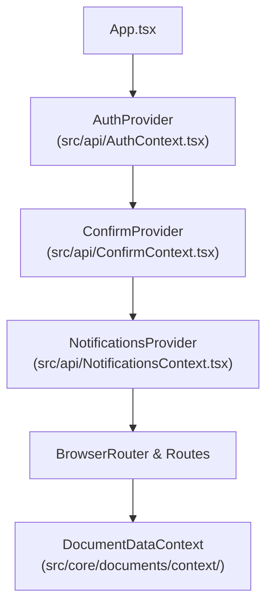

# Servicios, Hooks Especializados y Gestión del Estado Global (Frontend Web)

## 1. Visión General de la Capa de Lógica y Estado

El cliente web de DOSIER (`dosier_web`) implementa una arquitectura desacoplada donde la lógica de negocio, las peticiones HTTP, la sincronización en tiempo real y el ciclo de vida de los componentes se canalizan a través de tres pilares modulares:

1. **Capa de Servicios de Dominio REST (`src/services/`):** 27 clientes fuertemente tipados que encapsulan la comunicación con los controladores de ASP.NET Core Web API, garantizando el cumplimiento estricto del mandato de Service Layer (cero llamadas directas con `fetch` o Axios en el JSX).
2. **Contextos Globales (`src/api/` y `src/core/documents/context/`):** Proveedores reactivos para la sesión institucional, alertas vía WebSockets SignalR, cuadros de diálogo asíncronos y datos del expediente curricular activo.
3. **Hooks de Orquestación y Shell (`src/hooks/`, `src/components/DOSIER/shell/hooks/`, `src/core/`):** Custom hooks para autoguardado con retardo (*debounce*), concurrencia CRDT con Yjs, sincronización en tres niveles (*Three-Tier Reactive Sync*) y monitoreo de red.

---

## 2. Catálogo Oficial de los 27 Servicios de Dominio (`src/services/`)

Toda la comunicación de red se canaliza a través de las siguientes fachadas tipadas construidas sobre la instancia centralizada de Axios (`src/api/axios_config.ts`):

### 2.1. Dominio Curricular y Gestión del PEA
1. **`peaService.ts` (`/api/pea`):**
   * Servicio principal para la formulación, revisión y aprobación del PEA.
   * Administra el tipado de secciones (1 a 11), DTOs de unidades, subtemas, resultados de aprendizaje (RDA), actividades prácticas (APE), criterios de evaluación y bibliografía APA 7.ª edición.
   * Orquesta las transiciones de estado: `firmarPeaDocente`, `emitirAvalCarrera`, `emitirAvalAcademico`, `legalizarPeaVicerrector` y el circuito de observaciones (`crearObservacion`, `subsanarObservacion`).
2. **`curriculumProjectService.ts` (`/api/pea`, `/api/docente-asignaturas`, `/api/documents/instances`):**
   * Resuelve el expediente detallado del PEA o de instrumentos curriculares institucionales.
   * Recupera nóminas de asignaturas (`getMyProjects`, `getAllProjects`), historial de actividad en el workspace y trazabilidad de cambios de estado.
3. **`monitoreoService.ts` (`/api/pea`):**
   * Consulta datos de avance para la vista satélite de monitoreo curricular (`getProjectDetail`), computando horas normadas, avance de unidades y firmas CACES.
4. **`normativaService.ts` (`/api/normativas`):**
   * Provee resoluciones del CES (Art. 21 y 27 RRA), criterios de acreditación CACES y directrices del Modelo Educativo Institucional (MED).
5. **`salaCarreraService.ts` (`/api/expedientes-curriculares/sala-carrera`):**
   * Gestiona el estado de apertura y moderación de salas curriculares colegiadas, y la persistencia de snapshots JSON y binarios Base64 de Yjs para la pizarra interactiva.

### 2.2. Inteligencia Artificial y Extracción Documental
6. **`peaAiService.ts` (`/api/pea/ai`, `/api/pea/uuid/{uuid}/ai`):**
   * Configuración y almacenamiento cifrado con AES-256 de proveedores y modelos de IA (DeepSeek, Gemini, OpenAI, Claude, Groq, Ollama).
   * Generación asistida de propuestas y borradores estructurados con balance normativo de horas (`generatePeaAiDraft`) y conversión a campos reactivos Yjs (`convertDraftToEditorFields`).
7. **`peaDocumentExtractorService.ts` (`/api/pea/uuid/{uuid}/importar-documento`):**
   * Procesamiento y extracción sintáctica de archivos `.pdf` o `.docx` de hasta 15 MB para digitalización automática de sílabos existentes.

### 2.3. Autenticación, Seguridad y Datos Personales
8. **`authService.ts` (`/api/auth`):**
   * Consulta de perfil y roles activos (`getMe`), inicio de sesión con credenciales locales (`login`), autenticación federada con Azure AD / Microsoft 365 (`loginWithMicrosoft`) y cierre de sesión (`logout`).
   * Flujos de recuperación, verificación de tokens y actualización segura de contraseñas.
9. **`lopdpService.ts` (`/api/lopdp`):**
   * Registro obligatorio e inmutable del consentimiento informado de tratamiento de datos personales y administración de solicitudes de derechos ARCO.
10. **`verificationService.ts` (`/api/documents`):**
    * Validación forense pública de autenticidad documental mediante código de trazabilidad, certificados y comprobación del hash SHA-256 sin login.
11. **`signaturesService.ts` (`/api/signatures`):**
    * Estampado criptográfico mediante certificado digital PKCS#12 (`.p12` / `.pfx`) y firma electrónica institucional por sesión activa.

### 2.4. Colaboración, Concurrencia y Archivos
12. **`collaborationService.ts` (`/api/collaboration`):**
    * Hilos de discusión colegiada, comentarios anclados por sección, pulso de actividad en tiempo real, carga segura de adjuntos y notas de voz (`uploadFile`).
13. **`docenteAsignaturasService.ts` (`/api/docente-asignaturas`):**
    * Interfaz con la base de datos de solo lectura de SIGAFI (`sigafi_es`), consultando asignaturas, mallas, horas normadas y paralelos del docente autenticado.

### 2.5. Motor Documental y Diseñador de Plantillas
14. **`documentTemplateService.ts` (`/api/admin/templates`):**
    * Catálogo oficial de plantillas, publicación de versiones estructurales, restablecimiento a fábrica y configuración de sellos y firmas digitales.
15. **`documentInstanceService.ts` (`/api/documents/instances`):**
    * Creación, resolución perezosa y actualización de snapshots inmutables de instancias documentales.
    * Compilación en caliente de vistas previas en PDF preliminares o definitivas.
16. **`documentMaintenanceService.ts` (`/api/documents/instances/maintenance`, `/api/admin/backups`):**
    * Diagnóstico de ocupación en disco, purga de borradores preliminares obsoletos y generación, verificación de hash y descarga de respaldos de base de datos.

### 2.6. Soporte Técnico, Solicitudes e Incidencias
17. **`feedbackService.ts` (`/api/feedback`):**
    * Radicación de incidencias técnicas con captura de pantalla desde portapapeles, metadatos de máquina y chat interactivo bidireccional entre docente y administradores.
18. **`solicitudesService.ts` (`/api/solicitudes`):**
    * Tramitación de requerimientos curriculares, soporte de distributivos y solicitudes institucionales con acuerdos de nivel de servicio (SLA).

### 2.7. Administración, Analíticas y Notificaciones
19. **`usersService.ts` (`/api/Admin`):**
    * Catálogo de usuarios institucionales, sincronización con SIGAFI y asignación/revocación de roles curriculares (`idSistema = 6`).
20. **`auditService.ts` (`/api/Admin/audit`):**
    * Consulta forense de la bitácora `doc_audit_logs` con filtros por fecha UTC, usuario, módulo e IP.
21. **`emailService.ts` (`/api/Admin/email-engine`):**
    * Mantenimiento de plantillas HTML institucionales y pruebas de despacho SMTP.
22. **`configuracionService.ts` (`/api/catalogs`, `/api/calendario`):**
    * Parámetros normativos del sistema, períodos académicos y fechas límite de formulación.
23. **`analyticsService.ts` (`/api/pea`, `/api/catalogs`):**
    * Agregación estadística de cobertura curricular, avance de firmas institucionales y auditoría del Art. 21 CES.
24. **`calendarioService.ts` (`/api/calendario`):**
    * Consulta de eventos normativos institucionales y exportación a formato iCalendar (`.ics`).
25. **`notificacionesService.ts` (`/api/Admin/notifications`):**
    * Consulta, marcado de lectura y depuración de alertas transaccionales in-app.
26. **`reportService.ts` (`/api/reports`):**
    * Generación en streaming y descarga automatizada de informes analíticos y consolidados en PDF.

---

## 3. Contextos Globales del Sistema (`src/api/` y `src/core/`)

* **`AuthContext.tsx`:** Gestiona el token JWT, la hidratación del usuario (`User`), el control de LOPDP (`acepto_lopdp`), la jerarquía ponderada de roles (`ROLE_HIERARCHY_WEIGHT`) y la conmutación de roles activa exclusiva para administradores.
* **`NotificationsContext.tsx`:** Conexión persistente mediante SignalR hacia `/notificacionesHub`, mantenimiento de alertas no leídas y despacho de Toasts con soporte de reversión (`onUndo`).
* **`ConfirmContext.tsx`:** Interfaz declarativa `confirm(options) => Promise<boolean>` con modales 100% sólidos y captura de teclado (`Escape`).
* **`DocumentDataContext.ts`:** Provee el estado reactivo `formData`, funciones de mutación `onUpdateField`, el mapa de `BlockedSections` y el contexto de inmutabilidad `SectionGuardContext`.

---

## 4. Hooks Especializados del Sistema

### 4.1. Sincronización Reactiva (`src/hooks/useRealtimeSync.ts`)
Elimina la necesidad de botones de recarga manual mediante un modelo de sincronización en tres niveles:
1. **Nivel 1 (Eventos SignalR en Vivo):** Escucha eventos de dominio en el navegador (`dosier-projects-changed`, `dosier-emails-changed`, `dosier-activity-updated`) disparados por el hub de notificaciones.
2. **Nivel 2 (Revalidación por Foco):** Sincroniza automáticamente los datos al detectar `document.visibilityState === 'visible'` o `window.onfocus`.
3. **Nivel 3 (Latido Pasivo Silencioso):** Temporizador periódico en segundo plano (cada 30 a 45 segundos) activo únicamente mientras la pestaña del navegador está visible.

### 4.2. Hooks del Shell Curricular (`src/components/DOSIER/shell/hooks/`)
* **`useDOSIERBuilderShell.ts`:** Orquestador principal de la experiencia de edición curricular.
* **`useBuilderAutoSave.ts`:** Autoguardado silencioso con debounce (1.5s a 3s) y control del estado sucio (`isDirty`).
* **`useBuilderLayout.ts`:** Alternancia de rieles laterales de navegación, panel colaborativo y zoom.
* **`useBuilderPdfAndSign.ts`:** Generación de PDF en segundo plano y coordinación de firma digital.
* **`useBuilderNetworkMonitor.ts`:** Monitoreo de latencia y reconexión ante caídas del WebSocket.

### 4.3. Hooks de Motores Auxiliares (`src/core/`)
* **`useCoWork.ts` (`src/core/cowork/hooks/`):** Conexión con el WebSocket `/collabHub`, sincronización de tipos compartidos de Yjs (`Y.Text`) y conciencia espacial de presencia remota.
* **`useDOSIERDocument.ts` (`src/core/documents/hooks/`):** Hidratación de la instancia documental, mutación de campos y detección de actualizaciones estructurales de plantilla (`hasTemplateUpdate`).

### 4.4. Hooks de Vistas Especializadas
* `useSidebar.ts`: Control de colapso, persistencia de menús desplegables y responsividad.
* `useAnalyticsData.ts`: Procesamiento de datos de cumplimiento CACES y cálculo de avance.
* `useDocumentMaintenance.ts`: Diagnóstico de disco físico y ejecución de respaldos de base de datos.
* `useUsersPage.ts`: Filtrado y asignación de roles curriculares en el organigrama vertical.
* `useFeedbackPage.ts`: Gestión de incidencias, filtros y canal de soporte técnico.
* `useCalendarioPage.ts`: Coordinación del calendario mensual, tablero Kanban y notas adhesivas.

---

## 5. Gobernanza Central de Reglas de Negocio (`peaStatusWorkflow.ts`)

Ubicado en `src/pages/Curriculum/utils/peaStatusWorkflow.ts`, centraliza todas las reglas de negocio del ciclo de vida curricular para evitar discrepancias lógicas entre pantallas:

* **`resolveRoleKey`:** Normaliza cualquier rol institucional (`DOSIER_ADMIN`, `DOSIER_VICERRECTOR`, `DOSIER_COORD_ACAD`, `DOSIER_COORD_CARRERA`, `DOSIER_DOCENTE`) a una clave institucional tipada.
* **`isPeaPropio`:** Determina de forma fáctica si una asignatura pertenece a la carga lectiva del docente autenticado, cruzando `id_sigafi`, `id_usuario` y cédula.
* **`isPeaPendienteParaRol`:** Asigna la bandeja de entrada según la responsabilidad de cada autoridad:
  * *Vicerrectorado:* Instrumentos en `RevisadoAcad` (pendientes de firma y legalización final).
  * *Coordinación Académica:* Instrumentos en `RevisadoCoord` (pendientes de aval académico CACES).
  * *Coordinación de Carrera:* Instrumentos en `EnRevision`, `Observado`, `Corregido` (pendientes de dictamen disciplinar).
  * *Docente:* Instrumentos en `Borrador`, `NoIniciado` u `Observado` (pendientes de formulación o subsanación).
* **`isPeaAprobadoParaRol`:** Verifica si el instrumento ya superó la fase reglamentaria del rol evaluador o si se encuentra formalmente aprobado.
* **`getPeaNavegacion`:** Enruta de forma determinística al editor colaborativo (`/documentacion/mis-proyectos/workspace/...`) si la asignatura es propia, o al panel de revisión técnica (`/documentacion/revision-tecnica/...`) si se trata de un coordinador o evaluador.
* **`getPeaMetricsForRole`:** Calcula en un solo recorrido los totales, pendientes, aprobados, borradores y materias propias, garantizando consistencia matemática exacta entre `/dashboard`, `/documentacion` y la barra lateral de navegación.

---

## 6. Catálogo de Componentes UI Comunes (`src/components/Common/`)

Todos los componentes reutilizables implementan estrictamente la regla de **fondos 100% sólidos y opacos**:

| Componente | Archivo | Funcionalidad y Especificación Visual |
| :--- | :--- | :--- |
| **`GeistSelect`** | `GeistSelect.tsx` | Selector desplegable accesible con búsqueda integrada. Menú con **fondo 100% sólido** (`bg-white dark:bg-zinc-950`) y bordes nítidos. |
| **`GeistDatePicker`** | `GeistDatePicker.tsx` | Selector de fechas adaptado al calendario académico del ISTPET con paneles opacos. |
| **`GeistCalendar`** | `GeistCalendar.tsx` | Calendario mensual interactivo con marcadores visuales para hitos y plazos normativos. |
| **`CommandPalette`** | `CommandPalette.tsx` | Paleta de comandos rápidos (`Ctrl + K` / `Cmd + K`) para navegación inmediata a asignaturas y configuraciones. |
| **`MemberSearchSelector`** | `MemberSearchSelector.tsx` | Buscador predictivo de co-docentes y revisores institucionales con navegación por teclado. |
| **`TimedSuccessModal`** | `TimedSuccessModal.tsx` | Modal con temporizador visual opaco para confirmar operaciones exitosas. |
| **`StickyNotesFloatingButton`** | `StickyNotesFloatingButton.tsx` | Botón flotante para captura rápida de anotaciones docentes de cátedra. |
| **`ProximosEventosWidget`** | `ProximosEventosWidget.tsx` | Widget de escritorio para visualizar plazos perentorios del cronograma académico. |
| **`FullscreenLoader`** | `FullscreenLoader.tsx` | Pantalla de carga sobria utilizada como fallback universal de `Suspense`. |
| **`BentoGrid`** | `BentoGrid.tsx` | Cuadrícula modular para distribución uniforme de indicadores y catálogos. |
| **`PageHeader`** | `PageHeader.tsx` | Cabecera estandarizada con título, descripción y botones de acción principal. |
| **`UnderDevelopment`** | `UnderDevelopment.tsx` | Vista de marcador de posición para módulos en fase de homologación. |
